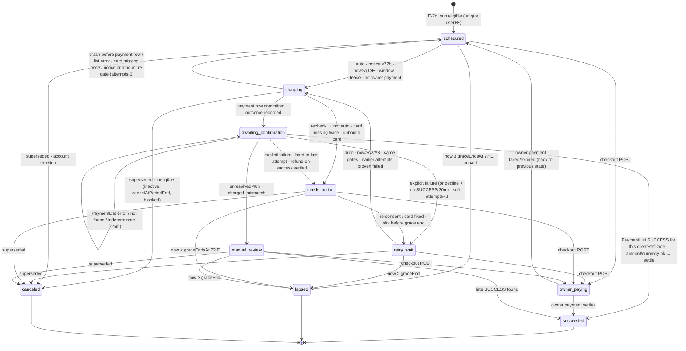

# Buaze — Saved cards (PayNKolay card storage) + opt-in monthly auto-renew

Implementation spec · 2026-11-19 · **revision 2** (security review + renewal-engine review resolved) · status: design, nothing implemented

Repo: `qrcode/` (Next.js 15 App Router, Prisma 6, Tailwind v4). Extends the PayNKolay hosted-page checkout described in CLAUDE.md §44.
Ground truth for PayNKolay behaviour is the research verdicts (`card_storage`, `recurring`). Anything they mark as unverified is
labelled **[VERIFY]** in this spec, and §16.2 gives the sandbox check for each one.

Revision 2 resolves every finding of the two reviews: the 15 security findings plus the security verdict's precondition note
(S-1 … S-16) and the 20 renewal-engine findings (E-1 … E-20). §18 maps every finding to the section that resolves it, and records the reason wherever part of a requested change was replaced by a different mechanism or rejected.
§16.4 lists the gates that must be passed before each rollout phase.

---

## 0. One-paragraph summary

The owner can save a card **only on PayNKolay's hosted `/Vpos` page**, during a real 3D Secure payment (`customerKey` +
`csAutoSave=true` + `csCardAlias`). Buaze stores per owner a random 11-character `[A-Z0-9]` PayNKolay customer key, sealed
with AES-256-GCM under a **dedicated `BILLING_VAULT_KEY`** (key id and owner id bound in the AAD, fail-closed). Identifiers
derived by HMAC (card handles, key and reference fingerprints, erasure pseudonyms) use a **separate, long-lived
`BILLING_HMAC_KEY`**, so rotating the seal key never breaks lookups. Buaze never stores the PayNKolay token, the TranId, the
PAN, the CVV or a raw `REFERENCE_CODE`. Auto-renew is off by default. It is turned on only with explicit, versioned consent,
captured either on the review page right before a 3D Secure payment or in the panel after step-up re-authentication, and it
can be turned off with one click. **Only the card bound to that consent is ever charged.** Unattended charges run only on a
PayNKolay path where the hosted page can never skip 3D Secure (a separate merchant-initiated terminal, or PayNKolay's written
confirmation), only at or after the period end, and only 72 h or more after a pre-charge notice has actually been delivered.
An hourly cron, single-flighted by a DB lease, commits a payment row before every HTTP charge, records the provider outcome
in the same transaction as the state change, and settles only on a `PaymentList` SUCCESS row for that exact `clientRefCode`.
**A missing confirmation is never treated as "not charged":** no further attempt starts until earlier attempts are proven
failed, and anything unresolved after 48 h goes to `manual_review`. Owner-initiated payments and the cron are mutually
exclusive, a circuit breaker stops provider-wide faults from hitting customers one by one, and every billing row is bound to
its PayNKolay environment so a test deployment can never touch live billing state. The review and result pages run on their
own root layout with no third-party scripts and an enforced nonce CSP. Retention jobs delete stored cards, consent IPs and
mirror rows on a fixed schedule. Without the merchant-initiated (non-3D) permission, renewal means reminder mails that lead
to a 3D Secure payment on the hosted page.

---

## 1. Decisions (binding for implementers)

| # | Decision | Why |
|---|---|---|
| D1 | **One saved card per owner.** After a new card is verified as saved, the other cards under the same customer key are deleted at PayNKolay. **Only the card bound to the effective auto-renew consent (`billing_cards.bound_consent_id`) is chargeable.** Every other card is display-only, is never promoted automatically and is never charged. | One clear "card on file". The consent names one card, and the code has no ambiguity about which card to charge. |
| D2 | **A card is saved only during a payment.** No zero-amount or verification save, and never `CardStorageCardRegister` (it takes the PAN and CVV). "Replace card" means paying the next period now with the new card saved; that time is anchored to the current period end. | The only PAN-free save path that is confirmed. Q-11 asks PayNKolay whether a card-only save exists. |
| D3 | **Auto-renew v1 is monthly only.** Yearly subscribers get the reminder flow plus a 3D Secure renewal payment. | Matches the request. Yearly prices (₺4.990 and up) are likely to exceed a non-3D limit. |
| D4 | **Charges happen at or after the period end E, never before.** A1 = first Istanbul window slot ≥ max(E, consent's first charge date, delivered notice + 72 h); A2 = first slot ≥ A1 + 48 h; A3 = first slot ≥ A2 + 48 h; attempts after `graceEnd = E + 120 h` are dropped. **Every renewal of a subscription with an effective auto-renew consent has grace until E + 120 h**, even while auto-charge is paused (flag off, dry run, breaker). The subscription becomes `past_due` only after a failed attempt. Renewals without a consent (reminder mode) lapse at E, as today. An owner who turns auto-renew off **before E** loses the grace for that period (today's semantics). | Turning auto-renew off before E can never cost money (§13.3 promise). Opted-in owners are never locked out by an operator switch. |
| D5 | **The amount always comes from the DB plan price at attempt time**, and it must be ≤ the consent cap **and** ≤ the amount stated in the delivered notice. Above the cap: no charge, `needs_action`, re-consent mail. Above the notice but within the cap: no charge now; a new notice is sent and the attempt moves to ≥ 72 h after its delivery. A lower price is charged as is. | Amount-tamper safety and consumer protection. |
| D6 | **A card switch under auto-renew happens only through `intent=replace_card`** (a 3D Secure payment with `saveCard` and a `card_save` consent). After the new card is verified, an amendment consent row (`kind='auto_renew_card_change'`) binds the new card, and the `card_replaced` mail (naming card, amount and date) serves as the pre-charge notice: the new card is charged no earlier than 72 h after that mail is delivered. | Without this, people who update an expired card would lapse; with it, the owner always knows which card is charged and when. |
| D7 | **The PayNKolay `REFERENCE_CODE` is stored only as an HMAC fingerprint** (`rf1_…`, keyed by `BILLING_HMAC_KEY`) in `BillingPayment.referenceCode` and `BillingInvoice.providerRef`. Rows written before this release are back-filled (§4.3), and a DB CHECK then forbids raw values. | It may equal or work as `csTranId` [VERIFY Q-5]. The operator finds a transaction in the PayNKolay panel by `clientRefCode` = `BillingPayment.id`. |
| D8 | **During admin impersonation (`actor.realAdminId` set) GET works, but nothing can be changed.** Adding, removing, consenting and toggling are all blocked. | Consent must be the owner's own act. |
| D9 | **Team members never see card details.** `/api/billing/summary` stays team-readable without card data. | Data minimisation. |
| D10 | **Charges and customer mails go out only between 09:00 and 21:00 Europe/Istanbul.** The window is re-checked before every claim, and a tick stops claiming 240 s after it started. Mails produced outside the window (by reconciliation) are queued and sent in the next window. Reconciliation runs at any hour. | Issuer fraud scoring and user expectations. |
| D11 | **Consent is captured on a review page** (`/billing/{locale}/checkout`) **before** the interstitial, or in the panel behind step-up (D14). The interstitial still auto-submits after a short pause. | The hosted form posts to PayNKolay, so a checkbox on it would never reach Buaze. |
| D12 | **The review and result pages live in a dedicated top-level segment `src/app/billing/[locale]/`** with its own root layout (CLAUDE.md §52) that renders **no third-party script**: no ConditionalAnalytics (GA, Yandex Metrica), no cookie banner, no ContactFloat, no Vercel scripts, no Session Replay. They are served with an enforced nonce CSP (§3.4). URLs: `/billing/tr/checkout`, `/billing/en/result`. | Outside the dashboard gate (expired owners are redirected to `/pricing`), and required for the SAQ A script-attack criterion. |
| D13 | **`customerKey` passes through the owner's own browser only on payments that save a card** (`saveCard`), as a hidden field of the auto-submitted hosted form. It is sent on other hosted payments only after sandbox step §16.2-3 has proven that PayNKolay then offers the saved card and shows no save prompt of its own (`PAYNKOLAY_HOSTED_CARD_SELECT=on`). It never appears in app JS state, API JSON, URLs, logs or storage. | Unavoidable with the hosted page. It cannot be charged without the merchant secret, and the form hash ties it to this one payment. Withholding it elsewhere stops PayNKolay from storing cards outside Buaze's save flow. |
| D14 | **Turning auto-renew on in the panel requires step-up re-authentication within the last 5 minutes**: TOTP when 2FA is on, otherwise the password, otherwise a fresh Google sign-in. The consent row records `authMethod` (`3ds_checkout`, `stepup_totp`, `stepup_password`, `stepup_google`). If PayNKolay answers Q-19 that the recurring agreement must be set up on a cardholder-initiated transaction, `RENEWAL_POLICY.panelEnable` becomes `false` and the panel toggle links to the review page instead. | A stolen session or an XSS cannot create a mandate. |
| D15 | **The hosted page can never be used without 3D Secure.** Merchant-initiated charges use either a separate PayNKolay terminal/sub-merchant (`PAYNKOLAY_MIT_SX` + `PAYNKOLAY_MIT_SECRET_KEY`) that holds the Non-Secure permission, shares the card-storage namespace and is used only server-to-server with `environment=API`; **or** the hosted `sx` when PayNKolay has confirmed in writing that the hosted `/Vpos` page enforces 3D regardless of the posted `use3D` and that Non-Secure applies only to API `csToken` requests (`PAYNKOLAY_HOSTED_3D_ENFORCED=confirmed`). Without one of the two, auto-charge stays off. | `use3D`, `installment`, `csAutoSave` and other hosted fields are not covered by `hashDataV2` and can be edited in the browser (§3.3). |
| D16 | **Buaze has its own PayNKolay merchant (or sub-merchant) with its own `sx`, `sxList` and secret, separate from laffogato's**, confirmed in writing. This is a phase-2 gate, not an open question. | Shared credentials would let a leak in either app charge or delete the other app's cards, and would make the foreign-transaction scan useless. |
| D17 | **"No confirmation" is not "not charged".** A merchant-initiated payment becomes `failed` only on an explicit terminal failure row in PaymentList for its `clientRefCode`, or on an explicit synchronous decline with still no SUCCESS row 30 min later. Anything else waits, and after 48 h moves to `manual_review`. Attempt n+1 never starts while an earlier attempt of the same renewal is not proven failed. | Timeouts, HTML error pages and in-progress statuses must not cause a second charge. |
| D18 | **Billing state is bound to a PayNKolay environment.** Every customer, payment, renewal and tombstone row carries `provider_env` (`live`/`test`). The app acts only on rows of its own environment, and all billing flags are off unless the site host is allow-listed, `PAYNKOLAY_ENV` matches the allow-listed base URL, and the DB singleton `billing_settings.provider_env` matches. | Preview deployments share the production database (CLAUDE.md §21.18). |
| D19 | **Owner-initiated payments and the cron's charge are mutually exclusive** per renewal (`owner_paying` state plus a SQL guard in the claim). A second payment for an already-paid period is never stacked; it is marked `duplicate_period` and queued for refund. | One payment per period. |

---

## 2. PayNKolay facts used (from research verdicts) and what must be verified

| Fact | Source status | Used for |
|---|---|---|
| Hosted page `POST ${base}/Vpos` with the field `hashDataV2` (capital V). `customerKey` is an official field ("required for card storage via hosted page"). | official | save / use a card |
| `csAutoSave=true` and `csCardAlias` on the hosted form | **not in official docs**; used by real integrations (kcalculate-tr) | save. **[VERIFY Q-1]**; the code always re-lists to confirm |
| Hosted hash `sx\|clientRefCode\|amount\|successUrl\|failUrl\|rnd\|customerKey\|secret` (paynkolay.ts:262-265). **`use3D`, `transactionType`, `installment`, `currencyCode`, `cardHolderIP`, `csAutoSave`, `csCardAlias` are not signed** and can be edited in the browser. An empty `use3D` means "the merchant's current limit applies" (official). | official + code | §3.3 controls; **[VERIFY Q-18]** whether the hosted page ignores client changes |
| Card storage needs `use3D=true` on the saving payment | official | always true on the hosted page |
| `customerKey` ≤ 11 characters. A random `[A-Z0-9]{11}` key works; longer keys fail with CORE0364. | official + sandbox | `generateCustomerKey()` |
| List: `POST /Vpos/Payment/CardStorageCardList` with `sx, customerKey, hashDatav2`; hash `sx\|customerKey\|secret` | official request | |
| List success: `ProcReturnCode "00"`, rows at `Data.cards.Card.CardFileds.Detail[]` (the key really is spelled `CardFileds`). `Detail` may be a single object. Fields `Token, TranId, Maskedpan, CARDISSUER, CARDBRAND, CARD_ALIACE` (`CARDTYPE`, `EXP_DATE` sometimes). No cards: `ProcReturnCode "02"`, `ErrMsg "Gecerli Kart Yok"`. Whether `Token`/`TranId` are stable across list calls is unknown. | measured (sandbox and live third-party code) | `parseCardList`; card identity **[VERIFY Q-9]** |
| Delete: `POST /Vpos/Payment/CardStorageCardDelete` with `sx, customerKey, token (required), tranId (optional)`; hash `sx\|customerKey\|tranId\|token\|secret`, keeping the empty slot (`\|\|`) | official Postman | |
| The delete success value is undocumented; whether delete permanently erases the PAN is unknown | | the code re-lists to verify **[VERIFY Q-10, Q-21]** |
| Pay with saved card: `POST /Vpos/v1/Payment` with `sx, clientRefCode, successUrl, failUrl, amount, installmentNo, use3D, transactionType=SALES, rnd, environment=API, currencyNumber=949, cardHolderIP, csCustomerKey, csToken\|csTranId, hashDatav2`; hash `sx\|clientRefCode\|amount\|successUrl\|failUrl\|rnd\|csCustomerKey\|secret` | official | merchant-initiated charge |
| An unattended charge needs the **Non-Secure (non-3D) permission** plus a non-3D limit. Above the limit, PayNKolay redirects to 3D. Whether the permission can be scoped to a separate terminal or to API `csToken` requests only is unknown. | vendor spec, inferred | D15 **[VERIFY Q-3]** |
| Where non-3D results go: docs say `successUrl`, the spec says the synchronous response. What an HTML 200 body means is unknown. | docs and spec disagree | handle both, decide by `PaymentList` **[VERIFY Q-6]** |
| No server-to-server webhook | official | cron reconciliation |
| List and delete use the normal `sx`; `PaymentList` uses `sxList`. The PaymentList hash includes `clientRefCode` (`sxList\|startDate\|endDate\|clientRefCode\|secret`). | official Postman + sandbox | date-range query without `clientRefCode` **[VERIFY Q-16]** |
| PaymentList row fields used: `CLIENT_REFERENCE_CODE`, `REFERENCE_CODE`, `STATUS`, `TRANSACTION_TYPE`, `AUTHORIZATION_AMOUNT`; additionally needed: a 3D indicator, `INSTALLMENT`, `CURRENCY_CODE`, merchant number and the full `STATUS` value list | partly measured | §7.3 decision **[VERIFY Q-20]** |
| Hosts: live `https://paynkolay.nkolayislem.com.tr`, test `https://paynkolaytest.nkolayislem.com.tr` | official | host allow-list (§5) **[VERIFY Q-8]** |

---

## 3. Security model

### 3.1 What lives where

| Item | Where | Chargeable? |
|---|---|---|
| PAN, CVV | PayNKolay hosted page only | — (never on Buaze) |
| PayNKolay card token, TranId | PayNKolay. On Buaze **only in process memory** during a list, charge or delete, wrapped in `Sensitive<string>` | yes, together with a secret and customerKey → never persisted |
| customerKey (`[A-Z0-9]{11}`) | `billing_customers.customer_key_enc` (AES-256-GCM under `BILLING_VAULT_KEY`, AAD = `cv1\|<kid>\|customer-key\|<userId>`); in the browser only as a hidden form field on saving payments (D13) | no (needs a merchant secret) |
| `PAYNKOLAY_MERCHANT_SECRET_KEY`, `PAYNKOLAY_SX`, `PAYNKOLAY_SX_LIST` | env, **runtime-only** (never available at build) | they are the hosted/3D capability |
| `PAYNKOLAY_MIT_SX`, `PAYNKOLAY_MIT_SECRET_KEY` (optional, D15) | env, runtime-only | the merchant-initiated (non-3D) capability |
| `BILLING_VAULT_KEY` (+ `_PREVIOUS` during rotation) | env, runtime-only | unlocks customerKeys |
| `BILLING_HMAC_KEY` (+ `_PREVIOUS` only after an HMAC-key compromise) | env, runtime-only | nothing; keys the identifiers below |
| `ENCRYPTION_KEY` | env, runtime-only | Google tokens only; **not** used by billing |
| last4, brand, issuer, expiry, alias, handle, bound consent | `billing_cards` | no |
| Consent evidence (rendered text, terms, hash, legal doc versions, auth method, IP, UA) | `billing_consents` | no |

### 3.2 Threats → mitigations

| Threat | Result / mitigation |
|---|---|
| **DB dump stolen** (the owner's main concern) | Nothing chargeable: customerKeys are ciphertext, there are no tokens or TranIds, and REFERENCE_CODEs are fingerprints (D7, back-filled). DB `CHECK`s make plaintext keys, raw references and PAN-like digit runs impossible to store by accident (§4.2). |
| DB dump + `BILLING_VAULT_KEY` | customerKeys can be decrypted, but charging still needs a merchant secret and `sx`. |
| Full env + DB stolen | An attacker could charge saved cards, but only into **Buaze's own merchant account** (settlement IBAN is set in the PayNKolay panel, not through the API). Mitigations: PayNKolay API IP allow-list (Q-14, a phase-3 gate when offered), the non-3D limit equal to the plan price, a separate MIT terminal (D15), the daily foreign/duplicate-transaction scan (§9 phase 7), secrets kept out of build images (§5.3), and the rotation runbook (§16.6). |
| Secrets readable from the build image (`docker image inspect`/`history`, cached layers, build logs) | All billing secrets and `CRON_SECRET` are runtime-only in Coolify; build-time checks only warn; enforcement is at runtime startup (§5.3). §16.5 inspects the current image and rotates anything found. |
| DB write access: an attacker copies a victim's `customer_key_enc` onto their own row so our cron charges the victim | Blocked: GCM AAD binds `kid` and `userId`, so `openCustomerKey` throws for any other row. A unique `customer_key_fp` also blocks key sharing. `gcmOpen` requires a 16-byte tag (no truncated-tag forgeries). |
| A card handle is replayed to another owner's API (IDOR) | The handle is resolved only inside the caller's own `CardStorageCardList` result, and the handle HMAC includes `userId`. A foreign handle never matches → 404. |
| **Hosted form tampering** (`use3D=false`, `installment`, `csAutoSave` edited in DevTools) → card testing without 3D on Buaze's merchant, instalment cost, cards stored without consent | D15 (hosted `sx` never carries Non-Secure permission); confirmation of hosted payments requires 3D, single instalment, TRY and SALES (§3.3, §7.3); card-testing controls on the checkout POST (§3.3); customerKey only on saving payments (D13); unbound cards are never charged (D1). |
| **Third-party script on a payment hand-off page** (compromised analytics tag rewrites the pay button to a fake card page) | Review, interstitial and result pages load no third-party script, under an enforced CSP (D12, §3.4); script inventory check (§9 phase 7). |
| Two cron runs at once, a run while the success URL is POSTed, or an owner payment during a cron charge | Tick lease row (§9.0), per-renewal claim lease via conditional update, unique `(renewal_id, attempt_no)`, unique `(user_id, period_end)`, `owner_paying` state and the claim's pending-owner-payment guard (D19), idempotent settle with `FOR UPDATE`. Payment row committed **before** the HTTP charge (§9.4). |
| Charge decided, then owner turns auto-renew off, deletes the card or the account | `createRenewalPayment` re-checks under the subscription row lock; the disable/delete paths take the same lock and set `cancel_requested_at`; a charge already sent is refunded on success (§9.3). |
| Timeout, HTML error, in-progress status or wrong-amount success treated as "not charged" | D17, `provider_outcome` persisted, `decidePayment` distinguishes `indeterminate`/`charged_mismatch`/`duplicate`, earlier attempts re-checked before every new attempt (§9). |
| A staging/preview deployment acts on live data, or a laptop with production env charges cards | D18: `provider_env` on rows, DB singleton binding, host allow-list; auto-charge refuses to run on Vercel; validate-env refuses a test base URL against the production DB; PayNKolay IP allow-list (Q-14). |
| Provider-wide fault (HTML error pages, revoked card storage, wrong `sx`) hits every customer | Circuit breaker (§9.5); one empty card list never disables auto-renew (two lists ≥ 24 h apart required). |
| Amount tampering (client or plan edit) | Server-side amount from `SubscriptionPlan`; consent cap and notice cap (D5); PaymentList `AUTHORIZATION_AMOUNT` must equal the stored `amountMinor`, otherwise `charged_mismatch` → manual review, never a retry. |
| Forged or replayed return POST/GET | The return route reads only `clientRefCode` (and `REFERENCE_CODE` as a tie-breaker); `decidePayment` considers only PaymentList rows whose `CLIENT_REFERENCE_CODE` equals the payment id; per-payment and per-IP rate limits. |
| Consent forgery, stolen session or XSS creating a mandate | Owner-session-only, impersonation blocked (D8), step-up for the panel path (D14), server-rendered canonical text stored verbatim with its hash, IP/UA/time/auth method stored, durable-medium confirmation mail with a one-click "not you? turn it off" link. |
| Client IP spoofing via `X-Forwarded-For` (fake consent IP, fraud-score evasion, rate-limit bypass) | Billing code uses `getTrustedClientIp` (rightmost address not in `TRUSTED_PROXIES`), with the proxy topology pinned (§5.4); merchant-initiated charges send `PAYNKOLAY_MIT_CARDHOLDER_IP`, never a stored consent IP. |
| Leaks through logs or Sentry | Production `includeLocalVariables: false`, scrubber that removes query strings, headers, cookies and PAN/base64/key-shaped values, normalised sensitive-key matching, mandatory `beforeSendLog`, allow-list log helper, parser errors that never echo response bodies (§14). |
| Key leak with no workable rotation | Dedicated vault key with `kid` in blob and AAD, separate long-lived HMAC key, consents and renewals bound to `billing_cards.id`, `scripts/rotate-billing-vault.ts` (§3.5). |
| Wrong PayNKolay host (missing or mistyped base URL) | Host allow-list; production requires an explicit `PAYNKOLAY_ENV`; otherwise config is `null` and every billing flag is off (§5). |
| CSRF | Checkout POST and JSON APIs check `Origin` against `SITE_URL`. Auth cookies are `SameSite=Lax`; the step-up cookie is `SameSite=Strict`. JSON routes require `content-type: application/json`. |

### 3.3 Hosted-form integrity and card-testing controls

1. **D15 is a phase-3 gate.** Until it is met, `flags.autoCharge` is false whatever the env says (§5.2).
2. **Confirmation of hosted payments** (`kind` `checkout` and `renewal_link`) additionally requires, on the matching PaymentList
   row: the 3D indicator true (field per Q-20, e.g. `USE_3D`/`IS_3D`/`MD_STATUS`), `INSTALLMENT` in `''`, `'0'`, `'1'`,
   `CURRENCY_CODE` `949`/`TRY`, `TRANSACTION_TYPE` `SALES`. Anything else is `charged_mismatch`: the payment becomes
   `needs_review` (no period), Sentry `billing-non3d-hosted` (3D false) or `billing-charged-mismatch` (other), and it enters the
   refund queue (§11.7). If PaymentList exposes no 3D indicator (Q-20), D15 alone carries this control and §16.4 gate G3a requires
   PayNKolay's written confirmation that the hosted terminal cannot authorise without 3D.
3. **Card-testing controls on `POST /api/billing/paynkolay/checkout`** (checked before any row is written):
   - **reCAPTCHA Enterprise score, without a script on the payment pages.** The existing login/register/Google routes already
     assess every sign-in with reCAPTCHA Enterprise. They now also write `User.lastLoginRiskScore` and `lastLoginRiskAt`. The
     checkout POST requires `lastLoginRiskScore ≥ 0.5` from an assessment less than 24 h old whenever
     `isRecaptchaServerConfigured()`; otherwise it answers `verification_required` (copy: sign in again). This keeps the
     review page free of third-party script (D12) while every checkout is still backed by a reCAPTCHA score.
   - Per account: ≤ 5 checkout POSTs and ≤ 3 hosted payments in `failed`/`needs_review` per rolling 24 h (DB count, authoritative);
     accounts younger than 7 days: ≤ 3 checkout POSTs per 24 h.
   - Per trusted client IP: ≤ 10 checkout POSTs and ≤ 5 failed hosted payments per 24 h (`rateLimit` buckets keyed by
     `getTrustedClientIp`).
   - `saveCard` only when `User.emailVerified` and the account is at least 24 h old (otherwise the save box is hidden and the
     POST answers `save_not_allowed`).
   - Daily decline-ratio check (§9 phase 7): Sentry `billing-decline-ratio` when ≥ 30 % of the day's hosted payments failed and
     there were ≥ 10, or when one account had ≥ 3 declines in 24 h.
4. **Q-18** asks PayNKolay which hosted fields `hashDataV2` protects and whether the hosted page rejects client changes to
   `use3D`, `installment`, `currencyCode`, `transactionType` and `csAutoSave`. Sandbox step §16.2-7 tries exactly those edits.

### 3.4 PCI scope (SAQ A posture)

Card entry stays on PayNKolay's page (redirect / form-POST model), so Buaze aims for SAQ A. Because the 2025 SAQ A
eligibility criterion requires that the pages which start the redirect are not susceptible to script attacks, **every page
that participates in the hand-off** — the review page, the interstitial and the result page — follows these rules:

- Rendered by the `src/app/billing/[locale]/` root layout (D12) with `RootHtml secure` (§6.3): no ConditionalAnalytics, no
  CookieConsentBanner, no ContactFloat, no `@vercel/speed-insights`/`@vercel/analytics`, no third-party `<script>`. The only
  scripts are Next.js chunks from `/_next/static/` and the first-party Sentry SDK (tunnelled through `/monitoring`), with
  Session Replay disabled on `/billing/*`.
- Enforced CSP set by `src/middleware.ts` for `/billing/:path*` with a per-request 128-bit nonce:
  `default-src 'self'; script-src 'nonce-<n>' 'strict-dynamic'; style-src 'self' 'unsafe-inline'; img-src 'self' data:; font-src 'self'; connect-src 'self'; form-action 'self'; frame-ancestors 'none'; base-uri 'none'; object-src 'none'; upgrade-insecure-requests`.
  (`'unsafe-inline'` is limited to styles: React style attributes need it, and it cannot run script.) The site-wide A-group CSP
  from `next.config.ts` still applies and is intersected by the browser; both are compatible. `Referrer-Policy: no-referrer`
  (header from middleware plus `<meta name="referrer" content="no-referrer">` in the layout). The interstitial has its own
  stricter hash-based CSP (§6.1 `checkout-interstitial.ts`).
- **Script inventory and change detection**: `docs/PAYNKOLAY_CARDS.md` lists the allowed script sources (`/_next/static/*`,
  nonce'd Next.js inline payloads, the interstitial's single hashed script). `tests/billing-pages-boundary.test.ts` fails when
  the billing layout or `RootHtml secure` imports or renders an analytics/banner/contact component. The daily scan (§9 phase 7)
  fetches `/billing/tr/result` and the interstitial fixture, compares `<script src>` values and the CSP header against the
  inventory, and raises Sentry `billing-script-inventory` on any difference.
- GA and Yandex no longer receive result URLs, `p=<paymentId>`, error codes or plan ids, because they do not load on these pages.
- **Before phase 2**: the acquirer's (PayNKolay's) **written SAQ determination** covering both the redirect pages and the
  server-to-server merchant-initiated API path (tokens and `customerKey` sent from Buaze's server). It is filed in
  `docs/PAYNKOLAY_CARDS.md` (gate G2, §16.4).

### 3.5 Key management

- `BILLING_VAULT_KEY` (32 bytes, base64) is the HKDF input for the seal key only. `ENCRYPTION_KEY` stays Google-only. **No key is
  used both raw and as HKDF input.**
- `BILLING_HMAC_KEY` (32 bytes, base64) is a separate, long-lived HKDF input for every derived identifier: card handles
  (`cd_`), customer-key fingerprints (`ckf1_`), reference fingerprints (`rf1_`), card identities and erasure pseudonyms
  (`del_`). **It is not rotated with the seal key**, so handles, the unique reference guard and support lookups survive a
  vault-key rotation. Only a suspected compromise of the HMAC key itself is a reason to rotate it; then
  `BILLING_HMAC_KEY_PREVIOUS` is kept **permanently**, and every lookup and uniqueness pre-check computes the value under both
  keys (`referenceFingerprints()`, `customerKeyFingerprints()` return `[current, previous]`).
- Sealed blobs carry the key id: `cv1.<kid>.<iv>.<ct>.<tag>`, AAD `cv1|<kid>|customer-key|<userId>`. `BILLING_VAULT_KEY_PREVIOUS`
  opens blobs whose `kid` matches it.
- Consents, renewals and payments refer to cards by `billing_cards.id` (a stable cuid). The handle is a display and API
  identifier only.
- Rotation (`scripts/rotate-billing-vault.ts`, idempotent, batched): with `BILLING_VAULT_KEY_PREVIOUS` = old and
  `BILLING_VAULT_KEY` = new, re-seal every `billing_customers` and `billing_vault_tombstones` blob under the new `kid` (same AAD
  user id); `customer_key_fp`, handles and `rf1_` values are untouched because the HMAC key did not change. Only
  `scripts/rotate-billing-hmac.ts` (HMAC-key compromise) recomputes `customer_key_fp` (opening each key), refreshes handles by
  re-listing every customer at PayNKolay, and leaves `rf1_` values as they are (looked up under both keys).
- Google tokens keep `ENCRYPTION_KEY` and their own format; their rotation is independent and out of scope.

---

## 4. Data model

### 4.1 Prisma (`prisma/schema.prisma`)

New relations on `model User` (schema-only, no column), plus two additive columns for §3.3:

```prisma
  billingCustomer     BillingCustomer?
  billingCards        BillingCard[]
  /// reCAPTCHA Enterprise score of the last assessed sign-in (login, register, Google). Checkout gate §3.3.
  lastLoginRiskScore  Float?    @map("last_login_risk_score")
  lastLoginRiskAt     DateTime? @map("last_login_risk_at")
```

New models:

```prisma
/// Singleton. Binds this database to one PayNKolay environment (D18) and holds engine-wide state.
model BillingSettings {
  id                      String    @id @default("singleton") @db.VarChar(16)
  /// 'live' | 'test'. Written once by scripts/billing-bind-env.ts; never by the app.
  providerEnv             String    @map("provider_env") @db.VarChar(8)
  breakerUntil            DateTime? @map("breaker_until")
  breakerReason           String?   @map("breaker_reason") @db.VarChar(40)
  breakerTrippedAt        DateTime[] @default([]) @map("breaker_tripped_at") // last trips, pruned to 24 h
  tickLeaseId             String?   @map("tick_lease_id") @db.VarChar(32)
  tickLeaseUntil          DateTime? @map("tick_lease_until")
  lastDailyScanOn         String?   @map("last_daily_scan_on") @db.VarChar(10)  // Istanbul YYYY-MM-DD
  lastRetentionOn         String?   @map("last_retention_on") @db.VarChar(10)
  referenceBackfillDoneAt DateTime? @map("reference_backfill_done_at")
  createdAt               DateTime  @default(now()) @map("created_at")
  updatedAt               DateTime  @updatedAt @map("updated_at")

  @@map("billing_settings")
}

/// One per owner who ever saved a card. Holds the sealed PayNKolay customerKey.
model BillingCustomer {
  userId            String    @id @map("user_id")
  user              User      @relation(fields: [userId], references: [id], onDelete: Restrict) // §37.9: deletion must purge provider cards first (§11.6)
  provider          String    @default("paynkolay") @db.VarChar(16)
  providerEnv       String    @map("provider_env") @db.VarChar(8)
  /// "cv1.<kid>.<iv>.<ct>.<tag>" (base64url parts), AES-256-GCM, AAD "cv1|<kid>|customer-key|<userId>". Never plaintext (DB CHECK).
  customerKeyEnc    String    @map("customer_key_enc")
  /// "ckf1_" + base64url(HMAC-SHA256(hmac.ckfp, "ckf:v1|" + plainKey))[0..32] — uniqueness without decrypting.
  customerKeyFp     String    @unique @map("customer_key_fp") @db.VarChar(40)
  lastListedAt      DateTime? @map("last_listed_at")
  retentionNoticeAt DateTime? @map("retention_notice_at")   // §4.4 stored-card retention notice
  createdAt         DateTime  @default(now()) @map("created_at")
  updatedAt         DateTime  @updatedAt @map("updated_at")

  @@map("billing_customers")
}

/// Display-only mirror of PayNKolay's card list. Nothing here is chargeable.
model BillingCard {
  id               String    @id @default(cuid())
  userId           String    @map("user_id")
  user             User      @relation(fields: [userId], references: [id], onDelete: Cascade)
  /// "cd_" + 22 base64url chars of HMAC-SHA256(hmac.handle, "card-handle:v2|<userId>|<identity>") — §6.1 cardIdentity.
  handle           String    @unique @db.VarChar(25)
  last4            String?   @db.VarChar(4)
  brand            String?   @db.VarChar(24)  // VISA | MASTERCARD | TROY | AMEX | … (upper-cased CARDBRAND)
  issuer           String?   @db.VarChar(64)  // CARDISSUER
  cardType         String?   @map("card_type") @db.VarChar(16) // credit | debit | prepaid (when CARDTYPE is listed)
  expMonth         Int?      @map("exp_month")
  expYear          Int?      @map("exp_year")
  /// csCardAlias we sent ("Buaze-XXXXXX"); used only to match a list row to the payment that saved it.
  alias            String?   @db.VarChar(32)
  /// Set only by reconcileCardsAfterSave for a payment with saveCard=true and a card_save consent ("verified save").
  savedByPaymentId String?   @map("saved_by_payment_id")
  /// The auto-renew consent (or card-change amendment) that makes this card chargeable (D1). At most one card per consent.
  boundConsentId   String?   @unique @map("bound_consent_id")
  /// First time a list call did not return this card; cleared when it reappears. Acted on only after a 2nd miss ≥ 24 h later.
  missingSince     DateTime? @map("missing_since")
  lastSeenAt       DateTime  @default(now()) @map("last_seen_at")
  deletedAt        DateTime? @map("deleted_at")
  deleteReason     String?   @map("delete_reason") @db.VarChar(24) // owner | replaced | provider_missing | unbound | retention | account_deleted
  createdAt        DateTime  @default(now()) @map("created_at")
  updatedAt        DateTime  @updatedAt @map("updated_at")

  @@index([userId, deletedAt])
  @@index([deletedAt])
  @@map("billing_cards")
}

/// Append-only consent / mandate evidence. On account erasure userId becomes the pseudonym "del_…" (§11.6).
model BillingConsent {
  id                 String    @id @default(cuid())
  userId             String?   @map("user_id")                     // owner id, or "del_<22>" after erasure
  kind               String    @db.VarChar(24)  // auto_renew_on | auto_renew_off | auto_renew_card_change | card_save | card_delete
  actor              String    @db.VarChar(12)  // owner | system | admin
  authMethod         String?   @map("auth_method") @db.VarChar(16) // 3ds_checkout | stepup_totp | stepup_password | stepup_google | mail_link | session
  reason             String?   @db.VarChar(40)  // off/delete by system|admin: card_removed | provider_missing | plan_changed | price_increase | admin_override | account_deletion | retention
  textVersion        String?   @map("text_version") @db.VarChar(32)
  textHash           String?   @map("text_hash") @db.VarChar(64)   // sha256 hex of textRendered (NFC)
  /// The exact NFC string shown to the owner. textHash can always be re-verified from it.
  textRendered       String?   @map("text_rendered") @db.Text
  /// Canonical terms: { version, locale, planId, planName, amountMinor, cycle, firstChargeDate, last4, retryGapHours, graceHours, noticeHours }
  terms              Json?
  /// Versions of the legal documents the text refers to: { "mesafeli-hizmet-sozlesmesi": "<revision id>", "iade-iptal-politikasi": "<revision id>" }
  legalDocVersions   Json?     @map("legal_doc_versions")
  locale             String?   @db.VarChar(2)
  subscriptionPlanId String?   @map("subscription_plan_id")
  billingCycle       String?   @map("billing_cycle") @db.VarChar(8)
  amountMinor        Int?      @map("amount_minor")                // consented per-charge ceiling (kuruş)
  cardId             String?   @map("card_id")                     // billing_cards.id this consent covers (stable; not the handle)
  paymentId          String?   @map("payment_id")                  // checkout that carried the consent
  effectiveAt        DateTime? @map("effective_at")                // set when it took effect (checkout path: after card verified)
  confirmationSentAt DateTime? @map("confirmation_sent_at")        // durable-medium mail delivered (§13.4 "on")
  ipAddress          String?   @map("ip_address") @db.VarChar(45)
  userAgent          String?   @map("user_agent") @db.VarChar(255)
  ipPurgeAfter       DateTime? @map("ip_purge_after")              // §4.4
  ipTruncatedAt      DateTime? @map("ip_truncated_at")
  purgeAfter         DateTime? @map("purge_after")                 // §4.4: row deleted after this
  createdAt          DateTime  @default(now()) @map("created_at")

  @@index([userId, createdAt])
  @@index([ipPurgeAfter])
  @@index([purgeAfter])
  @@map("billing_consents")
}

/// One row per (owner, period being renewed). The idempotency anchor of the renewal engine.
model BillingRenewal {
  id                    String    @id @default(cuid())
  userId                String    @map("user_id")
  providerEnv           String    @map("provider_env") @db.VarChar(8)
  periodEnd             DateTime  @map("period_end")          // BillingSubscription.renewsAt at scheduling time (E)
  subscriptionPlanId    String?   @map("subscription_plan_id")
  billingCycle          String    @map("billing_cycle") @db.VarChar(8)
  mode                  String    @db.VarChar(10)             // auto | reminder
  modeReason            String?   @map("mode_reason") @db.VarChar(32) // §6.1 RenewalDecision + flag_off | dry_run | breaker | notice_late | unbound_card
  state                 String    @default("scheduled") @db.VarChar(24) // see §10
  attempts              Int       @default(0)
  maxAttempts           Int       @default(3) @map("max_attempts")
  nextAttemptAt         DateTime? @map("next_attempt_at")
  confirmAfter          DateTime? @map("confirm_after")
  lockedUntil           DateTime? @map("locked_until")
  leaseId               String?   @map("lease_id") @db.VarChar(32)
  /// graceEnd(E) for every renewal whose subscription had an effective auto-renew consent at creation (D4); null otherwise.
  graceEndsAt           DateTime? @map("grace_ends_at")
  consentId             String?   @map("consent_id")
  chargeCardId          String?   @map("charge_card_id")      // billing_cards.id bound at notice time
  quotedAmountMinor     Int?      @map("quoted_amount_minor")  // amount stated in the delivered notice
  noticeClaimedAt       DateTime? @map("notice_claimed_at")    // auto notice / reminder_7 slot claimed
  noticeDeliveredAt     DateTime? @map("notice_delivered_at")  // set only when the mailer returned true
  noticeCardId          String?   @map("notice_card_id")
  noticeFailures        Int       @default(0) @map("notice_failures")
  announcedAttemptTimes Json?     @map("announced_attempt_times") // ISO strings named in the notice (A1..A3)
  lastCallClaimedAt     DateTime? @map("last_call_claimed_at") // reminder: D-1
  pendingMail           String?   @map("pending_mail") @db.VarChar(24) // dunning/result mail queued for the next window (D10)
  lastFailureCode       String?   @map("last_failure_code") @db.VarChar(40)
  lastFailureKind       String?   @map("last_failure_kind") @db.VarChar(8) // soft | hard
  ownerPaymentId        String?   @map("owner_payment_id")    // D19: the owner's pending payment while state = owner_paying
  ownerPrevState        String?   @map("owner_prev_state") @db.VarChar(24)
  cancelRequestedAt     DateTime? @map("cancel_requested_at") // §9.3 TOCTOU guard
  cancelReason          String?   @map("cancel_reason") @db.VarChar(32)
  manualReviewAt        DateTime? @map("manual_review_at")
  succeededPaymentId    String?   @unique @map("succeeded_payment_id")
  dunningStep           Int       @default(0) @map("dunning_step")
  dryRunCountedAt       DateTime? @map("dry_run_counted_at")
  endedAt               DateTime? @map("ended_at")
  endReason             String?   @map("end_reason") @db.VarChar(32)
  createdAt             DateTime  @default(now()) @map("created_at")
  updatedAt             DateTime  @updatedAt @map("updated_at")

  @@unique([userId, periodEnd])
  @@index([state, nextAttemptAt])
  @@index([state, confirmAfter])
  @@map("billing_renewals")
}

/// Provider-side card deletion still owed after an account was erased. Holds a verbatim copy of the sealed key.
model BillingVaultTombstone {
  id             String    @id                        // "tb_" + randomUUID()
  providerEnv    String    @map("provider_env") @db.VarChar(8)
  /// Verbatim copy of billing_customers.customer_key_enc (no re-seal, so no key is needed at delete time).
  customerKeyEnc String    @map("customer_key_enc")
  /// AAD context of the verbatim blob (the erased user's id). Kept only until provider deletion is verified.
  aadUserId      String    @map("aad_user_id")
  state          String    @default("open") @db.VarChar(8)  // open | manual
  attempts       Int       @default(0)
  nextAttemptAt  DateTime  @default(now()) @map("next_attempt_at")
  lastError      String?   @map("last_error") @db.VarChar(40)
  manualSince    DateTime? @map("manual_since")
  createdAt      DateTime  @default(now()) @map("created_at")

  @@index([state, nextAttemptAt])
  @@map("billing_vault_tombstones")
}
```

Additive columns on existing models:

```prisma
model BillingSubscription {
  // … existing (incl. cancelAtPeriodEnd) …
  autoRenew          Boolean   @default(false) @map("auto_renew")
  /// Latest effective auto_renew_on or auto_renew_card_change consent. The bound card is billing_cards.bound_consent_id = this.
  autoRenewConsentId String?   @map("auto_renew_consent_id")
  autoRenewChangedAt DateTime? @map("auto_renew_changed_at")
  /// Europe/Istanbul day-of-month the paid period is anchored to (1..31); stops month-end drift (Jan 31 → Feb 28 → Mar 31).
  billingAnchorDay   Int?      @map("billing_anchor_day")
  @@index([autoRenew, renewsAt])
}

model BillingPayment {
  // … existing; status values become pending | succeeded | failed | needs_review …
  kind                String    @default("checkout") @db.VarChar(16) // checkout | renewal_link | renewal_auto
  providerEnv         String?   @map("provider_env") @db.VarChar(8)   // null only on rows created before this release
  renewalId           String?   @map("renewal_id")
  attemptNo           Int?      @map("attempt_no")
  saveCard            Boolean   @default(false) @map("save_card")      // csAutoSave sent
  cardAlias           String?   @map("card_alias") @db.VarChar(32)
  cardSaveResult      String?   @map("card_save_result") @db.VarChar(16) // pending | saved | not_saved
  autoRenewConsentId  String?   @map("auto_renew_consent_id")
  chargeCardId        String?   @map("charge_card_id")                 // renewal_auto: billing_cards.id charged
  confirmAfter        DateTime? @map("confirm_after")
  confirmAttempts     Int       @default(0) @map("confirm_attempts")
  /// renewal_auto: what the synchronous call said. Written in the same transaction as the renewal's move to awaiting_confirmation.
  providerOutcome     String?   @map("provider_outcome") @db.VarChar(20) // not_sent | approved_claimed | declined | three_d_required | unknown
  providerOutcomeAt   DateTime? @map("provider_outcome_at")
  providerDeclineCode String?   @map("provider_decline_code") @db.VarChar(16)
  /// The owner opted out / removed the card / requested deletion while this charge was in flight: refund on success (§9.3).
  refundOnSuccess     Boolean   @default(false) @map("refund_on_success")
  refundState         String?   @map("refund_state") @db.VarChar(12)   // required | refunded | waived
  refundReason        String?   @map("refund_reason") @db.VarChar(32)  // duplicate_period | owner_opt_out | charged_mismatch | erased_user | …
  @@unique([renewalId, attemptNo])    // NULLs allowed → checkout rows unaffected
  @@index([status, createdAt])
  @@index([refundState])
}
```

Rules: every `findUnique` / `findFirst` on these models uses an explicit `select` (no `include` of whole rows). Supabase pooler
`connection_limit=1` (§40.1): no `Promise.all` over Prisma calls inside a request. Use sequential calls or `$transaction([...])`.
The pooler runs in transaction mode, so **session-level advisory locks are not used anywhere** (single-flighting uses the
`billing_settings` lease row, §9.0).

### 4.2 Migration `prisma/migrations/20261120000000_billing_saved_cards_auto_renew/migration.sql`

Additive only (CLAUDE.md §40.2): no DROP and no type change. New NOT NULL columns get constant defaults, which are metadata-only
on PG ≥ 11 and safe while the old container keeps serving. The migration does **not** insert the `billing_settings` row (§4.5).

```sql
-- Saved cards (PayNKolay card storage) + opt-in auto-renew (CLAUDE.md §44.3-§44.8). Additive only.

ALTER TABLE "users"
  ADD COLUMN "last_login_risk_score" DOUBLE PRECISION,
  ADD COLUMN "last_login_risk_at" TIMESTAMP(3);

ALTER TABLE "billing_subscriptions"
  ADD COLUMN "auto_renew" BOOLEAN NOT NULL DEFAULT false,
  ADD COLUMN "auto_renew_consent_id" TEXT,
  ADD COLUMN "auto_renew_changed_at" TIMESTAMP(3),
  ADD COLUMN "billing_anchor_day" INTEGER;
CREATE INDEX "billing_subscriptions_auto_renew_renews_at_idx" ON "billing_subscriptions"("auto_renew", "renews_at");

ALTER TABLE "billing_payments"
  ADD COLUMN "kind" VARCHAR(16) NOT NULL DEFAULT 'checkout',
  ADD COLUMN "provider_env" VARCHAR(8),
  ADD COLUMN "renewal_id" TEXT,
  ADD COLUMN "attempt_no" INTEGER,
  ADD COLUMN "save_card" BOOLEAN NOT NULL DEFAULT false,
  ADD COLUMN "card_alias" VARCHAR(32),
  ADD COLUMN "card_save_result" VARCHAR(16),
  ADD COLUMN "auto_renew_consent_id" TEXT,
  ADD COLUMN "charge_card_id" TEXT,
  ADD COLUMN "confirm_after" TIMESTAMP(3),
  ADD COLUMN "confirm_attempts" INTEGER NOT NULL DEFAULT 0,
  ADD COLUMN "provider_outcome" VARCHAR(20),
  ADD COLUMN "provider_outcome_at" TIMESTAMP(3),
  ADD COLUMN "provider_decline_code" VARCHAR(16),
  ADD COLUMN "refund_on_success" BOOLEAN NOT NULL DEFAULT false,
  ADD COLUMN "refund_state" VARCHAR(12),
  ADD COLUMN "refund_reason" VARCHAR(32),
  ADD CONSTRAINT "billing_payments_kind_valid" CHECK ("kind" IN ('checkout','renewal_link','renewal_auto')),
  ADD CONSTRAINT "billing_payments_env_valid" CHECK ("provider_env" IS NULL OR "provider_env" IN ('live','test')),
  ADD CONSTRAINT "billing_payments_refund_state_valid" CHECK ("refund_state" IS NULL OR "refund_state" IN ('required','refunded','waived'));
CREATE UNIQUE INDEX "billing_payments_renewal_id_attempt_no_key" ON "billing_payments"("renewal_id", "attempt_no");
CREATE INDEX "billing_payments_status_created_at_idx" ON "billing_payments"("status", "created_at");
CREATE INDEX "billing_payments_refund_state_idx" ON "billing_payments"("refund_state");

CREATE TABLE "billing_settings" (
  "id" VARCHAR(16) NOT NULL DEFAULT 'singleton',
  "provider_env" VARCHAR(8) NOT NULL,
  "breaker_until" TIMESTAMP(3),
  "breaker_reason" VARCHAR(40),
  "breaker_tripped_at" TIMESTAMP(3)[] NOT NULL DEFAULT ARRAY[]::TIMESTAMP(3)[],
  "tick_lease_id" VARCHAR(32),
  "tick_lease_until" TIMESTAMP(3),
  "last_daily_scan_on" VARCHAR(10),
  "last_retention_on" VARCHAR(10),
  "reference_backfill_done_at" TIMESTAMP(3),
  "created_at" TIMESTAMP(3) NOT NULL DEFAULT CURRENT_TIMESTAMP,
  "updated_at" TIMESTAMP(3) NOT NULL,
  CONSTRAINT "billing_settings_pkey" PRIMARY KEY ("id"),
  CONSTRAINT "billing_settings_singleton" CHECK ("id" = 'singleton'),
  CONSTRAINT "billing_settings_env_valid" CHECK ("provider_env" IN ('live','test'))
);

CREATE TABLE "billing_customers" (
  "user_id" TEXT NOT NULL,
  "provider" VARCHAR(16) NOT NULL DEFAULT 'paynkolay',
  "provider_env" VARCHAR(8) NOT NULL,
  "customer_key_enc" TEXT NOT NULL,
  "customer_key_fp" VARCHAR(40) NOT NULL,
  "last_listed_at" TIMESTAMP(3),
  "retention_notice_at" TIMESTAMP(3),
  "created_at" TIMESTAMP(3) NOT NULL DEFAULT CURRENT_TIMESTAMP,
  "updated_at" TIMESTAMP(3) NOT NULL,
  CONSTRAINT "billing_customers_pkey" PRIMARY KEY ("user_id"),
  CONSTRAINT "billing_customers_env_valid" CHECK ("provider_env" IN ('live','test')),
  -- defence in depth: a plaintext key can never be written
  CONSTRAINT "billing_customers_key_sealed" CHECK ("customer_key_enc" ~ '^cv1\.[0-9a-f]{8}\.[A-Za-z0-9_-]{16}\.[A-Za-z0-9_-]+\.[A-Za-z0-9_-]{22}$'),
  CONSTRAINT "billing_customers_fp_format" CHECK ("customer_key_fp" ~ '^ckf1_[A-Za-z0-9_-]{32}$')
);
CREATE UNIQUE INDEX "billing_customers_customer_key_fp_key" ON "billing_customers"("customer_key_fp");
ALTER TABLE "billing_customers" ADD CONSTRAINT "billing_customers_user_id_fkey"
  FOREIGN KEY ("user_id") REFERENCES "users"("id") ON DELETE RESTRICT ON UPDATE CASCADE;

CREATE TABLE "billing_cards" (
  "id" TEXT NOT NULL,
  "user_id" TEXT NOT NULL,
  "handle" VARCHAR(25) NOT NULL,
  "last4" VARCHAR(4),
  "brand" VARCHAR(24),
  "issuer" VARCHAR(64),
  "card_type" VARCHAR(16),
  "exp_month" INTEGER,
  "exp_year" INTEGER,
  "alias" VARCHAR(32),
  "saved_by_payment_id" TEXT,
  "bound_consent_id" TEXT,
  "missing_since" TIMESTAMP(3),
  "last_seen_at" TIMESTAMP(3) NOT NULL DEFAULT CURRENT_TIMESTAMP,
  "deleted_at" TIMESTAMP(3),
  "delete_reason" VARCHAR(24),
  "created_at" TIMESTAMP(3) NOT NULL DEFAULT CURRENT_TIMESTAMP,
  "updated_at" TIMESTAMP(3) NOT NULL,
  CONSTRAINT "billing_cards_pkey" PRIMARY KEY ("id"),
  -- a full or partial PAN can never be stored by mistake
  CONSTRAINT "billing_cards_last4_digits" CHECK ("last4" IS NULL OR "last4" ~ '^[0-9]{4}$'),
  CONSTRAINT "billing_cards_handle_format" CHECK ("handle" ~ '^cd_[A-Za-z0-9_-]{22}$'),
  CONSTRAINT "billing_cards_no_pan_alias"  CHECK ("alias"     !~ '[0-9]{12,}'),
  CONSTRAINT "billing_cards_no_pan_issuer" CHECK ("issuer"    !~ '[0-9]{12,}'),
  CONSTRAINT "billing_cards_no_pan_brand"  CHECK ("brand"     !~ '[0-9]{12,}'),
  CONSTRAINT "billing_cards_no_pan_type"   CHECK ("card_type" !~ '[0-9]{12,}')
);
CREATE UNIQUE INDEX "billing_cards_handle_key" ON "billing_cards"("handle");
CREATE UNIQUE INDEX "billing_cards_bound_consent_id_key" ON "billing_cards"("bound_consent_id");
CREATE INDEX "billing_cards_user_id_deleted_at_idx" ON "billing_cards"("user_id", "deleted_at");
CREATE INDEX "billing_cards_deleted_at_idx" ON "billing_cards"("deleted_at");
ALTER TABLE "billing_cards" ADD CONSTRAINT "billing_cards_user_id_fkey"
  FOREIGN KEY ("user_id") REFERENCES "users"("id") ON DELETE CASCADE ON UPDATE CASCADE;

CREATE TABLE "billing_consents" (
  "id" TEXT NOT NULL,
  "user_id" TEXT,
  "kind" VARCHAR(24) NOT NULL,
  "actor" VARCHAR(12) NOT NULL,
  "auth_method" VARCHAR(16),
  "reason" VARCHAR(40),
  "text_version" VARCHAR(32),
  "text_hash" VARCHAR(64),
  "text_rendered" TEXT,
  "terms" JSONB,
  "legal_doc_versions" JSONB,
  "locale" VARCHAR(2),
  "subscription_plan_id" TEXT,
  "billing_cycle" VARCHAR(8),
  "amount_minor" INTEGER,
  "card_id" TEXT,
  "payment_id" TEXT,
  "effective_at" TIMESTAMP(3),
  "confirmation_sent_at" TIMESTAMP(3),
  "ip_address" VARCHAR(45),
  "user_agent" VARCHAR(255),
  "ip_purge_after" TIMESTAMP(3),
  "ip_truncated_at" TIMESTAMP(3),
  "purge_after" TIMESTAMP(3),
  "created_at" TIMESTAMP(3) NOT NULL DEFAULT CURRENT_TIMESTAMP,
  CONSTRAINT "billing_consents_pkey" PRIMARY KEY ("id"),
  CONSTRAINT "billing_consents_no_pan_ua" CHECK ("user_agent" !~ '[0-9]{12,}')
);
CREATE INDEX "billing_consents_user_id_created_at_idx" ON "billing_consents"("user_id", "created_at");
CREATE INDEX "billing_consents_ip_purge_after_idx" ON "billing_consents"("ip_purge_after");
CREATE INDEX "billing_consents_purge_after_idx" ON "billing_consents"("purge_after");

CREATE TABLE "billing_renewals" (
  "id" TEXT NOT NULL,
  "user_id" TEXT NOT NULL,
  "provider_env" VARCHAR(8) NOT NULL,
  "period_end" TIMESTAMP(3) NOT NULL,
  "subscription_plan_id" TEXT,
  "billing_cycle" VARCHAR(8) NOT NULL,
  "mode" VARCHAR(10) NOT NULL,
  "mode_reason" VARCHAR(32),
  "state" VARCHAR(24) NOT NULL DEFAULT 'scheduled',
  "attempts" INTEGER NOT NULL DEFAULT 0,
  "max_attempts" INTEGER NOT NULL DEFAULT 3,
  "next_attempt_at" TIMESTAMP(3),
  "confirm_after" TIMESTAMP(3),
  "locked_until" TIMESTAMP(3),
  "lease_id" VARCHAR(32),
  "grace_ends_at" TIMESTAMP(3),
  "consent_id" TEXT,
  "charge_card_id" TEXT,
  "quoted_amount_minor" INTEGER,
  "notice_claimed_at" TIMESTAMP(3),
  "notice_delivered_at" TIMESTAMP(3),
  "notice_card_id" TEXT,
  "notice_failures" INTEGER NOT NULL DEFAULT 0,
  "announced_attempt_times" JSONB,
  "last_call_claimed_at" TIMESTAMP(3),
  "pending_mail" VARCHAR(24),
  "last_failure_code" VARCHAR(40),
  "last_failure_kind" VARCHAR(8),
  "owner_payment_id" TEXT,
  "owner_prev_state" VARCHAR(24),
  "cancel_requested_at" TIMESTAMP(3),
  "cancel_reason" VARCHAR(32),
  "manual_review_at" TIMESTAMP(3),
  "succeeded_payment_id" TEXT,
  "dunning_step" INTEGER NOT NULL DEFAULT 0,
  "dry_run_counted_at" TIMESTAMP(3),
  "ended_at" TIMESTAMP(3),
  "end_reason" VARCHAR(32),
  "created_at" TIMESTAMP(3) NOT NULL DEFAULT CURRENT_TIMESTAMP,
  "updated_at" TIMESTAMP(3) NOT NULL,
  CONSTRAINT "billing_renewals_pkey" PRIMARY KEY ("id"),
  CONSTRAINT "billing_renewals_attempts_bound" CHECK ("attempts" >= 0 AND "attempts" <= "max_attempts"),
  CONSTRAINT "billing_renewals_env_valid" CHECK ("provider_env" IN ('live','test')),
  CONSTRAINT "billing_renewals_mode_valid" CHECK ("mode" IN ('auto','reminder')),
  CONSTRAINT "billing_renewals_state_valid" CHECK ("state" IN ('scheduled','owner_paying','charging','awaiting_confirmation',
    'retry_wait','needs_action','manual_review','succeeded','lapsed','canceled'))
);
CREATE UNIQUE INDEX "billing_renewals_user_id_period_end_key" ON "billing_renewals"("user_id", "period_end");
CREATE UNIQUE INDEX "billing_renewals_succeeded_payment_id_key" ON "billing_renewals"("succeeded_payment_id");
CREATE INDEX "billing_renewals_state_next_attempt_at_idx" ON "billing_renewals"("state", "next_attempt_at");
CREATE INDEX "billing_renewals_state_confirm_after_idx" ON "billing_renewals"("state", "confirm_after");

CREATE TABLE "billing_vault_tombstones" (
  "id" TEXT NOT NULL,
  "provider_env" VARCHAR(8) NOT NULL,
  "customer_key_enc" TEXT NOT NULL,
  "aad_user_id" TEXT NOT NULL,
  "state" VARCHAR(8) NOT NULL DEFAULT 'open',
  "attempts" INTEGER NOT NULL DEFAULT 0,
  "next_attempt_at" TIMESTAMP(3) NOT NULL DEFAULT CURRENT_TIMESTAMP,
  "last_error" VARCHAR(40),
  "manual_since" TIMESTAMP(3),
  "created_at" TIMESTAMP(3) NOT NULL DEFAULT CURRENT_TIMESTAMP,
  CONSTRAINT "billing_vault_tombstones_pkey" PRIMARY KEY ("id"),
  CONSTRAINT "billing_vault_tombstones_key_sealed" CHECK ("customer_key_enc" ~ '^cv1\.[0-9a-f]{8}\.'),
  CONSTRAINT "billing_vault_tombstones_state_valid" CHECK ("state" IN ('open','manual')),
  CONSTRAINT "billing_vault_tombstones_env_valid" CHECK ("provider_env" IN ('live','test'))
);
CREATE INDEX "billing_vault_tombstones_state_next_attempt_at_idx" ON "billing_vault_tombstones"("state", "next_attempt_at");
```

Prisma does not model `CHECK` constraints. They live only in SQL, which Prisma allows, and `migrate diff` ignores them.

### 4.3 Reference fingerprint cut-over (D7)

1. Phase 0 deploys the code that writes only `rf1_…` / `paynkolay:<id>` values. Until the back-fill is done, settle's
   uniqueness pre-check looks for the new reference under **all** forms: `rf1_` under the current and previous HMAC key **and**
   the raw value (so an old raw reference cannot be reused once, E-9).
2. `scripts/backfill-reference-fingerprints.ts` (idempotent, batches of 500): every `billing_payments.reference_code` and every
   `billing_invoices.provider_ref` with `source = 'paynkolay'` that does not match `^(rf1_|paynkolay:)` is replaced by
   `referenceFingerprint(raw)`. It then sets `billing_settings.reference_backfill_done_at`.
3. Second migration `prisma/migrations/20261201000000_billing_reference_fingerprint_check/migration.sql`, deployed after step 2
   is confirmed (gate G0, §16.4):

```sql
ALTER TABLE "billing_payments" ADD CONSTRAINT "billing_payments_reference_fingerprinted"
  CHECK ("reference_code" IS NULL OR "reference_code" ~ '^(rf1_[A-Za-z0-9_-]{22}|paynkolay:[A-Za-z0-9_-]{1,64})$') NOT VALID;
ALTER TABLE "billing_invoices" ADD CONSTRAINT "billing_invoices_provider_ref_fingerprinted"
  CHECK ("source" <> 'paynkolay' OR "provider_ref" IS NULL OR "provider_ref" ~ '^(rf1_[A-Za-z0-9_-]{22}|paynkolay:[A-Za-z0-9_-]{1,64})$') NOT VALID;
ALTER TABLE "billing_payments" VALIDATE CONSTRAINT "billing_payments_reference_fingerprinted";
ALTER TABLE "billing_invoices" VALIDATE CONSTRAINT "billing_invoices_provider_ref_fingerprinted";
```

   If `VALIDATE` fails (a raw value slipped in), the migration fails loudly and the back-fill is re-run; the `NOT VALID` part
   already protects new writes.

### 4.4 Retention and data minimisation (enforced by §9 phase 8)

| Data | Retention | Basis | Enforcement |
|---|---|---|---|
| Stored card at PayNKolay (+ `billing_customers` row, mirror rows) | Until the owner removes it, the account is erased, or **180 days after the subscription ended** (status `canceled`/expired and no auto-renew). A notice mail (`billing-card-retention`) goes out 14 days before. | Contract (m.5/2-c); no purpose after that | Phase 8: notice at end + 166 d, `purgeProviderCards` at end + 180 d (verified by re-list; tombstone on failure), mirror rows soft-deleted `retention`, customer row deleted. A new save later creates a new key. |
| Card storage switched off permanently | All stored cards deleted | No purpose | `scripts/billing-decommission-cards.ts --confirm` (manual; needs config, vault and binding; tombstone per failure). The kill switch (§16.4) does not delete. |
| Soft-deleted `billing_cards` rows (last4, expiry, issuer, alias) | 30 days after `deleted_at` | Support only | Phase 8 hard-deletes. |
| `billing_consents` rows (text, terms, hash, plan, amount, card id, auth method) | Contract end + 10 years, then deleted (`purge_after`) | Legal claims, KVKK m.5/2-e (TBK general limitation 10 years) | Phase 8 sets `purge_after` = end + 10 y once the subscription has ended (or at erasure) and deletes rows past it. |
| `billing_consents.ip_address` / `user_agent` | Until `ip_purge_after` = max(consent time, last successful charge for that owner) + 540 days (longest chargeback / dispute window). Then the IP is truncated (IPv4 `/24`, IPv6 `/48`) and the UA set to null. Also applies after erasure. | Legal claims (m.5/2-e), limited to the dispute window | Phase 8 recomputes `ip_purge_after` on every successful charge and truncates rows past it. `anonymize-ips` still skips this table (it has its own rule). |
| Consent user link after erasure | Pseudonym `del_<HMAC(userId)>` (§11.6), so the evidence stays linked to the pseudonymised payments for disputes | as above | §11.6 |
| `billing_payments`, `billing_invoices` | 10 years (existing financial retention); user id pseudonymised (payments) / nulled (invoices, existing) on erasure | Legal obligation (m.5/2-ç) | existing + §11.6 |
| `billing_renewals` | 2 years after `ended_at` (operational history); deleted at erasure | Legitimate interest (support) | Phase 8 |
| `billing_vault_tombstones` | Until provider deletion is verified. After 14 failed attempts: state `manual`, Sentry `billing-tombstone-stuck`; the operator obtains PayNKolay's written confirmation of a manual/merchant-level purge, then runs `scripts/billing-tombstone-resolve.ts --id tb_… --provider-confirmed <ticket ref>`, which deletes the row. | Completing an erasure | Phase 6 + script |
| `users.last_login_risk_score` | Overwritten at every sign-in; deleted with the user | Fraud prevention (m.5/2-f) | — |

### 4.5 Environment binding row

`scripts/billing-bind-env.ts --env live|test` inserts the `billing_settings` singleton if it does not exist. It refuses to change
an existing value (an explicit `--rebind` plus typing the database host is required), and refuses `--env test` when
`DATABASE_URL` contains `BILLING_LIVE_DB_REF`. Until the row exists, every billing flag is off (§5.2) and the engine reports
`skipped: 'binding'`. The production database is bound to `live` as part of gate G0.

---
## 5. Environment variables, flags and binding

### 5.1 Variables

"Build" = may be marked *Available at Buildtime* in Coolify. Every secret is **runtime-only** (§5.3).

| Var | Secret | Build | Values / default | Effect |
|---|---|---|---|---|
| `PAYNKOLAY_ENV` | no | yes | `live` \| `test`; unset | Selects the allow-listed host. **Required whenever any PayNKolay value is set.** In production (`NODE_ENV=production`) there is no default: unset → `getPaynkolayConfig()` returns `null`. Also drives `paynkolayAdvertised()` for prerendered pricing pages. |
| `PAYNKOLAY_BASE_URL` | no | yes | optional | If set, must equal exactly the allow-listed host of `PAYNKOLAY_ENV` (`https://paynkolay.nkolayislem.com.tr` / `https://paynkolaytest.nkolayislem.com.tr`), else config is `null`. Never falls back to the test host. |
| `PAYNKOLAY_SX`, `PAYNKOLAY_SX_LIST`, `PAYNKOLAY_MERCHANT_SECRET_KEY` | yes | **no** | existing | Hosted page, list/delete (`sx`) and PaymentList (`sxList`). The hosted `sx` must never carry Non-Secure permission (D15). |
| `PAYNKOLAY_MERCHANT_NO` | no | yes | merchant number | Used by the sandbox/live check scripts and the daily scan (D16). |
| `PAYNKOLAY_MIT_SX`, `PAYNKOLAY_MIT_SECRET_KEY` | yes | **no** | unset | Separate merchant-initiated terminal (D15). When set, `chargeSavedCard` uses these. |
| `PAYNKOLAY_HOSTED_3D_ENFORCED` | no | no | `confirmed` \| unset | The written PayNKolay confirmation of D15's second option. Only an operator sets it, and only with the ticket filed in `docs/PAYNKOLAY_CARDS.md`. |
| `PAYNKOLAY_CARD_STORAGE` | no | yes | `on` \| `off`; off | Operator intent for saved cards, the review page with "save my card", `GET /api/billing/payment-method`, card delete, reminder mode for subscribers without consent. Capability additionally needs vault + HMAC keys, config and binding (§5.2). |
| `PAYNKOLAY_HOSTED_CARD_SELECT` | no | yes | `on` \| `off`; off | Send `customerKey` on non-saving hosted payments (D13). Turn on only after §16.2-3 passed. |
| `PAYNKOLAY_AUTO_CHARGE` | no | yes | `on` \| `off`; off | Shows the auto-renew toggle and lets the engine charge. Never set on Vercel or in `.env.local` (validate-env error when `VERCEL=1`). |
| `PAYNKOLAY_AUTO_CHARGE_DRY_RUN` | no | yes | **on unless exactly `off`** | Fail-safe: any value other than `off` (including unset, `true`, `1`, `ON`) means dry run. In dry run the engine does everything except the HTTP charge and charge-result mails (§9.6). |
| `PAYNKOLAY_NON3D_LIMIT_TRY` | no | yes | integer TL | The per-transaction non-3D limit PayNKolay granted. A plan amount above it runs in reminder mode (`above_non3d_limit`). |
| `PAYNKOLAY_MIT_CARDHOLDER_IP` | no | yes | IPv4 | `cardHolderIP` on merchant-initiated charges (the server egress IP, or what PayNKolay specifies under Q-4). **Required for auto-charge**; the consent IP is never used. |
| `BILLING_VAULT_KEY` | yes | **no** | 32-byte base64 | Seal-key HKDF input (§3.5). |
| `BILLING_VAULT_KEY_PREVIOUS` | yes | **no** | unset | Opens blobs with the old `kid` during a rotation. |
| `BILLING_HMAC_KEY` | yes | **no** | 32-byte base64 | Long-lived HMAC-key HKDF input (§3.5). |
| `BILLING_HMAC_KEY_PREVIOUS` | yes | **no** | unset | Only after an HMAC-key compromise; then kept permanently. |
| `BILLING_ALLOWED_HOSTS` | no | yes | `www.buaze.com,buaze.com` | `new URL(SITE_URL).host` must be in this list for any billing flag (D18). |
| `BILLING_LIVE_DB_REF` | no | yes | Supabase project ref of the production DB | validate-env and `billing-bind-env` refuse a test environment against this database. |
| `TRUSTED_PROXIES` | no | yes | CIDR list; default `127.0.0.0/8,10.0.0.0/8,172.16.0.0/12,192.168.0.0/16,::1/128,fc00::/7` | Proxies skipped when extracting the client IP (§5.4). |
| `ENCRYPTION_KEY` | yes | **no** | existing | Google tokens only. Billing never reads it. |
| `CRON_SECRET` | yes | **no** | existing | Cron auth; compared in constant time (§8.5). |

### 5.2 `src/lib/billing/flags.ts` (the only reader)

```ts
export type BillingEnv = 'live' | 'test';
export interface BillingBinding { ok: boolean; env: BillingEnv | null; reason: null | 'no_config' | 'host_not_allowed'
  | 'not_production' | 'no_binding_row' | 'env_mismatch' }
export interface BillingFlags {
  binding: BillingBinding;
  cardStorageIntent: boolean;   // PAYNKOLAY_CARD_STORAGE === 'on'
  cardStorage: boolean;         // intent && binding.ok && vault keys ok && HMAC keys ok
  hostedCardSelect: boolean;    // cardStorage && PAYNKOLAY_HOSTED_CARD_SELECT === 'on'
  autoCharge: boolean;          // see below
  dryRun: boolean;              // PAYNKOLAY_AUTO_CHARGE_DRY_RUN !== 'off'
  non3dLimitMinor: number | null;
  mitCardholderIp: string | null;
  mitPath: 'mit_terminal' | 'hosted_3d_enforced' | null;   // D15
  unknownValues: string[];      // env names with values other than on/off → Sentry 'billing-flag-unknown' (once per process)
}
/** Pure. `settings` is the billing_settings row (or null). */
export function readBillingFlags(env: NodeJS.ProcessEnv, settings: { providerEnv: string } | null): BillingFlags;
/** Reads billing_settings (cached 60 s per process) and calls readBillingFlags. */
export async function loadBillingFlags(): Promise<BillingFlags>;
```

`binding.ok` requires all of:
- `getPaynkolayConfig() !== null` (allow-listed host, explicit `PAYNKOLAY_ENV` in production);
- `new URL(SITE_URL).host` ∈ `BILLING_ALLOWED_HOSTS`;
- `NODE_ENV === 'production'`, **or** `PAYNKOLAY_ENV === 'test'` (local sandbox work against a separate test database, §18.2 #9);
- the `billing_settings` row exists and `settings.providerEnv === cfg.env`.

`autoCharge` = `cardStorage && PAYNKOLAY_AUTO_CHARGE === 'on' && non3dLimitMinor > 0 && mitCardholderIp !== null && mitPath !== null && process.env.VERCEL !== '1'`.
Unknown values for `PAYNKOLAY_CARD_STORAGE`, `PAYNKOLAY_AUTO_CHARGE`, `PAYNKOLAY_HOSTED_CARD_SELECT` mean off; for
`PAYNKOLAY_AUTO_CHARGE_DRY_RUN` they mean on.

Changing a flag needs no rebuild: an env change plus restart. Flags are read on every request and cron run (settings cached 60 s).

### 5.3 Build-time vs runtime enforcement

- **Coolify**: mark `PAYNKOLAY_MERCHANT_SECRET_KEY`, `PAYNKOLAY_SX`, `PAYNKOLAY_SX_LIST`, `PAYNKOLAY_MIT_SX`,
  `PAYNKOLAY_MIT_SECRET_KEY`, `BILLING_VAULT_KEY(_PREVIOUS)`, `BILLING_HMAC_KEY(_PREVIOUS)`, `ENCRYPTION_KEY` and `CRON_SECRET`
  as runtime-only (untick *Available at Buildtime*). Nixpacks otherwise bakes build variables into the image config and layers.
- **Prerendered pages** must not need these secrets: `toPublicPlan` stops calling `getPaynkolayConfig()` and uses
  `paynkolayAdvertised()` (`PAYNKOLAY_ENV` set, non-secret) to decide whether a plan shows the card-pay link. The checkout routes
  still need the full runtime config and answer `unavailable` without it. Implementers grep every `getPaynkolayConfig` call site
  reachable from a prerender and switch it.
- **`scripts/validate-env.js`** (build):
  - Add to `optional`: every variable in §5.1.
  - **Errors** (non-secret inputs only): unknown value for any of the four flags; `PAYNKOLAY_BASE_URL` set but not the
    allow-listed host of `PAYNKOLAY_ENV`; any `PAYNKOLAY_*` set without `PAYNKOLAY_ENV`; `PAYNKOLAY_ENV=test` with
    `PAYNKOLAY_CARD_STORAGE=on` while `DATABASE_URL` contains `BILLING_LIVE_DB_REF`; `PAYNKOLAY_AUTO_CHARGE=on` while `VERCEL=1`.
  - **Warnings only**: anything that needs a secret (vault/HMAC key missing or not 32 bytes, auto-charge prerequisites), because
    secrets are deliberately absent at build. Plus a warning when any secret from the list above **is** present at build time
    ("mark it runtime-only").
- **Runtime startup** (`instrumentation.ts` `register()`, nodejs runtime): `checkBillingRuntime()` validates the keys and the
  flag prerequisites. If `PAYNKOLAY_CARD_STORAGE=on` but the vault or HMAC key is missing/invalid → `console.error` plus Sentry
  `captureMessage('billing vault key unavailable', { fingerprint: ['billing-vault-key'] })`. Flags fail closed regardless.
- `.env.example`: append the variables with comments mirroring §5.1 (all `""`/off; `PAYNKOLAY_AUTO_CHARGE_DRY_RUN=""` documents
  "dry run unless `off`").

### 5.4 Proxy topology and client IP

Pinned topology: **client → Traefik (Coolify, `199.247.6.54`) → app container**, no CDN. Traefik keeps its default
`forwardedHeaders` behaviour (no `insecure`), with `forwardedHeaders.trustedIPs` empty, so it overwrites any client-sent
`X-Forwarded-For`. `getTrustedClientIp(headers)` (`src/lib/client-ip.ts`) walks `X-Forwarded-For` **from the right**, skips
addresses inside `TRUSTED_PROXIES`, and returns the first valid (`net.isIP`) non-trusted address; else `x-real-ip` if valid and
not trusted; else `null`. If a CDN is ever placed in front, its ranges are added to **both** Traefik
`forwardedHeaders.trustedIPs` and `TRUSTED_PROXIES` in the same change (SELF_HOST.md note). Billing code (consent rows,
hosted `cardHolderIP`, every billing rate limit) uses only this helper; the global `getClientIp` is unchanged for the rest of
the app. The Traefik access log stays disabled for this app (Coolify default); if it is ever enabled, it must run with
`--accesslog.fields.names.RequestPath=drop` because Traefik cannot strip query strings per path.

---

## 6. Files

### 6.1 New library files

#### `src/lib/crypto/aes-gcm.ts` (extracted primitive)
```ts
export const GCM_IV_LENGTH = 12;
export const GCM_TAG_LENGTH = 16;
export function gcmSeal(key: Buffer, plain: string, aad?: string): { iv: Buffer; ct: Buffer; tag: Buffer }; // iv = randomBytes(12)
/** Throws on: key.length !== 32, iv.length !== 12, tag.length !== 16, tag mismatch.
 *  Uses createDecipheriv('aes-256-gcm', key, iv, { authTagLength: 16 }) so Node never accepts a truncated tag. */
export function gcmOpen(key: Buffer, parts: { iv: Buffer; ct: Buffer; tag: Buffer }, aad?: string): string;
/** Strict base64url: /^[A-Za-z0-9_-]*$/, no padding, and Buffer round-trip must reproduce the input exactly; else throws. */
export function b64uDecodeStrict(s: string): Buffer;
export function b64uEncode(b: Buffer): string;
```
`src/lib/google-token-crypto.ts` is refactored to call `gcmSeal`/`gcmOpen`. Its format (`v1:` + base64), key (`ENCRYPTION_KEY`),
graceful degrade and tests stay byte-for-byte the same (`tests/google-token-crypto.test.ts` must still pass unchanged); its tags
are already 16 bytes.

#### `src/lib/billing/sensitive.ts`
```ts
export class Sensitive<T extends string = string> {
  readonly #value: T;
  constructor(value: T);
  reveal(): T;                    // the only way out; call sites are grep-able
  toJSON(): '[redacted]';
  toString(): '[redacted]';
  [Symbol.for('nodejs.util.inspect.custom')](): 'Sensitive([redacted])';
}
export function sensitive<T extends string>(v: T): Sensitive<T>;
```
`JSON.stringify`, `util.inspect`, string interpolation and our own loggers see `[redacted]`. **It does not protect against
Sentry's LocalVariables integration**, which reads values through the V8 inspector (and would capture any revealed string held
in a local). That is why production sets `includeLocalVariables: false` (§14).

#### `src/lib/billing/vault-crypto.ts` (fail-closed; `BILLING_VAULT_KEY` + `BILLING_HMAC_KEY`)
```ts
export class VaultKeyError extends Error { readonly code: 'missing' | 'invalid' | 'wrong_key' | 'malformed' | 'tampered' }
export interface VaultKeys { seal: Buffer; kid: string; previous: { seal: Buffer; kid: string } | null }
export interface HmacKeySet { handle: Buffer; ref: Buffer; ckfp: Buffer; card: Buffer; pseud: Buffer; offLink: Buffer }
export interface HmacKeys extends HmacKeySet { previous: HmacKeySet | null }
/** seal = HKDF-SHA256(ikm = b64(BILLING_VAULT_KEY), salt = "buaze-billing-vault-v2", info = "seal", 32).
 *  kid = first 8 hex of sha256("kid|" + seal). Throws VaultKeyError('missing'|'invalid'); never returns null. */
export function loadVaultKeys(env?: NodeJS.ProcessEnv): VaultKeys;
/** HKDF-SHA256(ikm = b64(BILLING_HMAC_KEY), salt = "buaze-billing-hmac-v1", info = "handle"|"ref"|"ckfp"|"card"|"pseud"|"off-link", 32). */
export function loadHmacKeys(env?: NodeJS.ProcessEnv): HmacKeys;
export function vaultReady(env?: NodeJS.ProcessEnv): boolean;  // both loaders succeed

export function sealCustomerKey(plain: Sensitive, userId: string, keys: VaultKeys): string;
  // "cv1.<kid>.<iv>.<ct>.<tag>", AAD `cv1|${kid}|customer-key|${userId}` (kid of the key actually used)
export function openCustomerKey(blob: string, userId: string, keys: VaultKeys): Sensitive;
  // strict parse (5 parts, b64uDecodeStrict, iv 12, tag 16), picks current or previous by kid (else 'wrong_key'),
  // AAD with that kid; validates /^[A-Z0-9]{11}$/. Tombstones use the same function with aadUserId (verbatim copies).
export function customerKeyFingerprint(plain: Sensitive, hk: HmacKeys): string;      // "ckf1_" + 32 b64url of HMAC(hk.ckfp, "ckf:v1|" + key)
export function customerKeyFingerprints(plain: Sensitive, hk: HmacKeys): string[];   // [current, previous?] for lookups
export type CardIdentity = Sensitive;                                                  // §6.1 paynkolay-cards cardIdentity()
export function cardHandle(userId: string, identity: CardIdentity, hk: HmacKeys): string;
  // "cd_" + 22 b64url of HMAC(hk.handle, "card-handle:v2|" + userId + "|" + identity)
export function referenceFingerprint(referenceCode: string, hk: HmacKeys): string;
  // "rf1_" + 22 b64url of createHmac('sha256', hk.ref).update('rf:v1|' + referenceCode).digest()
export function referenceFingerprints(referenceCode: string, hk: HmacKeys): string[]; // [current, previous?]
export function userPseudonym(userId: string, hk: HmacKeys): string;                   // "del_" + 22 b64url of HMAC(hk.pseud, "del:v1|" + userId)
export function offLinkToken(consentId: string, userId: string, exp: Date, hk: HmacKeys): string; // §8.8
export function verifyOffLinkToken(token: string, hk: HmacKeys, now: Date): { consentId: string; userId: string } | null;
export const CARD_HANDLE_RE = /^cd_[A-Za-z0-9_-]{22}$/;
```
The HMAC key is a **key**, never the message: tests assert that `referenceFingerprint(r)` differs from
`HMAC(r, r)` and changes when `BILLING_HMAC_KEY` changes. Rationale for not calling `encryptToken()`: that helper silently stores
plaintext when its key is missing (`google-token-crypto.ts` lines 64-70); this module throws instead.

#### `src/lib/billing/redact.ts`
```ts
/** Lower-case and strip "_" and "-" before matching. */
export function normalizeKey(k: string): string;
/** Normalised sensitive key names: token, cstoken, tranid, cstranid, customerkey, cscustomerkey, cardnumber, cardno, cvv, cvv2,
 *  cvc, pan, maskedpan, hashdatav2, hashdata, sx, sxlist, mitsx, merchantsecretkey, mitsecretkey, secret, cardtoken,
 *  bankrequestmessage, referencecode, cardholdername, authcode, authorization, cookie, setcookie, password, idtoken, totp,
 *  otp, stepup. */
export const SENSITIVE_KEYS: ReadonlySet<string>;
/** Value patterns: PAN-like /\b\d{12,19}\b/ → "[pan]"; base64/base64url runs ≥ 40 chars → "[b64]";
 *  in billing events also /\b[A-Z0-9]{11}\b/ (customer-key shaped) → "[ck]". */
export function redactString(s: string, opts?: { billing?: boolean }): string;
/** Allow-list projection of a PayNKolay return/response body for logs: keeps only
 *  CLIENT_REFERENCE_CODE, RESPONSE_CODE, ERROR_CODE, USE_3D, INSTALLMENT, STATUS, TRANSACTION_TYPE (values ≤ 64 chars,
 *  redactString'ed); reports `droppedKeys: number`. */
export function redactPaynkolayParams(params: Record<string, unknown>): Record<string, string | number>;
/** Recursively replaces values of SENSITIVE_KEYS (normalised) with "[redacted]" and redactString()s other strings, depth ≤ 6. */
export function redactDeep<T>(value: T, opts?: { billing?: boolean }): T;
/** True when the event concerns billing: tag billing / integration=paynkolay, request.url or transaction matching
 *  /\/api\/(billing|cron\/billing)|\/billing\/(tr|en)\//, or any frame filename matching /(\/billing\/|\/payment\/|paynkolay|vault|card)/i. */
export function isBillingEvent(event: unknown): boolean;
/** Sentry beforeSend helper (pure, no Sentry import). For EVERY event:
 *  - request: delete query_string, cookies; keep only headers user-agent and content-type; strip "?…" from request.url;
 *    delete request.data when the URL is a billing URL, else redactDeep it;
 *  - transaction: strip "?…";
 *  - breadcrumbs[]: strip "?…" from data.url/data.to/data.from, redactDeep data, redactString message;
 *  - exception.values[].value, message, logentry.message/params: redactString (billing patterns when isBillingEvent);
 *  - extra, contexts, tags: redactDeep;
 *  - billing events: delete frame.vars on every frame (defence in depth; production has includeLocalVariables off). */
export function scrubSentryEvent<E>(event: E): E;
/** Sentry beforeSendLog helper: redactString(message) and redactDeep(attributes). Mandatory in sentry.server.config.ts. */
export function scrubSentryLog<L>(log: L): L;
/** The only logger billing code uses: console[level](`[billing] ${event}`, redactDeep(fields)). Error objects are reduced
 *  to { name, code } — never message or body. */
export function billingLog(level: 'info' | 'warn' | 'error', event: string, fields?: Record<string, unknown>): void;
/** Wraps an unknown error for Sentry: new Error(`${name}:${code}`) with the original stack; no original message. */
export function safeError(err: unknown, code: string): Error;
```

#### `src/lib/client-ip.ts`
```ts
export function parseCidrs(list: string): Cidr[];
export function getTrustedClientIp(headers: Headers, trusted?: Cidr[]): string | null; // §5.4
```

#### `src/lib/cron-auth.ts`
```ts
/** timingSafeEqual(sha256(header), sha256(`Bearer ${secret}`)); false when the secret is unset. */
export function isCronAuthorized(authorizationHeader: string | null, secret: string | undefined): boolean;
```
Used by the new cron route. Existing cron routes may adopt it later (out of scope).

#### `src/lib/billing/billing-settings.ts`
```ts
export async function getBillingSettings(): Promise<{ providerEnv: BillingEnv; breakerUntil: Date | null; … } | null>; // 60 s cache
export async function acquireTickLease(now: Date, ttlMs: number, leaseId: string): Promise<boolean>;  // conditional UPDATE
export async function releaseTickLease(leaseId: string): Promise<void>;
export async function tripBreaker(now: Date, reason: string, holdMs: number): Promise<{ trips24h: number }>;
export async function claimDailyMarker(field: 'lastDailyScanOn' | 'lastRetentionOn', istanbulDay: string): Promise<boolean>;
```

#### `src/lib/payment/paynkolay-transport.ts`
```ts
export interface PaynkolayHttpResult { status: number; contentType: string; text: string }
export interface PaynkolayTransport {
  /** multipart/form-data POST, cache 'no-store', AbortSignal.timeout(timeoutMs ?? 15_000). Never logs the form.
   *  Refuses any URL whose origin is not the configured allow-listed base URL. */
  postForm(url: string, form: Record<string, string>, opts?: { timeoutMs?: number }): Promise<PaynkolayHttpResult>;
}
export const fetchTransport: PaynkolayTransport;
export class PaynkolayHttpError extends Error { readonly status: number } // message has no body text
```

#### `src/lib/payment/paynkolay-cards.ts` (pure builders and parsers, plus thin async calls)
```ts
export const CUSTOMER_KEY_RE = /^[A-Z0-9]{11}$/;
export function generateCustomerKey(randomIndex?: (max: number) => number /* crypto.randomInt */): Sensitive; // 11 × uniform [A-Z0-9]

export interface FormRequest { url: string; form: Record<string, string> }
export function cardListRequest(cfg: PaynkolayConfig, customerKey: Sensitive): FormRequest;
// url `${base}/Vpos/Payment/CardStorageCardList`; form { sx: cfg.sx, customerKey, hashDatav2: H([sx, customerKey]) }
export function cardDeleteRequest(cfg: PaynkolayConfig, customerKey: Sensitive, token: Sensitive, tranId?: Sensitive | null): FormRequest;
// url `${base}/Vpos/Payment/CardStorageCardDelete`; form { sx, customerKey, token, tranId: tranId ?? '' , hashDatav2: H([sx, customerKey, tranId ?? '', token]) }
export interface SavedCardChargeInput {
  clientRefCode: string; amountMinor: number; successUrl: string; failUrl: string;
  customerKey: Sensitive; token: Sensitive; cardHolderIp: string; use3D: false;
}
/** Uses cfg.mit (MIT terminal sx + secret) when configured, else the hosted sx/secret (only when mitPath='hosted_3d_enforced'). */
export function savedCardChargeRequest(cfg: PaynkolayConfig, input: SavedCardChargeInput, now: Date): FormRequest;
// url `${base}/Vpos/v1/Payment`; form { sx, clientRefCode, successUrl, failUrl, amount, installmentNo: INSTALLMENT_SINGLE [VERIFY Q-15],
//   use3D: 'false', transactionType: 'SALES', rnd, environment: 'API', currencyNumber: '949', cardHolderIP,
//   csCustomerKey, csToken, hashDatav2: H([sx, clientRefCode, amount, successUrl, failUrl, rnd, csCustomerKey]) }
// NO cardNumber / cvv / month / year / cardHolderName keys — asserted by test.

export interface ProviderCard {
  token: Sensitive; tranId: Sensitive | null;
  last4: string | null; brand: string | null; issuer: string | null; cardType: string | null;
  expMonth: number | null; expYear: number | null; alias: string | null;
}
export type ProviderCardList = { kind: 'empty' } | { kind: 'cards'; cards: ProviderCard[] };
/** unwrapPaynkolayResult → ProcReturnCode "02" (or ErrMsg /ge[cç]erli kart yok/i) ⇒ empty;
 *  "00" ⇒ collect Data.cards.Card(.CardFileds.Detail) where Card and Detail may each be object or array;
 *  rows without a non-empty Token are skipped; issuer/brand/type/alias values containing a 12+ digit run are dropped (null);
 *  any other code ⇒ throws Error(`card_list_failed:${code}`) — NEVER includes body text. */
export function parseCardList(payload: unknown): ProviderCardList;
export function last4FromMasked(masked: string | null | undefined): string | null; // last 4 digits or null; discards everything else
export function parseExpDate(raw: string | null | undefined): { month: number; year: number } | null; // MMYY | MM/YY | MM/YYYY | YYYYMM | YYMM [VERIFY Q-9]
export function parseCardDelete(payload: unknown): { providerAccepted: boolean; code: string }; // advisory only; truth = re-list

/** Card identity used for handles (Q-9). Set once from the sandbox result and recorded in docs/PAYNKOLAY_CARDS.md:
 *  'token'     → Token (only if stable across list calls),
 *  'composite' → CARD_ALIACE|last4|EXP_DATE|TranId (if TranId is stable but Token is not),
 *  'attributes'→ CARD_ALIACE|last4|EXP_DATE (neither stable; unique because D1 keeps one card and aliases are per payment). */
export const CARD_IDENTITY_STRATEGY: 'token' | 'composite' | 'attributes'; // default 'composite' until §16.2-2 decides
export function cardIdentity(card: ProviderCard, strategy?: typeof CARD_IDENTITY_STRATEGY): Sensitive;

/** HTML_200_MEANS_3D stays false until sandbox step §16.2-5 proves that an HTML 200 body always means "3D required". */
export const HTML_200_MEANS_3D = false;
export type DirectChargeOutcome =
  | { kind: 'approved_claimed'; referenceCode: string | null }   // NOT trusted — PaymentList decides
  | { kind: 'declined'; errorCode: string | null; safeMessage: string | null } // explicit decline in a JSON body; safeMessage ≤ 80 chars, no digit runs ≥ 6
  | { kind: 'three_d_required' }                                   // JSON with BANK_REQUEST_MESSAGE or USE_3D=true (or HTML 200 once proven)
  | { kind: 'unknown'; why: 'timeout' | 'http_status' | 'html' | 'unparsable' | 'empty' }; // never a decline
/** Non-2xx status ⇒ unknown('http_status'); text/html or a body starting with '<' ⇒ unknown('html') (three_d_required only when
 *  status is 200 and HTML_200_MEANS_3D); JSON ⇒ approved_claimed / declined / three_d_required by RESPONSE_CODE, ERROR_CODE,
 *  USE_3D, BANK_REQUEST_MESSAGE; anything else ⇒ unknown. */
export function parseDirectCharge(res: PaynkolayHttpResult | null): DirectChargeOutcome;

export async function listSavedCards(cfg: PaynkolayConfig, t: PaynkolayTransport, ck: Sensitive): Promise<ProviderCardList>;
export async function deleteSavedCard(cfg: PaynkolayConfig, t: PaynkolayTransport, ck: Sensitive, token: Sensitive): Promise<{ providerAccepted: boolean; code: string }>;
export async function chargeSavedCard(cfg: PaynkolayConfig, t: PaynkolayTransport, input: SavedCardChargeInput, now: Date): Promise<DirectChargeOutcome>; // catches timeout → unknown('timeout')
```
`H(parts)` is the existing `paynkolayHash(parts, secret)` with the secret that belongs to the `sx` in the form. Every request
builder takes `Sensitive` arguments and calls `.reveal()` only while building the `form` object, which goes straight to the
transport.

#### `src/lib/billing/card-vault.ts` (server-only orchestration: DB plus provider)
```ts
export interface PublicSavedCard {
  handle: string; last4: string | null; brand: string | null; issuer: string | null;
  expMonth: number | null; expYear: number | null; expired: boolean; expiresBeforeNextCharge: boolean;
  bound: boolean;      // chargeable under the effective auto-renew consent (D1)
  verified: boolean;   // saved through Buaze's save flow (savedByPaymentId)
}
export interface VaultDeps { db: typeof prisma; cfg: PaynkolayConfig; transport: PaynkolayTransport; keys: VaultKeys; hmac: HmacKeys; now: () => Date }

/** Creates the BillingCustomer row (random key, sealed, fingerprinted, providerEnv) if missing; retries once on fp collision (P2002). */
export async function getOrCreateCustomerKey(deps: VaultDeps, userId: string): Promise<Sensitive>;
export async function getCustomerKey(deps: VaultDeps, userId: string): Promise<Sensitive | null>;

/** Lists at PayNKolay, maps rows to handles via cardIdentity, syncs the billing_cards mirror:
 *  - present → upsert, lastSeenAt=now, missingSince=null;
 *  - absent → set missingSince (if null); soft-delete 'provider_missing' only when missingSince ≤ now-24h (2nd miss ≥ 24 h apart);
 *  never changes boundConsentId and never promotes a card. Returns public cards. Never returns tokens. */
export async function refreshCards(deps: VaultDeps, userId: string): Promise<PublicSavedCard[]>;
export async function mirrorCards(db: typeof prisma, userId: string, now: Date, nextChargeAt: Date | null): Promise<PublicSavedCard[]>; // DB only

export type ChargeableCard =
  | { ok: true; customerKey: Sensitive; token: Sensitive; cardId: string; card: PublicSavedCard }
  | { ok: false; reason: 'no_customer' | 'no_bound_card' | 'bound_missing_first' | 'bound_missing_confirmed'
      | 'unbound_card_present' | 'list_failed'; freshMirror?: boolean };
/** Server-internal, used ONLY by the renewal engine. Re-lists; returns the token of the card whose billing_cards row has
 *  boundConsentId === consentId. Any other card present (not the bound one, not deleted) ⇒ 'unbound_card_present' (no charge).
 *  'bound_missing_first' carries freshMirror: true when the mirror saw the bound card < 48 h ago (breaker input, §9.5). */
export async function resolveChargeableCard(deps: VaultDeps, userId: string, consentId: string): Promise<ChargeableCard>;

/** Owner delete: re-list → find by handle → CardStorageCardDelete → re-list to verify gone → mirror. */
export async function deleteOwnerCard(deps: VaultDeps, userId: string, handle: string, reason: 'owner' | 'replaced' | 'unbound'):
  Promise<'deleted' | 'not_found' | 'unconfirmed'>;

/** After a payment with saveCard=true settles: detect the new card (alias match ⇒ new identity ⇒ none), set savedByPaymentId,
 *  delete other cards (D1, verified), set BillingPayment.cardSaveResult, and — only when a card_save consent row exists for
 *  this payment — activate the pending auto-renew consent or write the card-change amendment (D6) and bind the card. */
export async function reconcileCardsAfterSave(deps: VaultDeps, paymentId: string): Promise<'saved' | 'not_saved' | 'pending'>;

/** Delete every card at PayNKolay, verify by re-list. */
export async function purgeProviderCards(deps: VaultDeps, userId: string): Promise<{ ok: boolean }>;

export function toPublicCard(row: { handle: string; last4: string | null; brand: string | null; issuer: string | null;
  expMonth: number | null; expYear: number | null; boundConsentId: string | null; savedByPaymentId: string | null },
  now: Date, nextChargeAt: Date | null): PublicSavedCard;
```

#### `src/lib/billing/consent.ts`
```ts
export const AUTO_RENEW_CONSENT_VERSION = 'ar-2026-12-v1';
export const CARD_SAVE_CONSENT_VERSION = 'cs-2026-12-v1';
export interface AutoRenewTerms { version: string; locale: 'tr' | 'en'; planId: string; planName: string; amountMinor: number;
  cycle: 'monthly'; firstChargeDate: string /* ISO */; last4: string | null; noticeHours: 72; retryGapHours: 48; graceHours: 120; maxAttempts: 3 }
export function autoRenewConsentText(terms: AutoRenewTerms): string;   // §13.3, dates in Europe/Istanbul, NFC
export function cardSaveConsentText(locale: 'tr' | 'en'): string;
export function consentTextHash(text: string): string;  // sha256 hex of text.normalize('NFC')
export interface AutoRenewOffer { textVersion: string; text: string; textHash: string; terms: AutoRenewTerms; cardHandle: string }
/** firstChargeDate = max(attemptSchedule(E)[0], nextWindowSlot(now + 72 h)) — never now (D4, D5). */
export function buildAutoRenewOffer(input: { plan: { id: string; name: string }; amountMinor: number; renewsAt: Date;
  card: PublicSavedCard }, locale: 'tr' | 'en', now: Date): AutoRenewOffer;
/** Reads the published revision ids of mesafeli-hizmet-sozlesmesi and iade-iptal-politikasi (LegalDocument CMS). */
export async function currentLegalDocVersions(db: typeof prisma, locale: 'tr' | 'en'): Promise<Record<string, string>>;
/** Writes the row; for consent kinds with text, stores textRendered + textHash + terms + legalDocVersions; strips digit runs
 *  ≥ 12 from the UA; sets ipPurgeAfter = now + 540 d. */
export async function recordConsent(db: typeof prisma | Prisma.TransactionClient,
  row: Omit<Prisma.BillingConsentUncheckedCreateInput, 'id' | 'createdAt'>): Promise<{ id: string }>;
```

#### `src/lib/auth/billing-step-up.ts` (D14)
```ts
export type StepUpMethod = 'totp' | 'password' | 'google';
/** totp when user.twoFactorEnabled; else password when the stored hash is usable (bcrypt.getRounds(hash) !== UNUSABLE_PASSWORD_BCRYPT_COST);
 *  else google. Exactly one method is offered. */
export function stepUpMethodFor(user: { twoFactorEnabled: boolean; passwordHash: string }): StepUpMethod;
/** Verifies the proof (verifyToken(totpSecret, code) | bcrypt.compare | verifyFirebaseIdToken with auth_time ≥ now-5 min and
 *  email === user.email) and returns the Set-Cookie for `bz_bsu`: base64url({u,s,m,t}) + "." + HMAC(HKDF(JWT_SECRET,
 *  "billing-step-up"), payload); HttpOnly; Secure; SameSite=Strict; Path=/api/billing; Max-Age=300. */
export async function performStepUp(…): Promise<{ ok: true; cookie: string; method: StepUpMethod } | { ok: false; error: 'invalid_proof' | 'method_mismatch' }>;
/** Valid when signature ok, u === userId, s === current session id, now - t ≤ 5 min. The caller clears the cookie after use. */
export function readStepUp(req: NextRequest, userId: string, sessionId: string, now: Date): { method: StepUpMethod } | null;
```

#### `src/lib/billing/renewal-policy.ts` (pure, no I/O)
```ts
export const RENEWAL_POLICY = {
  scheduleLeadHours: 7 * 24,            // create BillingRenewal at E-7d
  noticeLeadHours: 96,                  // auto notice sent from the first window slot ≥ E-96h
  minNoticeHours: 72,                   // a charge needs noticeDeliveredAt ≤ attempt - 72h
  reminderHours: [7 * 24, 24],          // reminder mode mails at E-7d and E-1d
  retryGapHours: 48,                    // A2 ≥ A1+48h, A3 ≥ A2+48h
  graceHours: 120,                      // access until E+5d for consented renewals
  maxAttempts: 3,
  istanbulWindow: { fromHour: 9, toHour: 21 }, // [9,21)
  tickLeaseMs: 330_000,
  tickBudgetMs: 240_000,                // stop claiming 240 s after the tick started
  leaseMs: 10 * 60_000,
  confirmDelayMs: 10 * 60_000,
  declineFailAfterMs: 30 * 60_000,      // explicit decline + no SUCCESS row after 30 min ⇒ failed
  hostedNotFoundFailAfterMs: 45 * 60_000,
  unresolvedAfterMs: 48 * 60 * 60_000,  // ⇒ manual_review
  ownerPayingLockMs: 45 * 60_000,
  recheckFailedDays: 7,
  cardMissingConfirmMs: 24 * 60 * 60_000,
  anchorAfterLapseDays: 7,
  breaker: { consecutive: 3, ratio: 0.2, minSample: 10, emptyListOwners: 2, mirrorFreshMs: 48 * 3600_000, holdMs: 6 * 3600_000, maxTrips24h: 3 },
  maxChargesPerRun: 40,
  maxReconcilesPerRun: 200,
  panelEnable: true,                    // D14; false if Q-19 requires a CIT
  stepUpMaxAgeMs: 5 * 60_000,
} as const;

export type RenewalState = 'scheduled' | 'owner_paying' | 'charging' | 'awaiting_confirmation' | 'retry_wait'
  | 'needs_action' | 'manual_review' | 'succeeded' | 'lapsed' | 'canceled';
export const TERMINAL_STATES: ReadonlySet<RenewalState>;      // succeeded | lapsed | canceled
export const NO_AUTO_ATTEMPT_STATES: ReadonlySet<RenewalState>; // TERMINAL_STATES + manual_review (the engine never charges again)
export function canTransition(from: RenewalState, to: RenewalState): boolean; // table in §10.2

/** A1 = slot(max(E, firstChargeDate?, noticeDelivered? + 72h)), A(n+1) = slot(A(n) + 48h); only times < graceEnd(E). */
export function attemptSchedule(periodEnd: Date, opts?: { firstChargeDate?: Date | null; noticeDeliveredAt?: Date | null }): Date[];
export function graceEnd(periodEnd: Date): Date;
export function inIstanbulWindow(now: Date): boolean;
export function nextWindowSlot(t: Date): Date;   // t if inside the window, else the next 09:00 Istanbul
export function istanbulDay(d: Date): string;    // YYYY-MM-DD in Europe/Istanbul

export type DeclineKind = 'soft' | 'hard';
/** Hard: 04,07,12,14,15,33,41,43,54,57,62,63 (+ messages matching /çal[ıi]nt[ıi]|kay[ıi]p|stolen|lost|expired|süresi dol/i).
 *  Soft: everything else incl. 05,51,61,65,91,96 and unknown. [VERIFY Q-13 with page 43 of PayNKolay docs] */
export function classifyDecline(code: string | null, message: string | null): DeclineKind;

export interface RenewalEvalInput {
  flags: BillingFlags;
  sub: { source: string; status: string; autoRenew: boolean; cancelAtPeriodEnd: boolean; billingCycle: string | null;
         renewsAt: Date | null; subscriptionPlanId: string | null };
  user: { isActive: boolean; deactivatedAt: Date | null; scheduledDeletionAt: Date | null; userId: string };
  plan: { isActive: boolean; amountMinor: number | null } | null;   // amount via paynkolayCheckoutAmounts(toAdminRow(plan))[cycle]
  consent: { id: string; amountMinor: number | null; subscriptionPlanId: string | null; billingCycle: string | null; cardId: string | null } | null;
  boundCard: { id: string } | null;    // billing_cards row with boundConsentId === consent.id, not deleted
}
export type RenewalDecision =
  | { eligible: false; reason: 'not_card_subscription' | 'subscription_inactive' | 'account_blocked' | 'plan_unavailable'
      | 'cancel_at_period_end' | 'pseudonymised' }
  | { eligible: true; mode: 'auto'; amountMinor: number }
  | { eligible: true; mode: 'reminder'; amountMinor: number; modeReason: 'flag_off' | 'dry_run' | 'yearly' | 'auto_renew_off'
      | 'no_card' | 'no_consent' | 'above_consent' | 'above_non3d_limit' | 'plan_changed' };
/** status ∉ {active, past_due} ⇒ subscription_inactive; cancelAtPeriodEnd ⇒ cancel_at_period_end; source ≠ paynkolay ⇒
 *  not_card_subscription; userId starts with "del_" ⇒ pseudonymised; flags.dryRun ⇒ reminder 'dry_run' (decision still
 *  computed for the would-charge count). */
export function evaluateRenewal(input: RenewalEvalInput): RenewalDecision;

/** Month-end safe period arithmetic in the Europe/Istanbul calendar; keeps the Istanbul time of day.
 *  anchorDay ?? istanbul day-of-month of `from`. (Turkey has a fixed UTC+3 offset; the helper still goes through Intl.) */
export function addPeriod(cycle: 'monthly' | 'yearly', from: Date, anchorDay?: number | null): Date;
```

#### `src/lib/billing/renewal-store.ts` (interface) and `src/lib/billing/renewal-store-prisma.ts` (implementation)
```ts
export interface RenewalRow { id: string; userId: string; providerEnv: BillingEnv; periodEnd: Date; subscriptionPlanId: string | null;
  billingCycle: string; mode: 'auto' | 'reminder'; modeReason: string | null; state: RenewalState; attempts: number; maxAttempts: number;
  nextAttemptAt: Date | null; confirmAfter: Date | null; lockedUntil: Date | null; leaseId: string | null; graceEndsAt: Date | null;
  consentId: string | null; chargeCardId: string | null; quotedAmountMinor: number | null; noticeClaimedAt: Date | null;
  noticeDeliveredAt: Date | null; noticeCardId: string | null; lastCallClaimedAt: Date | null; pendingMail: string | null;
  ownerPaymentId: string | null; ownerPrevState: RenewalState | null; cancelRequestedAt: Date | null; dunningStep: number }
export interface ChargeContext { sub: RenewalEvalInput['sub'] & { userId: string; billingAnchorDay: number | null; autoRenewConsentId: string | null };
  user: RenewalEvalInput['user'] & { email: string; locale: 'tr' | 'en' };
  plan: { id: string; name: string; isActive: boolean; amountMinor: number | null } | null;
  consent: RenewalEvalInput['consent']; boundCard: (PublicSavedCard & { id: string }) | null }

export type CreatePaymentResult = { id: string; createdAt: Date } | 'duplicate'
  | { rejected: 'auto_renew_off' | 'consent_changed' | 'superseded' | 'status' | 'account' | 'cancel_requested' | 'lease_lost' };

export interface RenewalStore {
  findSubscriptionsToSchedule(now: Date, limit: number, includeNonConsented: boolean): Promise<{ userId: string; renewsAt: Date }[]>;
    // source paynkolay, status active|past_due, renewsAt in [now-5d, now+7d], no renewal row; consented subs always,
    // others only when includeNonConsented (cardStorageIntent, O-2)
  createRenewal(row: { userId: string; providerEnv: BillingEnv; periodEnd: Date; subscriptionPlanId: string | null; billingCycle: string;
    mode: 'auto' | 'reminder'; modeReason: string | null; nextAttemptAt: Date | null; consentId: string | null;
    graceEndsAt: Date | null }): Promise<RenewalRow | 'exists'>; // P2002 → 'exists'
  loadChargeContext(userId: string): Promise<ChargeContext | null>;
  listRenewals(filter: { states: RenewalState[]; providerEnv: BillingEnv; dueBefore?: Date; confirmBefore?: Date; lockedBefore?: Date }, limit: number): Promise<RenewalRow[]>;
  /** Atomic: UPDATE billing_renewals r SET state='charging', attempts=attempts+1, locked_until, lease_id
   *  WHERE r.id=$id AND r.provider_env=$env AND r.state IN ('scheduled','retry_wait') AND r.mode='auto'
   *  AND r.next_attempt_at <= $now AND (r.locked_until IS NULL OR r.locked_until < $now) AND r.attempts < r.max_attempts
   *  AND r.cancel_requested_at IS NULL
   *  AND r.notice_delivered_at IS NOT NULL AND r.notice_delivered_at <= r.next_attempt_at - interval '72 hours'
   *  AND NOT EXISTS (SELECT 1 FROM billing_payments p WHERE p.user_id = r.user_id AND p.status = 'pending'
   *                  AND p.kind IN ('checkout','renewal_link') AND p.created_at > $now - interval '45 minutes')
   *  RETURNING *. */
  claimForCharge(id: string, env: BillingEnv, now: Date, leaseMs: number, leaseId: string): Promise<RenewalRow | null>;
  /** Conditional transition: WHERE id AND state IN (from) [AND lease_id = leaseId]; canTransition() asserted; false when nothing matched. */
  transition(id: string, from: RenewalState[], patch: Partial<RenewalRow> & { state?: RenewalState; endedAt?: Date | null;
    endReason?: string | null; lastFailureCode?: string | null; lastFailureKind?: 'soft' | 'hard' | null;
    succeededPaymentId?: string | null; manualReviewAt?: Date | null }, leaseId?: string): Promise<boolean>;
  claimMail(id: string, slot: 'notice' | 'last_call', now: Date): Promise<boolean>;       // UPDATE … WHERE <field> IS NULL
  markNoticeDelivered(id: string, v: { at: Date; amountMinor: number; cardId: string | null; attempts: Date[] }): Promise<void>;
  releaseNoticeClaim(id: string): Promise<void>;                                          // mailer returned false → retry next tick
  /** ONE transaction: SELECT … FROM billing_subscriptions WHERE user_id=$u FOR UPDATE; re-check auto_renew = true,
   *  auto_renew_consent_id = $consentId, renews_at = $periodEnd, status IN ('active','past_due'), cancel_at_period_end = false;
   *  users.scheduled_deletion_at IS NULL AND is_active; renewal state = 'charging' AND lease_id = $leaseId AND
   *  cancel_requested_at IS NULL; then INSERT billing_payments(kind 'renewal_auto', renewal_id, attempt_no, amount_minor,
   *  provider_env, charge_card_id, provider_outcome 'not_sent', …). P2002 → 'duplicate'. */
  createRenewalPayment(row: { userId: string; renewalId: string; leaseId: string; attemptNo: number; consentId: string;
    periodEnd: Date; subscriptionPlanId: string; billingCycle: string; amountMinor: number; chargeCardId: string;
    providerEnv: BillingEnv; locale: 'tr' | 'en' }): Promise<CreatePaymentResult>;
  /** ONE transaction: payment.provider_outcome/_at/decline code + renewal → awaiting_confirmation (confirmAfter = now). */
  recordChargeOutcome(paymentId: string, renewalId: string, leaseId: string, outcome: DirectChargeOutcome, now: Date): Promise<void>;
  paymentsForRenewal(renewalId: string): Promise<{ id: string; attemptNo: number | null; kind: string; status: string;
    providerOutcome: string | null; failureReason: string | null; amountMinor: number; createdAt: Date }[]>;
  listPaymentsToConfirm(env: BillingEnv, now: Date, limit: number): Promise<{ id: string; kind: string; renewalId: string | null;
    amountMinor: number; createdAt: Date; confirmAfter: Date | null; confirmAttempts: number; providerOutcome: string | null }[]>;
  listFailedToRecheck(env: BillingEnv, now: Date, limit: number): Promise<{ id: string; kind: string; renewalId: string | null; amountMinor: number; createdAt: Date }[]>;
  markPaymentFailed(id: string, reason: string, now: Date): Promise<boolean>;           // WHERE status='pending'
  markPaymentNeedsReview(id: string, reason: string, refundReason: string | null): Promise<boolean>;
  setSubscriptionPastDue(userId: string, periodEnd: Date): Promise<void>;                // WHERE status='active' AND renews_at = periodEnd
  /** Owner-payment exclusivity (D19), inside the checkout POST transaction. */
  enterOwnerPaying(tx: Prisma.TransactionClient, renewalId: string, paymentId: string, now: Date): Promise<'ok' | 'in_progress'>;
  releaseOwnerPaying(renewalId: string, paymentId: string): Promise<boolean>;            // back to ownerPrevState
  disableAutoRenew(userId: string, reason: string, actor: 'owner' | 'system' | 'admin', now: Date,
    evidence?: { authMethod?: string; ip?: string | null; ua?: string | null }):
    Promise<{ changed: boolean; chargeInProgress: boolean }>; // §9.3: sub FOR UPDATE, consent off row, unbind card,
                                                               // cancel_requested_at / refund_on_success, renewals → reminder
}
```
The Prisma implementation uses `updateMany` / `$executeRaw` for the conditional updates, re-reads with an explicit `select`, and
maps `P2002` to `'exists'` / `'duplicate'`.

#### `src/lib/billing/renewal-engine.ts`
```ts
export interface RenewalMailer {
  upcoming(to: MailTarget, v: { variant: 'auto_notice' | 'reminder_7' | 'reminder_1'; planName: string; amountMinor: number;
    chargeDate: Date; retryDates: Date[]; last4: string | null; offLink: string | null }): Promise<boolean>;
  paid(to: MailTarget, v: { variant: 'paid' | 'refund_pending'; planName: string; amountMinor: number; last4: string | null;
    periodEnd: Date; invoiceNumber: string | null }): Promise<boolean>;
  failed(to: MailTarget, v: { variant: 'attempt_1' | 'attempt_2' | 'final' | 'hard' | 'action_needed' | 'unresolved';
    amountMinor: number; nextAttemptAt: Date | null; graceEndsAt: Date; reason: string }): Promise<boolean>;
  autoRenewChanged(to: MailTarget, v: { variant: AutoRenewMailVariant; planName: string; amountMinor: number | null;
    last4: string | null; accessUntil: Date | null; consentText: string | null; nextChargeDate: Date | null; offLink: string | null }): Promise<boolean>;
  periodEnded(to: MailTarget, v: { planName: string }): Promise<boolean>;
  cardRetention(to: MailTarget, v: { last4: string | null; deleteOn: Date }): Promise<boolean>;
}
export type MailTarget = { email: string; locale: 'tr' | 'en' };
export type SettleFn = (paymentId: string, decision: PaymentDecision) => Promise<SettleResult>; // §11.2
export interface RenewalDeps {
  store: RenewalStore; vault: VaultDeps | null; cfg: PaynkolayConfig; transport: PaynkolayTransport; flags: BillingFlags;
  settings: BillingSettingsApi; clock: () => Date; mailer: RenewalMailer; settle: SettleFn; postSettle: (paymentId: string) => Promise<void>;
  expireLapsed: (now: Date) => Promise<number>; captureMessage: (msg: string, fingerprint: string, tags?: Record<string, string>) => void;
  runId: string; siteUrl: string; sleep?: (ms: number) => Promise<void>;
}
export interface RenewalTickSummary {
  skipped: null | 'config_missing' | 'binding' | 'busy';
  reconciled: number; scheduled: number; mailed: number; charged: number; succeeded: number; failed: number;
  needsAction: number; manualReview: number; lapsed: number; tombstonesCleared: number; dryRunWouldCharge: number;
  breaker: null | 'open' | 'tripped'; budgetExhausted: boolean; failedPhases: string[];
}
export async function runRenewalTick(deps: RenewalDeps): Promise<RenewalTickSummary>;   // §9
export async function runBillingRenewals(): Promise<RenewalTickSummary>;                // production wiring
```

#### `src/lib/billing/checkout-interstitial.ts`
```ts
export interface InterstitialInput {
  action: string; fields: Record<string, string>; locale: 'tr' | 'en';
  summary: { planName: string; cycle: 'monthly' | 'yearly'; amountMinor: number; saveCard: boolean; autoRenewFrom: Date | null;
             intent: 'new' | 'renew' | 'replace_card' };
  backUrl: string;   // the review page; also where `pageshow` with persisted=true navigates (§12.5)
}
export function renderCheckoutInterstitial(input: InterstitialInput): string;  // full HTML document (§12.5)
/** Constant script and style (no interpolation, ever); per-request values travel in data- attributes on <form>. */
export const INTERSTITIAL_SCRIPT: string;
export const INTERSTITIAL_STYLE: string;
export function interstitialCsp(): string;
// "default-src 'none'; script-src 'sha256-<INTERSTITIAL_SCRIPT>'; style-src 'sha256-<INTERSTITIAL_STYLE>'; img-src data:;
//  form-action https:; base-uri 'none'; frame-ancestors 'none'"
// form-action https: allows the 3DS redirect chain (CLAUDE.md §44.2) but blocks javascript:, data: and http: targets.
export function htmlEscape(s: string): string; // escapes & < > " ' (as &#39;)
```

#### `src/lib/billing/billing-mails.ts` plus templates
Real `RenewalMailer` implementation on top of `sendResendEmail` (returns `true` only when Resend accepted the message). New
templates in `src/lib/email/templates/`:

| Key | File | Variants |
|---|---|---|
| `billing-renewal-upcoming` | `billing-renewal-upcoming.ts` | `auto_notice` (amount, card, charge date, both retry dates), `reminder_7`, `reminder_1` |
| `billing-renewal-paid` | `billing-renewal-paid.ts` | `paid`, `refund_pending` |
| `billing-renewal-failed` | `billing-renewal-failed.ts` | `attempt_1`, `attempt_2`, `final`, `hard`, `action_needed`, `unresolved` |
| `billing-auto-renew-changed` | `billing-auto-renew-changed.ts` | `on` (full consent text + "not you?" off link), `off_owner`, `off_card_removed`, `off_provider_missing`, `off_plan_changed`, `off_price_increase`, `off_admin`, `off_account_deletion`, `card_replaced` (new card, amount, next charge date; counts as the notice, D6) |
| `billing-period-ended` | `billing-period-ended.ts` | — |
| `billing-card-retention` | `billing-card-retention.ts` | — (stored card will be deleted on {date}) |

Follow the 7-point checklist in §21.34: sender in `src/lib/email.ts`, template, `SUPPORTED_MAIL_KEYS`, `MAIL_PLACEHOLDERS`, seed
in `scripts/seed-mail-templates.ts`, inline TR/EN defaults, `loadMailCopy`. Mails carry **no tokens in links except the
off-only link** (§8.8). Other links go to `/billing/{locale}/checkout?intent=renew` (login required) or
`/{locale}/dashboard/account?section=billing`. They show only last4, amount, dates and plan name.

#### `src/lib/billing/retention.ts`
`runRetention(deps, now)` implements §4.4 (consent IP truncation and row purge, soft-deleted card rows, renewal history, stored-card
retention notices and provider deletion). Called once per Istanbul day from §9 phase 8.

#### `src/lib/billing/page-csp.ts`
`billingPageCsp(nonce)` returns the §3.4 policy; `generateNonce()` = `randomBytes(16).toString('base64')`.

### 6.2 New routes and pages

| Path | File | Purpose |
|---|---|---|
| `GET /api/billing/payment-method` | `src/app/api/billing/payment-method/route.ts` | Owner card + auto-renew state (§8.1) |
| `DELETE /api/billing/cards/[handle]` | `src/app/api/billing/cards/[handle]/route.ts` | Remove saved card (§8.2) |
| `POST /api/billing/auto-renew` | `src/app/api/billing/auto-renew/route.ts` | Opt in (consent + step-up) / opt out (§8.3) |
| `POST /api/billing/step-up` | `src/app/api/billing/step-up/route.ts` | Step-up re-authentication (§8.7) |
| `POST /api/billing/auto-renew/off-link` | `src/app/api/billing/auto-renew/off-link/route.ts` | Off-only mail link target (§8.8) |
| `GET /api/cron/billing-renewals` | `src/app/api/cron/billing-renewals/route.ts` | Renewal engine (§9) |
| `/billing/[locale]/checkout` | `src/app/billing/[locale]/checkout/page.tsx` + `CheckoutReviewClient.tsx` | Review + consent page (§12.4) |
| `/billing/[locale]/result` | `src/app/billing/[locale]/result/page.tsx` | Payment result outside the dashboard gate (§12.6) |
| `/billing/[locale]/auto-renew-off` | `src/app/billing/[locale]/auto-renew-off/page.tsx` | Confirmation page for the mail off link; a button POSTs to §8.8 (mail scanners only GET) |
| root layout | `src/app/billing/[locale]/layout.tsx` | §52 root layout: `<RootHtml lang={locale} secure>`, `buildBaseMetadata` with `robots: { index: false, follow: false }` and `title.absolute 'Buaze'`, `ROOT_VIEWPORT`, `<meta name="referrer" content="no-referrer">`, `dynamic = 'force-dynamic'`. A `locale` other than `tr`/`en` redirects to `/billing/tr/<same page>`. No `notFound()` calls. |

Every route: `export const dynamic = 'force-dynamic'; export const runtime = 'nodejs';`. Every `/api/billing/*` JSON response
sends `Cache-Control: private, no-store`.

Owner guard (shared helper `src/lib/billing/owner-guard.ts`):
```ts
export type OwnerGuard = { ok: true; userId: string; sessionId: string; actor: PanelActor }
  | { ok: false; status: 401 | 403 | 503; error: 'unauthorized' | 'owner_only' | 'impersonation_blocked' | 'unavailable' };
export async function requireBillingOwner(req: NextRequest, opts: { mutate: boolean; needFlag: 'cardStorage' | 'autoCharge' | null }): Promise<OwnerGuard>;
// actor.source==='user' && actor.role==='restaurant_owner'; mutate && actor.realAdminId → 403 impersonation_blocked;
// mutate → Origin must equal new URL(SITE_URL).origin (or req.nextUrl.origin in dev) else 403 owner_only (generic);
// any needFlag also requires flags.binding.ok.
```

UI components (new, `src/components/dashboard/billing/`):

| File | Responsibility |
|---|---|
| `billing-copy.ts` | TR/EN strings (§13.1), `formatTry(amountMinor, locale)`, `formatIstanbulDate(d, locale)` with `resolveDisplayTimeZone()` |
| `usePaymentMethod.ts` | React Query `useQuery(['billing-payment-method'])` and mutations `useDeleteCard`, `useSetAutoRenew`, `useStepUp` (invalidate `['billing-payment-method']` plus a summary refetch) |
| `CardVisual.tsx` | Presentational card (§12.2). Props `{ card: PublicSavedCard \| null; locale; size?: 'md' \| 'sm' }` |
| `SavedCardPanel.tsx` | Payment-method card: visual, meta, actions, empty state, remove `ConfirmDialog`, unverified-card rows |
| `AutoRenewControl.tsx` | APSwitch row with state copy; opens the consent modal when turning on; immediate off |
| `AutoRenewConsentModal.tsx` | Step-up + consent modal (§12.3) |
| `RenewalNotice.tsx` | past_due / needs_action / manual_review / upcoming banners (AlertBanner) with "Pay now" link |

### 6.3 Changed files

| File | Change |
|---|---|
| `prisma/schema.prisma` | §4.1 |
| `src/lib/payment/paynkolay.ts` | (a) `getPaynkolayConfig()` requires `PAYNKOLAY_ENV`, allow-lists exactly the two hosts (scheme `https`, no path), never defaults to the test host, returns `{ …, env, mit: { sx, secret } \| null }`; new `paynkolayAdvertised()`. (b) `HostedCheckoutInput` gains `customerKey?: Sensitive \| null; saveCard?: boolean; cardAlias?: string`. When `customerKey` is set, `fields.customerKey = reveal()` (asserting `CUSTOMER_KEY_RE`). When `saveCard`, add `csAutoSave: 'true'` and `csCardAlias` (`/^[A-Za-z0-9-]{1,20}$/`). The hash is unchanged in shape. The misleading comment "Always 3D Secure: chargeback liability moves to the issuer" is replaced by a pointer to §3.3 (`use3D` is unsigned). (c) `queryTransactions` becomes exported as `queryPaymentList(cfg, transport, clientRefCode, from, to)` plus `queryPaymentListRange(cfg, transport, from, to)` (Q-16). (d) `decidePayment` is rewritten (§7.3); `confirmPayment(cfg, params, expected, transport = fetchTransport)` and the new `confirmCharge(cfg, transport, expected: { clientRefCode; amountMinor; createdAt; kind })` return `PaymentDecision`. (e) `console.warn` uses `billingLog`. |
| `src/lib/billing/paynkolay-billing.ts` | §11 (Istanbul-anchored periods, `FOR UPDATE`, renewal-aware settle with `canTransition`, duplicate-period and refund handling, reference fingerprint, grace-aware expiry, Istanbul invoice month) plus `applyPostSettleEffects(paymentId)` |
| `src/app/api/billing/paynkolay/checkout/route.ts` | GET: when `flags.cardStorage`, 303 → `/billing/{locale}/checkout?planId&cycle` (keeps `/pricing` `<a>` links working). Otherwise unchanged. **New POST** (§8.4). HTML moves to `renderCheckoutInterstitial`, which the GET path uses too. The CSP exemption in `next.config.ts` already covers both methods (same path). |
| `src/app/api/billing/paynkolay/return/route.ts` | §8.6: reads only `clientRefCode` (+ `REFERENCE_CODE` tie-breaker), GET never copies query params, per-payment and per-IP limits, `provider_env` check, `renewal_auto` branch, post-settle effects, 303 to `/billing/{locale}/result?...`, `billingLog` + `redactPaynkolayParams`; `params` never passed to Sentry |
| `src/app/api/billing/summary/route.ts` | Adds `autoRenew: boolean`, `renewal: { state, mode, periodEnd, nextAttemptAt, graceEndsAt } \| null`. Card details are **not** added (D9). The `subscription` query switches from `include` to an explicit `select`. `Cache-Control: private, no-store`. |
| `src/app/api/cron/lifecycle-emails/route.ts` | Comment update. New isolated step `watchRenewals(now)`: Sentry `billing-renewal-overdue` when any renewal is `scheduled`/`retry_wait` with `next_attempt_at < now-26h` (scheduler down), `awaiting_confirmation` older than 2 h, or the breaker has been open > 24 h. The 500 rule becomes "all four steps failed". |
| `src/lib/user-hard-delete.ts` | §11.6 |
| `src/app/api/cron/process-scheduled-deletions/route.ts` | Honors the `deferred_billing_in_flight` result of `executeUserHardDelete` (retry next day, §11.6). |
| `src/app/api/admin/members/[id]/hard-delete/route.ts` | 409 `billing_in_flight` while §11.6 defers. |
| `src/app/api/account/delete/route.ts` | On scheduling deletion: `disableAutoRenew(userId, 'account_deletion', 'system')` under the subscription row lock (§9.3), move open renewals to `mode='reminder'` and mail `off_account_deletion`. Cancelling the deletion does **not** re-enable auto-renew. |
| `src/app/api/admin/members/[id]/billing/route.ts` | On a row with `autoRenew=true`, **any** change to `plan`, `subscriptionPlanId`, `billingCycle`, `amount`, `renewsAt`, `status`, `source` or `cancelAtPeriodEnd` → `disableAutoRenew(userId, 'admin_override', 'admin')` (consent row `{kind:'auto_renew_off', actor:'admin', reason:'admin_override'}`, card unbound, mail `off_admin`). Do not overwrite `paymentBrand`/`paymentLast4` with an empty value while a bound card exists. Reinstating `status='active'` never re-enables auto-renew. |
| `src/app/api/admin/members/[id]/support/route.ts` | Adds `{ savedCard: { brand, last4, expMonth, expYear, bound } \| null, autoRenew, autoRenewSince, renewal: { state, mode, attempts, nextAttemptAt, lastFailureKind, manualReviewAt } \| null, refundQueue: { paymentId, amountMinor, reason }[] }`. Read only: no admin action can charge or add a card. |
| `src/app/api/auth/login/route.ts`, `login/2fa/route.ts`, `register/route.ts`, `google/route.ts` | Where `verifyRecaptchaToken` already runs, store its score in `users.last_login_risk_score` / `last_login_risk_at` (§3.3). |
| `src/components/root/RootHtml.tsx` | New prop `secure?: boolean`: when true, omit `ConditionalAnalytics`, `CookieConsentBanner`, `SpeedInsights` and `Analytics`. Default behaviour unchanged. |
| `src/middleware.ts` | `matcher` += `'/billing/:path*'`; for those paths generate a nonce, set the request header `content-security-policy` (so Next.js applies the nonce to its scripts) and the response headers `Content-Security-Policy: billingPageCsp(nonce)` and `Referrer-Policy: no-referrer`. Existing `/` and `/admin` logic unchanged. |
| `instrumentation-client.ts` | Do not add the Session Replay integration when `location.pathname.startsWith('/billing/')`. |
| `instrumentation.ts` | `register()` (nodejs) calls `checkBillingRuntime()` (§5.3). |
| `sentry.server.config.ts` | `includeLocalVariables: process.env.NODE_ENV !== 'production'`; `beforeSend(event) { event = scrubSentryEvent(event); …existing impersonation tagging… }`; **`beforeSendLog: scrubSentryLog`** (present in `@sentry/core` 10.51 types, `options.d.ts:520`). |
| `src/components/dashboard/BillingReadOnlyCard.tsx` | §12.1 (SavedCardPanel, AutoRenewControl, RenewalNotice, hero copy, picker changes, stale copy fixes) |
| `src/components/marketing/PricingPlans.tsx` | No link change (GET redirects). Copy only (§13.6). |
| `src/lib/subscription-plans.ts` | `toPublicPlan` uses `paynkolayAdvertised()` instead of `getPaynkolayConfig()` (§5.3). |
| `src/app/[locale]/pricing/page.tsx`, `src/app/[locale]/faq/page.tsx`, `src/lib/help-articles.ts` (~3701, 3755, 3809, 3862) | Copy (§13.6) |
| `src/lib/legal/templates/mesafeli-hizmet-sozlesmesi.ts`, `iade-iptal-politikasi.ts` | New clauses (§13.5). Legal docs are a DB CMS, so the operator must also publish them in `/admin` (§16.5). |
| `vercel.json` | `{ "path": "/api/cron/billing-renewals", "schedule": "0 6 * * *" }` (test contract only; auto-charge refuses to run on Vercel; `tests/cron-guard.test.ts` enforces the route) |
| `docs/SELF_HOST.md` | Scheduled Task row, PayNKolay env subsection, runtime-only secrets, proxy topology note (§5.4, §16.3) |
| `scripts/validate-env.js`, `.env.example` | §5 |
| `src/app/robots.ts` | `PRIVATE_PATHS` += `/billing/` |
| `scripts/generate-public-routes.mjs`, `tests/public-routes.test.ts` | Confirm the generator scans only `src/app/[locale]`; the new top-level `billing` segment is not public. If it scans other top-level segments, add `billing` to `EXCLUDE_DIRS` and to the test regex. |
| Login redirect sanitiser used by `LoginForm` | Must accept the `/billing/` prefix as a same-origin redirect target. |
| `src/lib/email/copy-loader.ts`, `src/lib/email/placeholders.ts`, `src/lib/email.ts`, `scripts/seed-mail-templates.ts` | 6 new mail keys |
| `CLAUDE.md` | §16.7 |

New scripts: `scripts/billing-bind-env.ts`, `scripts/backfill-reference-fingerprints.ts`, `scripts/rotate-billing-vault.ts`,
`scripts/rotate-billing-hmac.ts`, `scripts/billing-tombstone-resolve.ts`, `scripts/billing-decommission-cards.ts`,
`scripts/billing-refund-queue.ts` (`list` / `mark <paymentId> refunded|waived --ref <panel ref>`),
`scripts/billing-breaker.ts` (`status` / `reset`), `scripts/billing-payment-resolve.ts` (§16.6), `scripts/paynkolay-sandbox-check.ts`
(§16.2) and `scripts/paynkolay-live-check.ts` (read-only: config, binding, merchant number ≠ laffogato, list call shape).

---
## 7. PayNKolay wire shapes (exact)

All server-to-server calls use `multipart/form-data` POST, `cache: 'no-store'` and a 15 s timeout, only to the allow-listed
base URL. `H(parts) = Base64(SHA-512(UTF8(parts.join('|') + '|' + secret)))`, which is the existing `paynkolayHash`; the
secret is the one belonging to the `sx` in that request.

### 7.1 Calls

| Call | URL | sx | Form fields (exact names) | Hash parts |
|---|---|---|---|---|
| Hosted pay + save | browser `POST ${base}/Vpos` | `sx` | `sx, clientRefCode, amount, currencyCode=949, successUrl, failUrl, rnd, use3D=true, transactionType=SALES, cardHolderIP, customerKey, csAutoSave=true, csCardAlias, hashDataV2` | `[sx, clientRefCode, amount, successUrl, failUrl, rnd, customerKey]` |
| Hosted pay, no save | same | `sx` | same **without** `csAutoSave`/`csCardAlias`; `customerKey=''` unless `flags.hostedCardSelect` and the owner has a verified card (D13) | same |
| Card list | `${base}/Vpos/Payment/CardStorageCardList` | `sx` | `sx, customerKey, hashDatav2` | `[sx, customerKey]` |
| Card delete | `${base}/Vpos/Payment/CardStorageCardDelete` | `sx` | `sx, customerKey, token, tranId='' , hashDatav2` | `[sx, customerKey, '', token]` → literal `sx\|ck\|\|tok\|secret` |
| Saved-card charge (merchant-initiated, non-3D) | `${base}/Vpos/v1/Payment` | `PAYNKOLAY_MIT_SX` (D15), else `sx` when `hosted_3d_enforced` | `sx, clientRefCode, successUrl, failUrl, amount, installmentNo, use3D=false, transactionType=SALES, rnd, environment=API, currencyNumber=949, cardHolderIP=PAYNKOLAY_MIT_CARDHOLDER_IP, csCustomerKey, csToken, hashDatav2` | `[sx, clientRefCode, amount, successUrl, failUrl, rnd, csCustomerKey]` with the matching secret |
| Verify one payment | `${base}/Vpos/Payment/PaymentList` | `sxList` | unchanged | `[sxList, startDate, endDate, clientRefCode]` |
| Verify a date range (daily scan) | same | `sxList` | without `clientRefCode` | **[VERIFY Q-16]** the hash for this shape; the scan is skipped until verified |

- `clientRefCode` is always `BillingPayment.id` (cuid). `successUrl` and `failUrl` are always `${SITE_URL}/api/billing/paynkolay/return`.
- `csCardAlias` = `'Buaze-' + paymentId.slice(-6).toUpperCase()`. It may be shown to the owner on PayNKolay's page.
- `amount` = `minorToPaynkolayAmount(amountMinor)`. `rnd` = `formatPaynkolayRnd(now)` (Europe/Istanbul).
- Unsigned hosted fields (`use3D`, `transactionType`, `installment`, `currencyCode`, `cardHolderIP`, `csAutoSave`, `csCardAlias`)
  are treated as attacker-controlled (§3.3).

### 7.2 Responses

Expected list response (measured; parser tolerant to object vs array at `Card` and `Detail`, and to a `result` wrapper):
```json
{ "ProcReturnCode": "00", "Data": { "cards": { "Card": { "CardFileds": { "Detail": [
  { "Token": "…", "TranId": "…", "Maskedpan": "545616******5454", "CARDISSUER": "…", "CARDBRAND": "MASTERCARD",
    "CARD_ALIACE": "Buaze-7K2Q9X", "CARDTYPE": "CREDIT", "EXP_DATE": "0828" } ] } } } } }
{ "ProcReturnCode": "02", "ErrMsg": "Gecerli Kart Yok" }
```

Direct-charge response handling: `parseDirectCharge` (§6.1). A non-2xx status, an HTML body (including 200 until
`HTML_200_MEANS_3D` is proven), a timeout or an unparsable body is **`unknown`**, never a decline. Whatever it returns, **only a
PaymentList decision settles a payment.** If PayNKolay instead POSTs the result to `successUrl` (the docs version), the return
route handles it (§8.6).

### 7.3 `decidePayment` (rewritten)

```ts
export type PaymentDecision =
  | { kind: 'succeeded'; referenceCode: string | null; amountMinor: number }
  | { kind: 'duplicate'; referenceCode: string | null; amountMinor: number; successCount: number } // settle once + alert + refund
  | { kind: 'failed'; reason: string }            // ≥ 1 matching row, all in TERMINAL_FAILURE_STATUSES, no SUCCESS
  | { kind: 'not_found' }                          // no row for this clientRefCode
  | { kind: 'indeterminate'; status: string }      // a matching row in a non-terminal / unknown status
  | { kind: 'charged_mismatch'; reason: 'amount' | 'currency' | 'installment' | 'not_3d' | 'type'; referenceCode: string | null };
export function decidePayment(rows: Record<string, unknown>[], expected: { clientRefCode: string; amountMinor: number;
  hosted: boolean }, returnedReference?: string): PaymentDecision;
```
1. Keep only rows whose `CLIENT_REFERENCE_CODE` (or `clientRefCode`) **equals** `expected.clientRefCode`. A row without that
   field does not count. (Correctness no longer depends on PaymentList honouring the filter.)
2. Among them, SUCCESS rows with `TRANSACTION_TYPE` `SALES` (or empty):
   - `AUTHORIZATION_AMOUNT` ≠ `amountMinor` → `charged_mismatch('amount')`;
   - currency field present and not `949`/`TRY` → `charged_mismatch('currency')` (field name per Q-20; if the verified schema
     has no currency field the check is skipped and that fact is recorded in `docs/PAYNKOLAY_CARDS.md`; a field that the
     verified schema says exists but is missing ⇒ `indeterminate`);
   - `hosted` and (3D indicator false, or `INSTALLMENT` ∉ {`''`,`'0'`,`'1'`}) → `charged_mismatch('not_3d' | 'installment')`;
   - more than one matching SUCCESS row → `duplicate`;
   - exactly one → `succeeded`.
   `returnedReference` is used only to pick between otherwise identical SUCCESS rows; it can never select a row with another
   `clientRefCode`.
3. A SUCCESS row of another type (`REFUND`, `CANCEL`, …) → `charged_mismatch('type')`.
4. No SUCCESS: if every matching row is in `TERMINAL_FAILURE_STATUSES` (initial set `FAIL`, `FAILED`, `ERROR`, `DECLINED`,
   `REJECTED`, `CANCELED`, `CANCELLED`; finalised from Q-20/sandbox) → `failed`; any other status → `indeterminate`.
5. No matching row → `not_found`.

A legacy adapter maps `PaymentDecision` to the old `PaymentCheck` for code that has not moved yet; the return route and the
engine use `PaymentDecision` directly.

---

## 8. Buaze API contracts

Error envelope everywhere: `{ "error": "<code>", ...extra }`. Bodies are validated with Zod via `validateBody` (§28.3.2
high-risk). Rate limits use the existing `rateLimit(key, max, windowMs)`; IP keys use `getTrustedClientIp`. Every JSON
response sends `Cache-Control: private, no-store`.

### 8.1 `GET /api/billing/payment-method[?refresh=1]`
Guard: `requireBillingOwner(req, { mutate: false, needFlag: null })`. Impersonation may read.
Rate limits: `billing:pm:${userId}` 30/min; `refresh=1` additionally `billing:pm-refresh:${userId}` 6/10 min.
Reads the DB mirror. `refresh=1`, or a mirror older than 24 h with a `BillingCustomer` present, calls `refreshCards` first (only
when `flags.cardStorage`).

```ts
// 200
{
  enabled: boolean;                    // flags.cardStorage
  autoChargeAvailable: boolean;        // flags.autoCharge (in dry run enabling works; status then reads 'paused')
  canManage: boolean;                  // !actor.realAdminId
  card: PublicSavedCard | null;        // the bound card, else the newest verified card (D1)
  otherCards: PublicSavedCard[];       // unverified / unbound cards, display-only, removable
  autoRenew: {
    status: 'off' | 'on' | 'paused' | 'unavailable';  // paused: consent on but flags.autoCharge off, dry run on, or breaker open
    unavailableReason: null | 'no_card' | 'yearly_cycle' | 'not_card_subscription' | 'subscription_inactive'
                     | 'above_non3d_limit' | 'plan_unavailable' | 'flag_off' | 'cancel_at_period_end';
    since: string | null;              // consent.effectiveAt ISO
    nextCharge: { date: string; amountMinor: number; currency: 'TRY' } | null; // date = A1 (≥ E)
    offer: AutoRenewOffer | null;      // present iff status==='off' && eligible for auto
    stepUp: { required: boolean; method: StepUpMethod } | null; // panel enable path (D14); null when panelEnable is false
    enableVia: 'panel' | 'checkout';   // 'checkout' when RENEWAL_POLICY.panelEnable is false
  };
  renewal: null | { state: RenewalState; mode: 'auto' | 'reminder'; periodEnd: string; nextAttemptAt: string | null;
                    graceEndsAt: string | null; attempts: number; maxAttempts: number; lastFailureKind: 'soft' | 'hard' | null };
  accessUntil: string | null;          // BillingSubscription.renewsAt
}
// 401 unauthorized · 403 owner_only · 429 rate_limited · 502 provider_error (refresh only; mirror still returned as `stale: true`)
```
The serializer `buildPaymentMethodResponse(...)` is pure and tested (it must never contain `token`, `tranId`, `customerKey`
or any 11-character `[A-Z0-9]` value that matches the owner's key).

### 8.2 `DELETE /api/billing/cards/[handle]`
Guard: `mutate: true, needFlag: 'cardStorage'`. Rate limit `billing:card-del:${userId}` 5/10 min.
`handle` must match `CARD_HANDLE_RE`, else 400 `invalid_handle`.

Flow:
1. If the handle belongs to the bound card: `disableAutoRenew(userId, 'card_removed', 'system')` first (§9.3 lock protocol);
   it returns `chargeInProgress` when a charge for the current period is already in flight (that payment gets
   `refundOnSuccess=true`).
2. `deleteOwnerCard(deps, userId, handle, 'owner')`. It re-lists **with this owner's customerKey only**, then finds the card
   whose `cardHandle(userId, cardIdentity(row))` equals `handle`:
   - No match → **404 `card_not_found`**, and no provider delete is called (the IDOR path).
   - Match → `CardStorageCardDelete`, then re-list. If the card is still present → 502 `delete_unconfirmed` (mirror unchanged;
     auto-renew stays off if step 1 turned it off — turning off is always safe).
   - Gone → mirror `deletedAt`, `deleteReason='owner'`, consent row `{kind:'card_delete', actor:'owner', cardId}`, mail
     `off_card_removed` when step 1 changed anything. Open auto renewals switch to `mode='reminder'` (by step 1).

```ts
// 200
{ ok: true; autoRenewDisabled: boolean; chargeInProgress: boolean; card: null }
// 400 invalid_handle · 401 · 403 owner_only|impersonation_blocked · 404 card_not_found · 429 · 502 provider_error|delete_unconfirmed · 503 unavailable
```

### 8.3 `POST /api/billing/auto-renew`
Guard: `mutate: true, needFlag: null`. For `enabled:true`, `flags.autoCharge` is required (dry run allowed; the result then reads `paused`),
else 503 `unavailable`; and `RENEWAL_POLICY.panelEnable`, else 409 `use_checkout`. `content-type: application/json` is required. Rate
limit `billing:auto-renew:${userId}` 10/10 min.

```ts
const Body = z.discriminatedUnion('enabled', [
  z.object({
    enabled: z.literal(true),
    consent: z.object({ accepted: z.literal(true), textVersion: z.string().max(32), textHash: z.string().regex(/^[a-f0-9]{64}$/) }).strict(),
    expected: z.object({ amountMinor: z.number().int().positive(), planId: z.string().regex(/^[A-Za-z0-9_-]{1,64}$/),
                         cardHandle: z.string().regex(/^cd_[A-Za-z0-9_-]{22}$/), firstChargeDate: z.string().datetime() }).strict(),
  }).strict(),
  z.object({ enabled: z.literal(false) }).strict(),
]);
```
Enable flow:
1. **Step-up**: `readStepUp(req, userId, sessionId, now)` must return a method, else 403 `step_up_required { method }`. The
   cookie is cleared in the response whatever the outcome.
2. Load the subscription, plan and card (`refreshCards` first, so the card is verified at PayNKolay). The card must be the
   newest **verified** card (savedByPaymentId set, with a `card_save` consent); otherwise 409 `not_eligible { reason: 'no_card' }`.
3. `evaluateRenewal` must give `mode:'auto'`, ignoring the `autoRenew` and consent inputs. Otherwise → 409 `not_eligible { reason }`.
4. Rebuild the offer on the server (`buildAutoRenewOffer`, firstChargeDate = max(A1, slot(now + 72 h))). If `expected.*` or
   `consent.textVersion`/`textHash` differ from the server offer → 409 `terms_changed { offer }`. The UI shows the new terms and
   asks again.
5. One transaction with `SELECT … FROM billing_subscriptions WHERE user_id = $1 FOR UPDATE`:
   `recordConsent({ kind:'auto_renew_on', actor:'owner', authMethod: 'stepup_'+method, textVersion, textHash, textRendered,
   terms, legalDocVersions, locale, subscriptionPlanId, billingCycle:'monthly', amountMinor, cardId, effectiveAt: now,
   ipAddress: getTrustedClientIp(req.headers), userAgent })`; `billing_cards.boundConsentId = consent.id`; subscription
   `{ autoRenew: true, autoRenewConsentId, autoRenewChangedAt: now }`; if an open renewal for the current `renewsAt` exists in
   `scheduled`/`retry_wait`/`needs_action` and `attemptSchedule(E, { firstChargeDate })` still has a slot before graceEnd →
   `mode='auto'`, `consentId`, `graceEndsAt = graceEnd(E)`, `state` (`needs_action`→`retry_wait`), `nextAttemptAt` = that
   slot, `noticeDeliveredAt = null`. Otherwise the renewal stays as it is and auto-renew starts with the next period.
6. Mail `on` (the durable-medium confirmation: full consent text, first charge date, amount, card, and the off-only "not you?"
   link, §8.8). When the mailer returns `true`: `consent.confirmationSentAt = now`, and — because it names the amount, card and
   first charge date — it counts as the pre-charge notice: the open renewal gets `noticeDeliveredAt = now`,
   `quotedAmountMinor`, `noticeCardId`, `announcedAttemptTimes`. When it returns `false`, the phase-3 notice will be sent later
   and gates the charge (§9.2).

Disable flow (no consent text, no step-up — turning off is never harder than turning on): `disableAutoRenew(userId,
'owner_off', 'owner', now, { authMethod: 'session', ip, ua })` (§9.3), mail `off_owner`.

```ts
// 200
{ ok: true; autoRenew: PaymentMethodResponse['autoRenew']; accessUntil: string | null; chargeInProgress: boolean }
// 400 invalid_body · 401 · 403 owner_only|impersonation_blocked|step_up_required{method} · 409 terms_changed{offer}|not_eligible{reason}|use_checkout · 415 · 429 · 503 unavailable
```
`chargeInProgress: true` means a charge for this period was already sent; the UI shows `ar.inFlightRefund` (it will be refunded
if it goes through).

### 8.4 `POST /api/billing/paynkolay/checkout` (form post from the review page)
`content-type: application/x-www-form-urlencoded`. Fields:

| Field | Values |
|---|---|
| `planId` | `/^[A-Za-z0-9_-]{1,64}$/` (ignored for `intent=renew`) |
| `cycle` | `monthly` \| `yearly` (ignored for `intent=renew`) |
| `locale` | `tr` \| `en` |
| `intent` | `new` \| `renew` \| `replace_card` |
| `saveCard` | `on` \| absent (required for `replace_card`) |
| `autoRenew` | `on` \| absent (only valid with `saveCard=on`, `cycle=monthly`, `flags.autoCharge`) |
| `cardSaveTextHash` | sha256 of `cardSaveConsentText(locale)`, required with `saveCard` |
| `autoRenewTextVersion`, `autoRenewTextHash` | required with `autoRenew` |
| `expectedAmountMinor` | integer (stale-page detection only) |

Checks, in this order. Each failure is a 303 to `/billing/{locale}/checkout?...&error=<code>`, except the auth redirect:
- Origin check → `origin_mismatch`.
- Owner guard: not logged in → login redirect; `owner_only`; `impersonation_blocked`.
- PayNKolay config and `flags.binding.ok` (or the legacy path when `cardStorage` is off) → `unavailable`.
- Rate limits: `paynkolay:checkout:${id}` 10/10 min (shared with GET) and the §3.3 caps (account, young account, trusted IP,
  failed hosted payments) → `rate_limited`.
- reCAPTCHA gate (§3.3) → `verification_required`.
- Plan active and paynkolay → `unavailable`. `maxBusinesses` → `plan_too_small`.
- `intent=renew`: the subscription must be source paynkolay and status active/past_due. The plan and cycle are the current
  `subscriptionPlanId`/`billingCycle`, otherwise → `unavailable`.
- Open renewal for the current `renewsAt` in `charging` or `awaiting_confirmation`, or in `owner_paying` for another pending
  payment → `renewal_in_progress`. (`manual_review` is allowed; the review page shows `notice.manualReview`.)
- `saveCard` or `autoRenew` while `!flags.cardStorage` → `unavailable`. `saveCard` while the account is unverified or younger
  than 24 h → `save_not_allowed`.
- `autoRenew` without `saveCard`, or a hash mismatch → `consent_required` / `terms_changed`.
- Amount from DB ≠ `expectedAmountMinor` → `terms_changed`.

Effects, in **one transaction** that starts with `SELECT … FROM billing_subscriptions WHERE user_id = $1 FOR UPDATE` (when the
row exists):
1. If `saveCard` → `getOrCreateCustomerKey` (before the transaction; idempotent).
2. If `saveCard` → consent row `{kind:'card_save', actor:'owner', authMethod:'3ds_checkout', textVersion: CARD_SAVE_CONSENT_VERSION,
   textHash, textRendered, ip, ua}`.
3. If `autoRenew` → consent row `{kind:'auto_renew_on', authMethod:'3ds_checkout', effectiveAt: null, textRendered, terms,
   legalDocVersions, amountMinor, subscriptionPlanId, billingCycle:'monthly', …}` (`cardId` is filled on activation).
4. Insert `BillingPayment { kind: intent==='renew' ? 'renewal_link' : 'checkout', providerEnv, renewalId (the open renewal for
   the current renewsAt, if any), saveCard, cardAlias, cardSaveResult: saveCard ? 'pending' : null, autoRenewConsentId }`.
5. If an open renewal for the current `renewsAt` exists in `scheduled`/`retry_wait`/`needs_action`/`manual_review` →
   `enterOwnerPaying(tx, renewalId, paymentId, now)` (`state='owner_paying'`, `ownerPaymentId`, `ownerPrevState`,
   `lockedUntil = now + 45 min`). This applies to every intent, so "Süreyi uzat" or "Kartı değiştir" during an open renewal is
   treated as paying that renewal (D19).
6. After commit: `buildHostedCheckout(cfg, { …, customerKey: saveCard || (flags.hostedCardSelect && hasVerifiedCard && intent!=='new') ? ck : null,
   saveCard, cardAlias, buyerIp: getTrustedClientIp(req.headers) })`.
7. Respond 200 with `renderCheckoutInterstitial`, headers `Content-Security-Policy: interstitialCsp()`,
   `Cache-Control: no-store`, `Referrer-Policy: no-referrer`, `X-Robots-Tag: noindex`.

### 8.5 `GET /api/cron/billing-renewals`
`isCronAuthorized(req.headers.get('authorization'), process.env.CRON_SECRET)` (constant time), else 401. No reliance on
`maxDuration` (ignored under `next start`); the engine enforces its own 240 s budget (§9.0).
`export const GET = withCronGuard('/api/cron/billing-renewals', handleCron);` (exact line, enforced by `tests/cron-guard.test.ts`).
Response 200 `{ ok: failedPhases.length === 0, ...RenewalTickSummary }`. 500 only when every phase failed. No PII in the body.

### 8.6 Return route (changed): `POST|GET /api/billing/paynkolay/return`
- **Input**: POST reads only `CLIENT_REFERENCE_CODE`/`clientRefCode` (must match the cuid shape), `REFERENCE_CODE` (tie-breaker
  only) and the fields of the existing log-only hash check. **GET reads only `clientRefCode`/`CLIENT_REFERENCE_CODE`** and never
  copies any other query parameter into a variable. Neither logs the URL or the body; `params` is never passed to Sentry.
- Rate limits: per trusted IP 30/min (existing) and per payment `paynkolay:return:pid:${paymentId}` 10/10 min.
- Lookup `select { id, userId, kind, renewalId, saveCard, autoRenewConsentId, providerEnv, status, locale }`. A row whose
  `providerEnv` is set and differs from the current environment → 303 to the generic result page, nothing else.
- `kind==='renewal_auto'` (PayNKolay posting a non-3D result to `successUrl`): `confirmCharge` → apply the §10 rules (settle on
  `succeeded`/`duplicate`, nothing else changes state here) and answer `200 text/plain "ok"`. No redirect, because no browser
  is involved.
- Otherwise: `confirmPayment` → `succeeded`/`duplicate` → settle → `applyPostSettleEffects`; `failed` → payment failed;
  `charged_mismatch` → `needs_review`; `not_found`/`indeterminate` → stays pending (reconcile decides). Then 303 to
  `/billing/{locale}/result?payment=success|failed|pending|review&p=<paymentId>` with `Cache-Control: no-store` and
  `Referrer-Policy: no-referrer`. A GET always ends in this 303, so the PayNKolay parameters never stay in the address bar.

### 8.7 `POST /api/billing/step-up` (new, D14)
Guard: `mutate: true, needFlag: 'autoCharge'`. Rate limit `billing:stepup:${userId}` 5/15 min. JSON body
`{ method: 'totp', code: /^\d{6}$/ } | { method: 'password', password: string(1..200) } | { method: 'google', idToken: string(1..4096) }`.
The method must equal `stepUpMethodFor(user)` (else 400 `method_mismatch`). Success → 204 with `Set-Cookie: bz_bsu=…`; failure →
401 `invalid_proof` (generic). Nothing is logged except `{ userId, method, ok }`.

### 8.8 Off-only mail link (new)
The `on` and `card_replaced` mails contain `${SITE_URL}/billing/{locale}/auto-renew-off?t=<token>`, where
`t = offLinkToken(consentId, userId, now + 30 d)` (HMAC under `hk.offLink`). It can only turn auto-renew **off**. The page
(GET, no side effect, so mail scanners cannot trigger it) shows the plan and a single button that POSTs `{ t }` to
`/api/billing/auto-renew/off-link`, which verifies the token, checks that the consent is still the effective one, and calls
`disableAutoRenew(userId, 'owner_off', 'owner', now, { authMethod: 'mail_link', ip, ua })`. Login is not required; the
response never shows account data beyond the plan name. Rate limit per trusted IP 10/10 min.

---
## 9. Renewal engine: `runRenewalTick`

Runs hourly on Coolify (§16.3). Each phase is wrapped in `try/catch`; a failure pushes onto `failedPhases`, logs only
`billingLog('error', 'renewal.phase_failed', { phase, code: err.name })`, sends `captureException(safeError(err, phase))`, and the
next phase still runs. Work is sequential (pooler limit) with per-run caps. Provider calls only touch rows whose `provider_env`
equals the current environment (rows with `NULL` — created before this release — count as `live`).

### 9.0 Tick prelude

1. `flags = await loadBillingFlags()`. No PayNKolay config → `skipped:'config_missing'`. `!flags.binding.ok` →
   `skipped:'binding'`: **nothing runs, not even reconciliation** (a preview or laptop pointed at the wrong database does nothing).
2. `acquireTickLease(now, 330 s, runId)` on the `billing_settings` row (conditional `UPDATE … WHERE tick_lease_until IS NULL OR
   tick_lease_until < now`). Not acquired → `skipped:'busy'`. Released in `finally`. This replaces `pg_try_advisory_lock`, which
   is unsafe behind the transaction-mode pooler.
3. `deadline = start + 240 s`. No new provider call (PaymentList, list, charge, delete) starts after the deadline; DB-only work
   (phases 2 and 5) always completes. Phases 6-8 start only when `clock() < start + 270 s`. `scripts/cron.mjs` aborts at 320 s,
   so the worst case (last charge started at 239 s, ≈ 63 s of list/charge/confirm) still finishes inside it, and the next hourly
   run cannot overlap (lease).
4. `breakerOpen = settings.breakerUntil > now`.

### 9.1 Flag-state normalisation (start of phase 2, DB only)

- `pausedReason = !flags.autoCharge ? 'flag_off' : flags.dryRun ? 'dry_run' : breakerOpenForMoreThan24h ? 'breaker' : null`.
- If `pausedReason`: every open renewal with `mode='auto'` in `scheduled`/`retry_wait`/`needs_action` becomes `mode='reminder'`,
  `modeReason=pausedReason`, `nextAttemptAt=null`. `graceEndsAt`, `consentId` and `attempts` are kept, so these owners keep
  access until graceEnd (D4) and get reminder mails. Renewals in `owner_paying`, `charging`, `awaiting_confirmation` or
  `manual_review` are not touched. A breaker open for less than 24 h leaves renewals unchanged.
- If not paused: open renewals with `mode='reminder'` and `modeReason` in (`flag_off`, `dry_run`, `breaker`) whose subscription
  still has an effective consent are re-evaluated; if `evaluateRenewal` says auto and `attemptSchedule(E, { firstChargeDate })`
  has a slot before graceEnd → `mode='auto'` and a notice reset (§9.2 phase 3; a fresh notice with fresh dates is required
  before any charge). Otherwise they stay in reminder mode.
- **Dry-run would-charge count**: for reminder rows with `modeReason='dry_run'`, the decision is evaluated as if live; when it
  is `auto`, the simulated A1 ≤ now and `dryRunCountedAt` is null → `dryRunWouldCharge++`, `dryRunCountedAt = now`, ids only in
  the summary. No HTTP call.

### 9.2 Phases

1. **Reconcile** (provider calls, any hour).
   - (a) `listPaymentsToConfirm`: `status='pending'` and (`confirmAfter ≤ now`, or hosted kinds created ≥ 30 min ago), at most
     7 days old, ≤ `maxReconcilesPerRun`. For each, `decidePayment` on PaymentList rows for its `clientRefCode` (§7.3):
     - `succeeded` / `duplicate` → `settle` + `postSettle` (§11.2).
     - `charged_mismatch` → payment `needs_review` + refund queue; a renewal in `awaiting_confirmation` → `manual_review`; an
       `owner_paying` renewal → back to its previous state. Sentry `billing-charged-mismatch` / `billing-non3d-hosted`.
     - `failed` (explicit terminal rows) → payment `failed('provider:<status>')`; renewal transitions of §10.2; an
       `owner_paying` renewal → back to its previous state.
     - `not_found`: hosted kinds (`checkout`, `renewal_link`) ≥ 45 min old → `failed('no_transaction')` (re-checked by (d)) and
       the `owner_paying` renewal is released. `renewal_auto` with `providerOutcome='declined'` ≥ 30 min old →
       `failed('declined:<code>')` + attempt-failure transition. Any other `renewal_auto` stays pending.
     - `indeterminate`, or `not_found` for a `renewal_auto` that is not an explicit decline → stays pending; once the payment is
       ≥ 48 h old → renewal `manual_review` (hosted kinds: payment `needs_review`), Sentry `billing-charge-unresolved`, mail
       `failed(unresolved)` queued.
     - PaymentList throws → `confirmAfter = now + min(15 min × 2^confirmAttempts, 6 h)`, `confirmAttempts++`.
   - (b) **Stale leases**: renewals in `charging` with `lockedUntil < now`. A payment exists for `(renewalId, attempts)` →
     `awaiting_confirmation`, `confirmAfter = now` (its recorded `providerOutcome`, even `not_sent`, means "outcome unknown"; D17
     applies). No payment → the crash happened before the HTTP call (§9.4) → back to `scheduled` (attempts−1 = 0) or
     `retry_wait`, with attempts−1 and the same `nextAttemptAt`.
   - (c) **`owner_paying` expiry**: `lockedUntil < now` and the owner payment is `failed` → back to `ownerPrevState`; still
     pending → left to (a).
   - (d) **Late-success re-check** (≤ 50 per tick): payments `failed` with reason `transaction_not_found`, `no_transaction` or
     `abandoned`, younger than 7 days, last checked > 6 h ago → `succeeded`/`duplicate` → settle with the late-success rules
     (§11.2).
2. **Schedule** (DB only; runs even when flags are paused, as long as the binding is valid). §9.1 first. Then
   `findSubscriptionsToSchedule(now, limit, flags.cardStorageIntent)`: subscriptions with an effective auto-renew consent always;
   other PayNKolay subscriptions only when card storage is intended (O-2). For each, `loadChargeContext` → `evaluateRenewal`:
   - Not eligible → skip. `plan_unavailable` → create a reminder-mode row anyway (`modeReason:'plan_changed'`).
   - Effective consent → `graceEndsAt = graceEnd(E)` whatever the mode (D4).
   - `mode='auto'` → `nextAttemptAt = attemptSchedule(E, { firstChargeDate })[0]`, `chargeCardId = boundCard.id`.
   - `createRenewal(…)`; `'exists'` is fine (unique `(user_id, period_end)`).
3. **Mails** (inside the Istanbul window only). A **notice reset** (used here, in phase 4 and in §8.3/§11.2 wherever
   `noticeDeliveredAt = null` is written) sets `noticeClaimedAt`, `noticeDeliveredAt`, `quotedAmountMinor`, `noticeCardId` and
   `announcedAttemptTimes` to null, so a new auto notice can be claimed.
   - Queued mails (`pendingMail`, produced outside the window or by reconciliation) are sent and cleared; `false` keeps them.
   - **Auto notice**: `mode='auto'`, state `scheduled`/`retry_wait`, `noticeDeliveredAt` null, `now ≥ E − 96 h` →
     `claimMail('notice')` → fresh `evaluateRenewal` (amount, bound card) → `schedule = attemptSchedule(E, { firstChargeDate,
     noticeDeliveredAt: now })`. Empty schedule (no slot before graceEnd) → `mode='reminder'`, `modeReason='notice_late'`,
     reminder mails follow. Otherwise `upcoming(auto_notice, { amount, chargeDate: schedule[0], retryDates: schedule.slice(1),
     last4, offLink })`: `true` → `markNoticeDelivered(now, amount, cardId, schedule)`, `nextAttemptAt = schedule[0]`; `false` →
     `releaseNoticeClaim`, `noticeFailures++`, Sentry `billing-notice-undelivered` at 3. The charge is gated on delivery (§9.4).
   - Reminder mode: `now ≥ E − 7 d` → `upcoming(reminder_7)`; `now ≥ E − 1 d` → `claimMail('last_call')` → `upcoming(reminder_1)`.
     Renewals with a consent (paused auto-renew) get the paused paragraph and the real access end (graceEnd).
   - Dry run suppresses only charge-related mails (`auto_notice`, `paid`, `failed/*`); reminders, `on`/`off_*` and
     `period-ended` still go out.
4. **Charge** — only when `flags.autoCharge && !flags.dryRun && !breakerOpen`. Candidates: `mode='auto'`, state
   `scheduled`/`retry_wait`, `nextAttemptAt ≤ now`, ordered by `nextAttemptAt`, at most `maxChargesPerRun`. For each:
   1. Stop when `clock() ≥ deadline` or `!inIstanbulWindow(clock())`.
   2. **Notice gate** (code check before the SQL backstop): `noticeDeliveredAt` null or `> nextAttemptAt − 72 h` → recompute
      `attemptSchedule(E, { firstChargeDate, noticeDeliveredAt })`; a slot exists → move `nextAttemptAt` to it; none → reminder
      mode `notice_late`. Continue with the next renewal.
   3. **Earlier attempts** (attempts ≥ 1): for every earlier `renewal_auto` payment of this renewal, query PaymentList. Any
      `succeeded`/`duplicate` → settle and stop with this renewal. `indeterminate`/`charged_mismatch` → `manual_review`. A
      payment that is still `pending` → invariant breach: renewal → `awaiting_confirmation`, Sentry `billing-engine-invariant`.
   4. `claimForCharge(id, env, now, leaseMs, leaseId)` (SQL guard in §6.1). `null` → skip.
   5. Fresh `ChargeContext` → `evaluateRenewal`:
      - Not eligible (`subscription_inactive`, `cancel_at_period_end`, `account_blocked`, `pseudonymised`, `not_card_subscription`)
        → `canceled` with `endedAt` and `endReason` = reason. No charge, no mail.
      - Superseded (`sub.renewsAt ≠ E`) → `canceled`.
      - `mode` became `reminder` → `needs_action` (`lastFailureCode = modeReason`, attempts−1), queue `failed(action_needed)`;
        `above_consent` also `disableAutoRenew('price_increase', 'system')` + `off_price_increase`. **No charge.**
      - Bound card differs from `noticeCardId` → back to the previous state (attempts−1), `noticeDeliveredAt = null` (D6).
   6. **Amount gate**: `amount > quotedAmountMinor` (but ≤ consent cap) → back to the previous state (attempts−1),
      `noticeDeliveredAt = null`, `quotedAmountMinor = null`; the next phase 3 sends a new notice (D5).
   7. `resolveChargeableCard(vault, userId, consentId)`:
      - `ok` → continue.
      - `list_failed` → previous state, attempts−1, `nextAttemptAt = now + 1 h`; breaker input.
      - `bound_missing_first` → previous state, attempts−1, `nextAttemptAt = slot(now + 24 h)` if before graceEnd, else
        `needs_action`. Nothing is disabled. Breaker input when the mirror saw the card < 48 h ago.
      - `bound_missing_confirmed` (second empty list ≥ 24 h after the first) → `needs_action`,
        `disableAutoRenew('provider_missing', 'system')`, queue `off_provider_missing`. No charge.
      - `unbound_card_present` → `needs_action` (`modeReason='unbound_card'`, attempts−1), Sentry `billing-unbound-card`, queue
        `failed(action_needed)`. The extra card is listed under `otherCards` with a remove action; removing it (or a verified
        `replace_card`) moves the renewal back to `retry_wait` (§10.2). No charge.
      - `no_customer` / `no_bound_card` → `needs_action`, `disableAutoRenew('card_removed', 'system')`, Sentry.
   8. `createRenewalPayment({ attemptNo: claimed.attempts, amountMinor: decision.amountMinor, chargeCardId, consentId, leaseId })`
      (one transaction, subscription `FOR UPDATE`, §6.1). `'duplicate'` → `awaiting_confirmation` (never charge twice).
      `rejected`: `cancel_requested`/`auto_renew_off`/`consent_changed` → previous state, attempts−1, `mode='reminder'`;
      `superseded`/`status`/`account` → `canceled`; `lease_lost` → nothing.
   9. `chargeSavedCard(cfg, transport, { clientRefCode: payment.id, amountMinor, customerKey, token, cardHolderIp:
      flags.mitCardholderIp, use3D:false })`.
   10. `recordChargeOutcome(paymentId, renewalId, leaseId, outcome, now)` — payment `providerOutcome`/`providerOutcomeAt`/decline
       code and renewal → `awaiting_confirmation` in **one transaction**. Nothing about the outcome is kept only in memory.
   11. Confirm immediately: `confirmCharge`. `not_found` after `approved_claimed` → `sleep(3000)` and retry once. Then:
       `succeeded`/`duplicate` → settle; explicit `failed` → attempt failure (§10.2); `not_found` after `declined` →
       `confirmAfter = createdAt + 30 min` (phase 1 fails it then if still no SUCCESS); anything else →
       `confirmAfter = now + confirmDelayMs`.
   12. Breaker accounting (§9.5); a trip ends phase 4 for this tick.
5. **Lapse** (DB only).
   - Renewals not in `succeeded`/`lapsed`/`canceled`/`owner_paying`/`charging`/`awaiting_confirmation` where
     `now ≥ (graceEndsAt ?? periodEnd)` and the subscription is not renewed (`sub.renewsAt == periodEnd`) → `lapsed`, mail
     `periodEnded`. `manual_review` lapses at graceEnd too (its payment keeps being reconciled; a late success reactivates).
   - Then `deps.expireLapsed(now)` (§11.3). It is idempotent, and the 08:00 lifecycle cron runs it too.
6. **Tombstones** (needs config, binding and vault keys; independent of the card-storage flag). `state='open'`, own
   `provider_env`, `nextAttemptAt ≤ now`, limit 20: `openCustomerKey(blob, aadUserId)` → list → delete each → re-list.
   - Empty → delete the row.
   - Otherwise `attempts++` with backoff 1 h, 6 h, 24 h, then daily. After 14 attempts → `state='manual'`, `manualSince`,
     Sentry `billing-tombstone-stuck`; the operator follows §4.4 (PayNKolay manual purge, then `billing-tombstone-resolve`).
   - `VaultKeyError` → Sentry `billing-vault-key`, row untouched.
7. **Daily scans** (first tick after 06:00 UTC per Istanbul day; `claimDailyMarker('lastDailyScanOn', istanbulDay(now))`):
   - Range PaymentList for yesterday (only once Q-16 is verified): SUCCESS rows whose `CLIENT_REFERENCE_CODE` is not a
     `billing_payments.id` → `billing-foreign-transaction`; merchant number (when present) ≠ `PAYNKOLAY_MERCHANT_NO` →
     `billing-foreign-merchant`; more than one SUCCESS SALES row per `CLIENT_REFERENCE_CODE` → `billing-duplicate-charge` and
     the payment enters the refund queue; SUCCESS amount ≠ stored `amountMinor` → `billing-charged-mismatch`; SUCCESS row whose
     payment is not `succeeded` → normal settle path when it is `pending`/`failed`, alert otherwise; hosted kinds without 3D →
     `billing-non3d-hosted`. Alerts carry only payment ids, reference fingerprints and amounts.
   - Decline ratio (§3.3) → `billing-decline-ratio`.
   - Script inventory (§3.4): GET `${SITE_URL}/billing/tr/result` (unauthenticated generic page): the CSP header (nonce
     stripped) must equal the expected policy, every `<script src>` must start with `/_next/static/`, and the HTML must not
     contain `googletagmanager`, `google-analytics`, `mc.yandex`, `_vercel/insights` or `va.vercel-scripts`. The interstitial
     script/style hashes must equal the constants. Any difference → `billing-script-inventory`.
   - Refund queue older than 3 days → `billing-refund-overdue`.
8. **Retention** (once per Istanbul day, `claimDailyMarker('lastRetentionOn', …)`): `runRetention` (§4.4). Provider deletions
   need config, binding and vault keys; DB-only steps always run.

### 9.3 Lock protocol for opt-out, card removal and account deletion (time-of-check/time-of-use)

`disableAutoRenew(userId, reason, actor, now, evidence)` runs in one transaction:
1. `SELECT … FROM billing_subscriptions WHERE user_id = $1 FOR UPDATE` — the same lock `createRenewalPayment` takes first.
2. If `autoRenew`: consent row `{kind:'auto_renew_off', actor, reason, authMethod, ip, ua}`, `autoRenew=false`,
   `autoRenewChangedAt=now`, bound card `boundConsentId = null`.
3. For each open renewal of the user:
   - `charging` with **no** payment row for `(renewalId, attempts)` → `cancelRequestedAt = now`, `cancelReason = reason`.
     `createRenewalPayment` then refuses and no HTTP call is made.
   - `charging` with a payment row, `awaiting_confirmation`, or `manual_review` with a still-pending payment → that payment
     `refundOnSuccess = true`, `refundReason = reason`;
     result `chargeInProgress: true`. If the charge succeeds, settle records it, grants **no** period, queues the refund and
     mails `paid/refund_pending` (§11.2).
   - Other open states → `mode='reminder'`, `modeReason='auto_renew_off'`, `nextAttemptAt=null`; if `now < periodEnd` (before E)
     → `graceEndsAt = null` (D4), otherwise the running grace is kept.
The panel off switch, the mail off link, card removal of the bound card, account-deletion scheduling and admin changes all use
this function.

### 9.4 Invariants (tested)

1. The HTTP charge is sent **only after** the `billing_payments` row for `(renewal_id, attempt_no)` is committed, at most once per
   row, and its outcome is persisted in the same transaction as the renewal's move to `awaiting_confirmation`.
2. Attempt n+1 starts only when attempts 1..n are explicitly failed (§7.3, D17) and have been re-checked in PaymentList
   immediately before. A crash, timeout, HTML page or in-progress status never leads to a new attempt.
3. No charge without a notice delivered ≥ 72 h before the attempt, for the same card, with an amount ≥ the charged amount (D5,
   D6), and never before E (D4).
4. No charge while an owner payment for the user is pending (< 45 min) or the renewal is `owner_paying`, or after a cancel request.
5. Only the bound card is charged (D1); only rows of the current `provider_env` are touched (D18).
6. One tick at a time (lease); no claim after 240 s or outside the window.

### 9.5 Circuit breaker

- Inputs per run: charge outcomes counted as **bad** = `unknown`, `three_d_required`, HTTP ≥ 500, `list_failed`; the number of
  owners whose list came back empty although the mirror saw the bound card less than 48 h ago.
- Trip when 3 consecutive charges are bad, or the run has ≥ 10 charges and ≥ 20 % are bad, or ≥ 2 owners had an empty list with
  a fresh mirror.
- On trip: `billing_settings.breakerUntil = now + 6 h`, `breakerReason`, append to `breakerTrippedAt`; phase 4 stops; Sentry
  `billing-breaker-open` (level error). The renewals involved are left as they are: unknown outcomes stay in
  `awaiting_confirmation` (resolved by PaymentList), list problems were not attempts, empty lists change nothing. **No
  customer mail** about charge results or card removal is produced by the outcomes that tripped the breaker.
- While open: phase 4 is skipped; reconciliation, schedule, reminder mails, lapse and scans continue. After 24 h open, §9.1
  moves open auto renewals to reminder mode (`breaker`), so owners get reminder mails before graceEnd.
- 3 trips within 24 h → `breakerUntil` far in the future; only `scripts/billing-breaker.ts reset` (operator) clears it.
  Sentry level fatal.
- A single empty card list never disables auto-renew: `missingSince` plus a second empty list ≥ 24 h later is required (§6.1).

### 9.6 Dry run

`PAYNKOLAY_AUTO_CHARGE_DRY_RUN` is on unless exactly `off`. In dry run, §9.1 keeps every consented renewal in reminder mode
(`dry_run`) with its grace, so opted-in owners are never locked out at E, receive reminder mails, and the panel shows
`paused`. The engine counts `dryRunWouldCharge` (§9.1) and makes no charge call. Phase 3a's exit criterion reads that counter.

---

## 10. Renewal state machine

### 10.1 Diagram

Mode changes are not state changes: `auto → reminder` by §9.1 normalisation, opt-out (§9.3), account deletion or
`notice_late`; `reminder → auto` by §9.1 (flags back on) or by enabling auto-renew (§8.3).

### 10.2 Transition table (implemented in `canTransition` and `RenewalStore.transition`; settle uses it too)

| From → To | Guard | Side effects |
|---|---|---|
| ∅ → scheduled | `now ≥ E−7d`, eligible, unique ok | `graceEndsAt = graceEnd(E)` when a consent is effective; `nextAttemptAt = A1` for auto |
| scheduled\|retry_wait → charging | `mode=auto`, `autoCharge && !dryRun`, breaker closed, window, `nextAttemptAt ≤ now`, lease free, `attempts < 3`, notice delivered ≥ 72 h before, no pending owner payment (45 min), no cancel request; for retry_wait: earlier attempts re-checked | `attempts+1`, `lockedUntil = now+10m` |
| charging → awaiting_confirmation | payment row committed | `recordChargeOutcome` (same transaction); `confirmAfter = now` |
| charging → scheduled\|retry_wait | stale lease and no payment row; list error; bound card missing for the first time; notice/card/amount re-gate; `createRenewalPayment` rejected for cancel/opt-out | `attempts−1`; `nextAttemptAt` kept or rescheduled |
| charging → needs_action | re-evaluation says reminder; bound card missing twice ≥ 24 h apart; unbound card present; no bound card | `attempts−1`; queued mail `action_needed` / `off_price_increase` / `off_provider_missing` |
| charging → canceled | superseded or ineligible (`subscription_inactive`, `cancel_at_period_end`, `account_blocked`, `pseudonymised`) | `endedAt`, `endReason` |
| awaiting_confirmation → succeeded | `decidePayment` → `succeeded`/`duplicate` | `settle()` (§11.2), `succeededPaymentId`, mail `paid` |
| awaiting_confirmation → retry_wait | explicit failure (terminal rows, or `declined` with no SUCCESS after 30 min), soft, `attempts < 3`, a slot before graceEnd | payment `failed`; `nextAttemptAt` = the announced retry time (or the next slot after it); sub → `past_due`; mail `attempt_{attempts}` (queued outside the window) |
| awaiting_confirmation → needs_action | explicit failure and (hard decline, or no attempt/slot left); or a `refundOnSuccess` payment settled | payment `failed` (or succeeded + refund queue); mail `hard` / `final` / `paid(refund_pending)` |
| awaiting_confirmation → manual_review | outcome `unknown`/`three_d_required`/`approved_claimed`/`indeterminate` still unresolved 48 h after the payment row; or `charged_mismatch` | `manualReviewAt`; Sentry `billing-charge-unresolved` / `billing-charged-mismatch`; mail `unresolved`; access until graceEnd; no further automatic attempt |
| awaiting_confirmation → awaiting_confirmation | PaymentList throws; `not_found`; `indeterminate` (< 48 h) | `confirmAfter` backoff (15 min doubling, ≤ 6 h) |
| scheduled\|retry_wait\|needs_action\|manual_review → owner_paying | checkout POST for this period (any intent) | `ownerPaymentId`, `ownerPrevState`, `lockedUntil = now+45m` |
| owner_paying → succeeded | the owner payment settles | via settle (anchored to E) |
| owner_paying → `ownerPrevState` | the owner payment `failed`, `not_found` ≥ 45 min, or `charged_mismatch` | restore state; clear owner fields |
| manual_review → needs_action | a `refundOnSuccess` payment of this renewal settled (owner opted out while it was unresolved) | refund queue; mail `paid(refund_pending)` |
| needs_action → retry_wait | owner re-consents, removes the unbound card, or a `replace_card` is verified; `now < graceEnd`; attempts left; a slot ≥ notice + 72 h before graceEnd | `nextAttemptAt` = that slot; notice reset unless the `on`/`card_replaced` mail was delivered |
| manual_review → succeeded | a SUCCESS row appears for any payment of this renewal | via settle |
| scheduled\|retry_wait\|needs_action\|manual_review → canceled | `sub.renewsAt ≠ E` (superseded) or account deletion | `endedAt = now` |
| scheduled\|retry_wait\|needs_action\|manual_review → lapsed | `now ≥ graceEndsAt ?? periodEnd` and unpaid | expiry as today, mail `periodEnded` |
| lapsed\|canceled → (none) | — | A late SUCCESS does not change the renewal; settle reactivates the subscription from now (§11.2) and raises `billing-late-success` |

### 10.3 Timeline (monthly auto, E = period end)

| When | What |
|---|---|
| E−7d | renewal row created (`graceEndsAt = E+5d` when a consent is effective) |
| first window slot ≥ E−96h | pre-charge notice: amount (DB price at that moment), card last4, charge date A1 and the two possible retry dates, "turn off" link. Delivery is recorded; without delivery there is no charge. |
| A1 = first window slot ≥ max(E, notice + 72 h, first charge date) | charge attempt 1 |
| E | period end. Access continues (`active`); `past_due` only after a failed attempt |
| A2 = first slot ≥ A1+48h | attempt 2 (after an explicit soft failure); dunning mail 1 was sent when A1 failed |
| A3 = first slot ≥ A2+48h (< E+120h) | attempt 3; dunning mail 2 already sent |
| after A3 fails | final mail: "access stops on E+5d" |
| E+120h | lapse: `status='canceled'`, `plan='expired'`, `User.plan='expired'` (exactly as today) |

Reminder mode without consent: E−7d and E−1d mails with a renew link; it lapses at E, as today. Reminder mode **with** a consent
(paused): the same mails, but access and lapse follow graceEnd.

---

## 11. Settlement, expiry, refunds and account deletion (`src/lib/billing/paynkolay-billing.ts`, `src/lib/user-hard-delete.ts`)

### 11.1 Period arithmetic (Europe/Istanbul)
`nextPeriodEnd(cycle, currentEnd, now, anchorDay?)` now uses `addPeriod`, computed in the **Europe/Istanbul calendar**:
- monthly: the target month is the Istanbul month of `start` + 1, the day is `min(anchorDay ?? istanbulDayOfMonth(start), daysInMonth(target))`,
  and the Istanbul time of day is kept (a payment at 01:30 Istanbul on 1 March anchors to the 1st, not to 28 February UTC).
- yearly: Feb 29 → Feb 28 in non-leap years.

`billingAnchorDay` (Istanbul day) is set at the first settle when it is null and **reset** when the plan or cycle changes. The
invoice number month (`PNK-YYYYMM-…`) is the Istanbul month for new invoices; existing numbers are not touched.

### 11.2 `settlePaynkolayPayment(paymentId, decision)`
`decision` is a `succeeded` or `duplicate` `PaymentDecision`. Result: `'succeeded' | 'already' | 'duplicate_period' | 'refund_pending' | 'late_success' | 'review'`.
Inside one `$transaction`:
1. Payment `select` adds `userId, kind, renewalId, autoRenewConsentId, refundOnSuccess, providerEnv, subscriptionPlanId, billingCycle`.
2. **Pseudonymised owner** (`userId` starts with `del_`) → payment `needs_review`, `refundState='required'`,
   `refundReason='erased_user'`, Sentry `billing-refund-required`; return `'review'`. No subscription is created.
3. **Reference guard**: `rf = referenceFingerprint(ref)`; if any other payment has `reference_code` in
   `referenceFingerprints(ref)` (+ the raw `ref` until `referenceBackfillDoneAt`) → payment `needs_review('reference_reused')`,
   Sentry; return `'review'`.
4. **Claim**: `UPDATE billing_payments SET status='succeeded', completed_at=now, reference_code=rf WHERE id=$1 AND status IN
   ('pending','failed')` (failed allowed for late successes; `needs_review` never). 0 rows → `'already'`.
5. `SELECT user_id FROM billing_subscriptions WHERE user_id = $1 FOR UPDATE`. When the row does not exist, the `upsert` may hit
   `P2002` → retry the whole transaction once.
6. Renewal context: `payment.renewalId`, else the renewal whose `ownerPaymentId = paymentId`.
7. Exactly one of:
   - **a. Refund on success** (`refundOnSuccess`): invoice as normal (money was received), **no** period change,
     `refundState='required'`; a renewal in `awaiting_confirmation` or `manual_review` → `needs_action` (mode reminder; grace
     as set by §9.3);
     mail `paid/refund_pending`. Return `'refund_pending'`.
   - **b. Duplicate period**: the renewal is already `succeeded` (or has `succeededPaymentId`) through another payment →
     invoice, no period change, `refundState='required'`, `refundReason='duplicate_period'`, Sentry `billing-duplicate-charge`.
     Return `'duplicate_period'`. Never stacked.
   - **c. Renewal payment**: renewal open (`canTransition(state, 'succeeded')`), `current.renewsAt == periodEnd`, same plan and
     cycle → `renewsAt = addPeriod(cycle, periodEnd, anchorDay)` (**anchored to E even when paid during grace**), status
     `active`, renewal → `succeeded` (`succeededPaymentId`, `endedAt`, `lockedUntil=null`) through `store.transition`.
   - **d. Late success**: `renewal_auto` whose renewal is `lapsed`/`canceled` → reactivate **from now**
     (`renewsAt = addPeriod(cycle, now)`, status `active`, plan restored), renewal unchanged, Sentry `billing-late-success`.
     Return `'late_success'`.
   - **e. Plain checkout** (no renewal context): same plan and cycle and the subscription is `past_due`, or `canceled` with
     `renewsAt ≥ now − 7 d` → **anchored**: `renewsAt = addPeriod(cycle, current.renewsAt)` (grace days are paid for, E-17);
     same plan, `active` → stacking as today (`max(renewsAt, now)` + period); otherwise (new or changed plan) → restart from now
     and reset `billingAnchorDay`.
8. `decision.kind === 'duplicate'` (PayNKolay charged this `clientRefCode` more than once): settle once as above and set
   `refundState='required'`, `refundReason='provider_duplicate'` on this payment; Sentry `billing-duplicate-charge`.
9. Invoice: `providerRef = rf` (or `paynkolay:<paymentId>`), description `renewal_auto` → `'Aylık abonelik · otomatik yenileme · PayNKolay'`.
10. `autoRenew` is **never** set by settle. `cancelAtPeriodEnd` is reset to `false` only for owner-initiated kinds (`checkout`,
    `renewal_link`).

`applyPostSettleEffects(paymentId)` runs after a successful settle, best effort, logs only ids:
- `saveCard` → `reconcileCardsAfterSave`. Only if the card was verified as saved **and** a `card_save` consent exists for this
  payment:
  - a pending `auto_renew_on` consent from this checkout (monthly) becomes effective: `effectiveAt=now`, `cardId`, card
    `boundConsentId`, `sub.autoRenew=true`, `autoRenewConsentId`; mail `on` with the full text and the off link; on delivery
    `confirmationSentAt` is set and it serves as the notice for an open renewal (§8.3 step 6);
  - `intent=replace_card` while auto-renew is on → amendment consent `{kind:'auto_renew_card_change', authMethod:'3ds_checkout',
    cardId: new, terms (new last4), textRendered}`, `sub.autoRenewConsentId = amendment.id`, new card bound, old card deleted
    (D1), open renewal `noticeDeliveredAt = null`; mail `card_replaced` (names card, amount, next charge date ≥ delivery + 72 h)
    and, on delivery, it is the new notice (D6).
  Otherwise the pending consent stays `effectiveAt=null` and the result page says so.
- A checkout whose plan or cycle differs from the active auto-renew consent, and which carried no new consent →
  `disableAutoRenew('plan_changed')` + mail.
- Open renewals whose `periodEnd ≠` the new `renewsAt` and which are not final → `canceled` (superseded).
- `renewal_auto` → mail `paid`.
- Every success extends the owner's consents' `ipPurgeAfter` to at least `now + 540 d` (§4.4).

### 11.3 `expireLapsedPaynkolayPeriods(now)`
- `where: { source:'paynkolay', status: { in: ['active','past_due'] }, renewsAt: { lt: now } }`, `select { userId, renewsAt }`,
  `orderBy renewsAt asc`, `take 500`.
- Skip a user when a `billing_renewals` row exists with `periodEnd = renewsAt` and either:
  - state ∈ {`owner_paying`, `charging`, `awaiting_confirmation`} (never expire mid-payment), or
  - `graceEndsAt > now` (any open state, any mode — consented renewals keep access until graceEnd, D4).
- Otherwise expire exactly as today (sub `canceled`/`expired`, `User.plan='expired'`) and set the open renewal to `lapsed`
  (through `canTransition`). `autoRenew` stays as is. If the owner later pays a checkout, §11.2 e anchors or restarts, and
  `applyPostSettleEffects` keeps auto-renew only if the plan and cycle are unchanged.

### 11.4 Return route
See §8.6. `confirmPayment` keeps the hash check (log only). `billingLog('warn', 'paynkolay.return.unconfirmed', { paymentId, reason })`.
The `catch` block calls `Sentry.captureException(safeError(err, 'return'), { tags: { billing: 'return' } })`.

### 11.5 `/api/billing/summary`
Adds `autoRenew` and the `renewal` notice. It is used by the plan hero, which team members also see. No card data.

### 11.6 Account hard delete (`executeUserHardDelete`)
**Deferral.** If the user has a `billing_payments` row in `pending` created in the last 7 days, or a renewal in `owner_paying`,
`charging` or `awaiting_confirmation`, the function returns `{ deferred: 'billing_in_flight' }` without deleting anything:
`process-scheduled-deletions` retries the next day, and the admin hard-delete route answers 409 `billing_in_flight`. Once the
oldest in-flight item is 7 days old, deletion proceeds anyway (its payment is pseudonymised and a late success becomes a refund).

**Before** the DB transaction (network I/O is not allowed inside a transaction), **whatever the flags say**:
- If a `BillingCustomer` row exists: when config, binding, vault keys and a matching `providerEnv` are all available →
  `purgeProviderCards` (verified by re-list). If any of them is missing, or the purge is not verified → a tombstone is needed.

Inside the transaction:
1. Tombstone needed → `tx.billingVaultTombstone.create({ id: 'tb_'+randomUUID(), providerEnv: customer.providerEnv,
   customerKeyEnc: customer.customerKeyEnc /* verbatim, no re-seal */, aadUserId: userId })`. No key is needed at delete time;
   the phase-6 worker opens the blob later with the original AAD.
2. `pseud = userPseudonym(userId)` (HMAC key); if the HMAC key is unavailable, a random `del_` value (it only has to be
   consistent within this deletion).
3. `tx.billingConsent.updateMany({ where: { userId }, data: { userId: pseud, purgeAfter: now + 10 y } })`.
4. `tx.billingPayment.updateMany({ where: { userId }, data: { userId: pseud } })`. Amounts and reference fingerprints stay, so a
   dispute can still be traced from the payment id.
5. `tx.billingRenewal.deleteMany`, `tx.billingCard.deleteMany`, `tx.billingCustomer.deleteMany` (`where: { userId }`). The
   customer FK is `RESTRICT`, so forgetting this step makes `user.delete()` throw rather than silently orphan a vault key.
6. `HardDeleteResult` gains `billingVaultPurged`, `billingTombstoned`, `consentsPseudonymised`, `paymentsPseudonymised`.

Reconciliation skips settling for pseudonymised users (§11.2 step 2). A KVKK erasure is never blocked by PayNKolay or by the
vault key; only an in-flight charge defers it, for at most 7 days.

### 11.7 Refund queue
Payments with `refundState='required'` (`duplicate_period`, `provider_duplicate`, `owner_opt_out`, `card_removed`,
`account_deletion`, `charged_mismatch`, `erased_user`, `reference_reused`) appear in the admin support view and in
`scripts/billing-refund-queue.ts list`. The operator refunds in the PayNKolay panel (or through the API once Q-17 is answered),
then runs `mark <paymentId> refunded --ref <panel ref>` (invoice status → `refunded`, credit note per accounting) or `waived`
with a reason. Entries older than 3 days raise `billing-refund-overdue` (§9 phase 7).

---
## 12. UI spec (Pulse: graphite `#0A0A0A`, lime `#C6F24E`, white; CLAUDE.md §11/§49)

All panel UI stays under `.bz-panel` (Geist), uses `bz-*` classes, inline hex, and lucide icons (`CreditCard`, `Lock`,
`ShieldCheck`, `MoreHorizontal`, `RefreshCw`, `Loader2`, `Check`, `X`, `AlertTriangle`). No new dependencies. Motion uses CSS
transitions only and follows the reduced-motion blanket rule. Touch targets are 44 px on phones. Text follows Pulse voice:
calm, exact, no emoji.

### 12.1 Billing section (`BillingReadOnlyCard.tsx`)
The top row grid stays `lg:grid-cols-[1.4fr_1fr]`.

```
┌──────── Plan hero (graphite) ─────────────────┐ ┌──────── ÖDEME YÖNTEMİ (bz-card p-5) ───────────┐
│ MEVCUT PLAN                                   │ │ ┌────────────────────────────────┐            │
│ Büyüme                                         │ │ │ Garanti BBVA            VISA   │ CardVisual │
│ Aktif abonelik                                 │ │ │ ▭                               │            │
│ ₺999 / ay                                      │ │ │ ••••  ••••  ••••  4242   08/28 │            │
│ ● Otomatik yenileme açık · 18 Ara · ₺999,00    │ │ └────────────────────────────────┘            │
│ [ Planı değiştir ]                              │ │ 🔒 PayNKolay'de saklanır · Kart numaranız …   │
└───────────────────────────────────────────────┘ │ [ Kartı değiştir ]  [ … ]                     │
                                                  │ ───────────────────────────────────────────── │
                                                  │ Otomatik yenileme                    (●───)   │
                                                  │ Sonraki çekim 18 Ara 2026 · ₺999,00 · ••4242  │
                                                  └───────────────────────────────────────────────┘
```
- Hero status line (auto-renew on): `mt-3 inline-flex items-center gap-2 text-[12px] text-[#A3A3A3]` with a 6 px lime dot
  `bg-[#C6F24E] rounded-full` (`bz-pulse-dot` only when `renewal.state==='charging'`).
- Hero CTA label:

  | Condition | Label | Action |
  |---|---|---|
  | `renewal.state ∈ {retry_wait, needs_action, manual_review}` or `status==='past_due'` | "Şimdi öde" | link to `/billing/{l}/checkout?intent=renew` |
  | `autoRenew` on | "Planı değiştir" | picker |
  | `paidByCard` | "Süreyi uzat" | picker |
  | otherwise | "Planı yükselt" | picker |

  Helper text: §13.1.
- `RenewalNotice` sits above the grid (AlertBanner):
  - `warn` for `retry_wait` (past_due) and for `manual_review` (`notice.manualReview`)
  - `danger` for `needs_action`
  - `info` for reminder mode within 7 days of E, for paused auto-renew (`ar.paused`, with the real access end), and for an
    auto renewal whose first attempt is after E (`notice.autoScheduled`)
  - `lime` once after `?autoRenew=on` success

  One banner at a time, priority danger > warn > info.
- When `!enabled` (card storage flag off), the payment-method card keeps today's legacy content, but the stale captions are fixed:
  - "Admin tarafından yönetilir" (managed by admin) shows only when `source==='manual'`.
  - The "Destek üzerinden" (via support) badge is removed.

### 12.2 `CardVisual`
- Container: `relative w-full max-w-[340px] aspect-[1.586/1] rounded-[14px] overflow-hidden bg-[#0A0A0A] text-white p-4 sm:p-5`
  `ring-1 ring-inset ring-white/[0.06] shadow-[0_12px_32px_rgba(10,10,10,0.18)]`, plus a decorative layer
  `bg-[radial-gradient(120%_80%_at_100%_0%,rgba(198,242,78,0.16),transparent_60%)]`.
- Top row:
  - Left: issuer, `text-[12px] text-[#A3A3A3] truncate`.
  - Right: brand as text (no brand logo assets), `bz-mono text-[11px] tracking-[0.14em] uppercase text-white/80`
    (VISA / MASTERCARD / TROY / AMEX / KART).
- Middle: a 28×20 chip drawn as inline SVG: rounded rect, 1 px stroke `#C6F24E` at 0.7 opacity, two inner lines.
- Bottom row:
  - Left: `•••• •••• •••• 4242`, `bz-mono text-[15px] tracking-[0.12em]`.
  - Right: `08/28`, `bz-mono text-[12px] text-[#A3A3A3]`; if the expiry is unknown, nothing is shown.
- States:
  - expired: `grayscale opacity-70` plus `<Badge kind="warn">Süresi doldu</Badge>` (expired) at the absolute top-right of the meta row.
  - `expiresBeforeNextCharge`: amber text under the card.
  - `size='sm'`: max-w 240, used on the review page and in the consent modal.
- Accessibility: `role="img"` with `aria-label` like "Visa kart, son dört hane 4242, son kullanma 08/28" (Visa card, last four
  digits 4242, expires 08/28). Decorative layers are `aria-hidden`.
- Empty state, same footprint: `border border-dashed border-[#E5E5E5] bg-[#FAFAFA] rounded-[14px]`, a centred `CreditCard`
  icon (20, `#A3A3A3`), "Kayıtlı kart yok" (no saved card), a 12 px body, and a `bz-btn` "Ödeyip kartı kaydet" (pay and save
  card) → `/billing/{l}/checkout?intent=…&saveCard=1`. The flag preselects nothing; it only scrolls to the checkbox. When the
  account may not save a card yet (§3.3: unverified e-mail or younger than 24 h), the button reads "Öde" and `pm.saveLater`
  explains when saving becomes available.
- Meta line: `mt-3 flex items-center gap-1.5 text-[12px] text-[#737373]` with `Lock` 12.
- Actions:
  - `mt-4 flex gap-2`: `bz-btn-ghost min-h-[44px] sm:min-h-[32px]` "Kartı değiştir" (replace card) →
    `/billing/{l}/checkout?intent=replace_card`.
  - "…" `PulseMenu` (trigger `bz-btn-icon h-11 w-11 sm:h-8 sm:w-8`, aria-label "Kart — diğer işlemler", meaning card, other
    actions) with "Kartı yenile" (refresh card, `RefreshCw` → refetch `?refresh=1`), a divider, then a `danger` item
    "Kartı kaldır" (remove card) → `afterMenuCloses(() => askConfirm(...))`.
  - Remove confirm uses `ConfirmDialog variant="danger"` with `loading`. Copy: §13.1.
- Other cards (`otherCards`: unverified or unbound): one compact row each under the actions, `text-[12px] text-[#737373]`:
  `pm.other` ("Doğrulanmamış kart •••• 1234") + a `bz-btn-ghost` "Kaldır" (same confirm dialog) and `pm.otherHint`. They
  are never selectable and never charged (D1). When the renewal is in `needs_action` because of such a card, the row has a
  `warn` dot.
- Team member: card hidden; text "Ödeme yöntemini yalnız hesap sahibi görür ve yönetir." (only the account owner can see and
  manage the payment method). Impersonation: everything visible but disabled, using `aria-disabled` and a hint line.

### 12.3 `AutoRenewControl` + `AutoRenewConsentModal`
- Row: `border-t border-[#EDEDED] mt-4 pt-4`.
  `<APSwitch size="md" checked={status==='on'} label="Otomatik yenileme" sublabel={…} loading={mutation.isPending} disabled={!canManage || status==='unavailable'} />`.
  The row is hidden when `autoChargeAvailable===false` **and** `status!=='paused'`.
- When `autoRenew.enableVia==='checkout'` (Q-19 answered "set up on a cardholder-initiated transaction"), the switch is
  replaced by a link `ar.useCheckout` to `/billing/{l}/checkout?intent=renew`, where the auto-renew box comes with the 3D
  Secure payment.
- Turning on never toggles directly. It opens `<Modal size={520} title="Otomatik yenilemeyi aç">` (turn on auto-renew):
  - Step 1, step-up (D14), when `stepUp.required`: `stepup.title` and one control for the offered method — `stepup.password`
    (password field), `stepup.totp` (`inputMode="numeric"`, `autoComplete="one-time-code"`) or a `stepup.google` button
    (Firebase popup) — plus `bz-btn-primary` "Devam et". It calls `POST /api/billing/step-up`; on 204 the modal moves to step 2;
    on error it shows `stepup.error`. Nothing about the step-up is stored client-side. Step 2 is the consent below.
  - Summary `dl` (2 columns, `text-[13px]`): Paket (plan) · Tutar (amount; "aylık, KDV dahil", monthly, VAT included) ·
    İlk çekim (first charge) · Kart (card, with `CardVisual size="sm"` inline on ≥ sm).
  - Consent text box: `rounded-xl border border-[#EDEDED] bg-[#FAFAFA] p-4 text-[12.5px] leading-[1.6] text-[#525252] max-h-[220px] overflow-y-auto`,
    rendering `offer.text` **verbatim** (`whitespace-pre-line`).
  - `<APCheckbox checked onChange label={ar.check} />` ("Talimatı okudum; her ay {amount} ödeme yükümlülüğünü kabul
    ediyorum.", which names the payment obligation), unchecked by default.
  - Footer: `bz-btn-ghost` "Vazgeç" (cancel) · `bz-btn-primary` "Onayla ve otomatik yenilemeyi aç" (`ar.confirm`). The primary button uses
    `aria-disabled` until the box is checked, shows `Loader2` while pending, and on 409 `terms_changed` re-renders with the new
    offer plus `AlertBanner warn`.
  - On phones it becomes the automatic bottom sheet.
- Turning off is immediate: one click, no dialog, an optimistic switch with revert on error. A `role="status"` line confirms
  "Otomatik yenileme kapatıldı. Planınız {date} tarihine kadar açık." (auto-renew is off; your plan stays active until {date}).
  When the response has `chargeInProgress`, the line is `ar.inFlightRefund` instead. Turning off needs no step-up and is
  never harder than turning on.

### 12.4 Review page `/billing/[locale]/checkout`
Server component, rendered under the billing root layout (D12, §3.4: no analytics, no cookie banner, no ContactFloat,
enforced nonce CSP):
- Auth: same cookie read as `dashboard/layout.tsx` (`user_token` → `verifyUserTokenForLayout`). Logged out → login with
  `redirect` back. Not an owner → result page with `owner_only`.
- Loads the plan, the amount (`paynkolayCheckoutAmounts`), the subscription, the card mirror (bound or newest verified card),
  the flags, whether the account may save a card (§3.3), the open renewal state, the projected period end (`addPeriod` in
  the Istanbul calendar; anchored to E when the payment renews the current period, §11.2) and the consent texts and hashes
  (`buildAutoRenewOffer`: first automatic charge ≥ E and ≥ now + 72 h). Passes them to `CheckoutReviewClient`.

Layout, using marketing fonts (outside the panel):
- `<main className="min-h-dvh bg-[#FAFAFA]">`
- Top bar `h-14 border-b border-[#EDEDED] bg-white`: `BuazeLogo` + "Güvenli ödeme" (secure payment) eyebrow + "Vazgeç" (cancel)
  link back.
- Body `mx-auto w-full max-w-[1040px] px-4 sm:px-7 py-8 lg:py-12 grid gap-6 lg:grid-cols-[minmax(0,1fr)_360px]`.

```
┌ Ödeme özeti (bz-card p-5 sm:p-6) ────────────────┐ ┌ (graphite, sticky lg:top-8) ─────────┐
│ Büyüme                         [Aylık|Yıllık]    │ │ Bugün ödenecek                       │
│ 3 işletme · Pulse AI · Menü · Anket               │ │ ₺999,00            (lime, 32px)     │
│ Dönem: 19 Kas – 19 Ara 2026                       │ │ KDV dahil · Türk lirası             │
│ ─────────────────────────────────────────────── │ │ [ ₺999,00 öde ]  (bz-btn-lime w-full)│
│ ☐ Kartımı sonraki ödemeler için PayNKolay'de      │ │ 🔒 3D Secure · Kart bilgileri        │
│   kaydet                                          │ │    PayNKolay'de girilir              │
│   Kart numaranız Buaze'ye ulaşmaz…                │ │ Mesafeli Hizmet Sözleşmesi ·         │
│ ☐ Aboneliğim her ay otomatik yenilensin           │ │ İade ve İptal Politikası             │
│   (disabled until the first box is ticked)        │ └──────────────────────────────────────┘
│   ┌ consent text box (visible when ticked) ┐     │
└───────────────────────────────────────────────────┘
```
- Cycle toggle: the QrClient segmented idiom (`role=group`, `aria-pressed`). Changing it navigates with `router.replace`
  (`?cycle=`), so the server recomputes the amounts and hashes. It is hidden for `intent=renew`.
- `intent=renew`: title "Aboneliği yenile" (renew subscription). When `flags.hostedCardSelect` is on and a verified card
  exists, `CardVisual size="sm"` with the text "PayNKolay sayfasında kayıtlı kartınızı seçip 3D Secure ile onaylayın." (pick
  your saved card on the PayNKolay page and confirm with 3D Secure), plus a checkbox "Yeni kart girersem kaydet" (if I enter a
  new card, save it), unchecked. While it is off (D13) the text is "Kart bilgilerinizi PayNKolay'in sayfasında girip 3D
  Secure ile onaylayın." and the checkbox is `review.saveNewCard` (sends `saveCard`; after verification the new card replaces
  the old one, D1/D6). Banner when past_due; `notice.manualReview` when the renewal is in `manual_review`.
- `intent=replace_card`: title "Kartı değiştir" (replace card), explainer "Yeni kartınız bir ödemeyle kaydedilir: sonraki
  dönemi (₺999,00) şimdi ödersiniz, süre {renewsAt} tarihinden sonraya eklenir ({newEnd} tarihine kadar)." (the new card is
  saved with a payment; you pay the next period now and the time is added after {renewsAt}, until {newEnd}). Save checkbox
  required; the pay button stays `aria-disabled` until it is ticked.
- The form is a **native** `<form method="post" action="/api/billing/paynkolay/checkout">` with hidden inputs (`planId, cycle,
  locale, intent, expectedAmountMinor, cardSaveTextHash, autoRenewTextVersion, autoRenewTextHash`). No fetch, no secrets.
  Submit → button `Loader2` "Yönlendiriliyor…" (redirecting), with double submit prevented.
- Directly above the pay button: `review.obligation` (`text-[12px]`), so the button and its line name the payment
  obligation (§13.5).
- The auto-renew box is shown only when `autoChargeAvailable`, the cycle is monthly and saving is allowed; its label is
  `review.autoRenew` (names the monthly obligation) and its hint `review.autoRenewHint`. The consent text box shows the
  exact §13.3 text that will be stored.
- `?error=<code>`: `AlertBanner danger` at the top with copy from §13.1.
- Mobile: the right column becomes a `sticky bottom-0 border-t bg-white/95 backdrop-blur px-4 py-3 pb-safe` bar with the amount
  and the pay button.

### 12.5 Interstitial (HTML from `renderCheckoutInterstitial`)
A self-contained document with system font stack (`ui-sans-serif, system-ui, -apple-system, "Segoe UI", Roboto, sans-serif`;
the CSP has no font-src), one constant inline `<style>` and one constant inline `<script>`, each allowed by its SHA-256
hash (§6.1). Per-request values (auto-submit delay, back URL) are read by the script from `data-` attributes on the
`<form>`; no value is ever interpolated into the script or style.

```
                    ● buaze                       (inline SVG mark: graphite bubble + lime dot)
                 GÜVENLİ ÖDEME                    (11px mono-ish, tracking .18em, #737373)
           PayNKolay'e geçiyorsunuz               (22px/600 #0A0A0A)
   Kart bilgilerinizi PayNKolay'in sayfasında girersiniz;
             Buaze kart numaranızı görmez.         (14px #525252)
  ┌──────────────────────────────────────────────┐
  │ Büyüme · Aylık                    ₺999,00     │  (white card, 1px #EDEDED, radius 14)
  │ ✓ Kartınız PayNKolay'de saklanacak            │  (only when saveCard)
  │ ✓ Otomatik yenileme: 19 Ara 2026'dan itibaren │  (only when autoRenew)
  │   her ay ₺999,00 · istediğiniz an kapatın     │
  └──────────────────────────────────────────────┘
  ▬▬▬▬▬▬▬▬▬▬▬▬▬▬▬░░░░░░  (3px lime progress, 900ms; static under prefers-reduced-motion)
     [ Güvenli ödemeye devam et ]   (graphite pill, white text, min-h 48)
            Vazgeç                    (link to backUrl, #525252)
      🔒 3D Secure · PayNKolay (Nkolay Ödeme Kuruluşu)
```
- Behaviour: `setTimeout(submit, 900)`, or 0 ms when `matchMedia('(prefers-reduced-motion: reduce)')`. The button submits
  immediately, and both paths disable the button and set `aria-busy`. `<noscript>` shows "Devam etmek için düğmeye basın."
  (press the button to continue). `pageshow` with `persisted` (back/forward cache) calls `location.replace(backUrl)`: the owner lands on the review
  page, and paying again there creates a new payment; the old signed form is never re-enabled or resubmitted.
- Hidden inputs are rendered with `htmlEscape` (`& < > " '`). No other element contains field values: `customerKey` appears
  only in its hidden input, and only on payments that save a card (D13).
- Background `#FAFAFA`, card white, accents lime. It must look identical to the review page so the hand-off feels like a single
  step.

**PayNKolay's hosted page cannot be styled by Buaze.** None of the sources checked document any branding fields: the official
form fields list no logo, colour or merchant display name parameter. The operator should ask PayNKolay (Q-12) whether the
merchant panel ("Üye İşyeri Paneli") lets them upload a logo or merchant display name for the "Ortak Ödeme Sayfası", and
whether a `language` parameter exists for English-speaking owners. Until then, Buaze's branding lives on the interstitial
and the result page.

### 12.6 Result page `/billing/[locale]/result`
Rendered under the billing root layout (D12). Centred: `mx-auto max-w-[480px] px-4 py-16`.
- Icon circle (56 px):
  - success: `bg-[#EAF9B8]` + `Check #4D5C00`
  - failed: `bg-[#FEF2F2]` + `X #991B1B`
  - pending: `bg-[#F5F5F5]` + `Loader2` (static under reduced motion)
  - review (`payment=review`, a hosted payment held as `needs_review`): `bg-[#FFF7ED]` + `AlertTriangle #9A3412`, copy
    `result.review` / `result.reviewBody`
- Then title, body, a details `dl` (plan, amount, period end, card •••• last4 when saved), and buttons:
  - primary "Panele dön" (back to dashboard) → `/{l}/dashboard/account?section=billing`
  - secondary, only on failure: "Tekrar dene" (try again) → the review page.
- `p=<paymentId>` is used only when `payment.userId === actor.id`, with an explicit select. Otherwise a generic message is
  shown (IDOR-safe).
- Pending: polls `router.refresh()` 3 times at 5 s intervals; the reconcile cron is the backstop.

### 12.7 Plan picker modal (in `BillingReadOnlyCard`)
- Add the segmented toggle "Aylık | Yıllık · 2 ay hediye" (monthly | yearly, 2 months free) at the top. Yearly is available
  in the panel now.
- Each wired plan's CTA becomes "Devam et · ₺999/ay" (continue). With `cardStorage` it is an `<a>` to
  `/billing/{l}/checkout?planId&cycle`; without it, the existing GET checkout link.
- The current plan gets `Badge kind="lime"` "Mevcut plan" (current plan).
- Copy fixes:
  - "İptal istediğiniz zaman müşteri portalından yapılır" (cancel any time from the customer portal) → "Ödeme PayNKolay'in
    güvenli sayfasında alınır. Otomatik yenileme isteğe bağlıdır." (payment is taken on PayNKolay's secure page; auto-renew is
    optional)
  - Footer "GÜVENLİ ÖDEME · İSTEDİĞİNDE İPTAL · TAAHHÜTSÜZ" (secure payment · cancel anytime · no commitment) →
    "GÜVENLİ ÖDEME · 3D SECURE · TAAHHÜTSÜZ" (secure payment · 3D Secure · no commitment)

---

## 13. Copy (TR / EN)

### 13.1 UI strings (`billing-copy.ts`)

| Key | TR | EN |
|---|---|---|
| pm.eyebrow | ÖDEME YÖNTEMİ | PAYMENT METHOD |
| pm.meta | PayNKolay'de saklanır · Kart numaranız Buaze'ye ulaşmaz | Stored by PayNKolay · Your card number never reaches Buaze |
| pm.expires | Son kullanma {mm}/{yy} | Expires {mm}/{yy} |
| pm.expired | Süresi doldu | Expired |
| pm.expiresSoon | Kartınızın süresi bir sonraki yenilemeden önce doluyor. | Your card expires before the next renewal. |
| pm.replace | Kartı değiştir | Replace card |
| pm.refresh | Kartı yenile | Refresh card |
| pm.remove | Kartı kaldır | Remove card |
| pm.removeTitle | Kayıtlı kart kaldırılsın mı? | Remove saved card? |
| pm.removeBodyAuto | Kart PayNKolay'den silinir ve otomatik yenileme kapanır. Planınız {date} tarihine kadar açık kalır. | The card is deleted at PayNKolay and auto-renew turns off. Your plan stays active until {date}. |
| pm.removeBody | Kart PayNKolay'den silinir. Sonraki ödemede kart bilgilerinizi yeniden girersiniz. | The card is deleted at PayNKolay. You'll enter your card again next time you pay. |
| pm.removed | Kart kaldırıldı. | Card removed. |
| pm.empty | Kayıtlı kart yok | No saved card |
| pm.emptyBody | Kartınız bir ödeme sırasında, PayNKolay'in güvenli sayfasında kaydedilir. | Your card is saved during a payment, on PayNKolay's secure page. |
| pm.add | Ödeyip kartı kaydet | Pay and save card |
| pm.teamOnly | Ödeme yöntemini yalnız hesap sahibi görür ve yönetir. | Only the account owner can see and manage the payment method. |
| pm.impersonating | Destek oturumunda kart ve yenileme ayarları değiştirilemez. | Card and renewal settings can't be changed during a support session. |
| pm.other | Doğrulanmamış kart •••• {last4} | Unverified card •••• {last4} |
| pm.otherHint | Bu kart otomatik yenilemede kullanılmaz. İstemiyorsanız kaldırın. | This card is never used for auto-renew. Remove it if you don't want it. |
| pm.saveLater | Kart kaydı, hesabınız doğrulandıktan 24 saat sonra açılır. | Saving a card becomes available 24 hours after your account is verified. |
| ar.label | Otomatik yenileme | Auto-renew |
| ar.on | Sonraki çekim {date} · {amount} · •••• {last4} | Next charge {date} · {amount} · •••• {last4} |
| ar.off | Kapalı. Dönem sonunda planınızı kendiniz uzatırsınız. | Off. You extend your plan yourself at the end of the period. |
| ar.paused | Otomatik yenileme geçici olarak durduruldu; bu dönem kartınızdan otomatik çekim yapılmaz. Erişiminiz {grace} tarihine kadar sürer; dilerseniz şimdi yenileyin. | Auto-renew is paused for now; your card won't be charged automatically this period. You keep access until {grace}; renew now if you like. |
| ar.na.no_card | Otomatik yenileme için kayıtlı kart gerekir. | Auto-renew needs a saved card. |
| ar.na.yearly_cycle | Otomatik yenileme şimdilik yalnız aylık planlarda var. | Auto-renew is available for monthly plans only for now. |
| ar.na.above_non3d_limit | Bu tutar otomatik çekilemiyor; yenilemeyi kayıtlı kartınızla 3D Secure ile onaylarsınız. | This amount can't be charged automatically; you confirm the renewal with your saved card and 3D Secure. |
| ar.na.subscription_inactive | Otomatik yenileme, aktif bir kartlı abonelikte açılabilir. | Auto-renew can be turned on for an active card subscription. |
| ar.modalTitle | Otomatik yenilemeyi aç | Turn on auto-renew |
| ar.check | Talimatı okudum; her ay {amount} ödeme yükümlülüğünü kabul ediyorum. | I have read the instruction and accept the obligation to pay {amount} every month. |
| ar.confirm | Onayla ve otomatik yenilemeyi aç | Confirm and turn on auto-renew |
| ar.onNotice | Otomatik yenileme açıldı. İlk çekim {date}. Her çekimden en az 3 gün önce tarih ve tutarı bildiren bir e-posta alırsınız. | Auto-renew is on. First charge on {date}. You'll get an email stating the date and amount at least 3 days before every charge. |
| ar.offNotice | Otomatik yenileme kapatıldı. Planınız {date} tarihine kadar açık. | Auto-renew is off. Your plan stays active until {date}. |
| ar.termsChanged | Tutar ya da kart değişti. Güncel bilgileri kontrol edip yeniden onaylayın. | The amount or card changed. Check the updated details and confirm again. |
| ar.inFlight | Bu dönemin ödemesi şu anda işleniyor; sonucu birkaç dakika içinde göreceksiniz. | This period's payment is being processed; you'll see the result in a few minutes. |
| ar.inFlightRefund | Otomatik yenileme kapatıldı. Bu dönemin çekimi tam şu anda işleniyordu; gerçekleşirse iade edilir. | Auto-renew is off. This period's charge was already being processed; if it goes through, it will be refunded. |
| ar.useCheckout | Otomatik yenilemeyi bir sonraki ödemenizde açabilirsiniz. | You can turn on auto-renew with your next payment. |
| stepup.title | Kimliğinizi doğrulayın | Confirm it's you |
| stepup.password | Şifreniz | Your password |
| stepup.totp | Doğrulama uygulamanızdaki 6 haneli kod | The 6-digit code from your authenticator app |
| stepup.google | Google ile doğrula | Verify with Google |
| stepup.error | Doğrulama başarısız. Tekrar deneyin. | Verification failed. Try again. |
| hero.autoOn | Otomatik yenileme açık · {date} · {amount} | Auto-renew on · {date} · {amount} |
| hero.autoOff | Otomatik çekim kapalı; dönem bitmeden uzatabilirsiniz. | Automatic charging is off; extend before the period ends. |
| hero.payNow | Şimdi öde | Pay now |
| hero.changePlan | Planı değiştir | Change plan |
| notice.pastDue | Ödemeniz alınamadı. {date} tarihinde tekrar deneyeceğiz. Erişiminiz {grace} tarihine kadar sürer. | We couldn't take your payment. We'll try again on {date}. You keep access until {grace}. |
| notice.needsAction | Bu dönemin otomatik yenilemesi yapılamadı. Planınızın kesilmemesi için {grace} tarihine kadar ödeyin. | This period couldn't be renewed automatically. Pay by {grace} to keep your plan. |
| notice.reminder | Planınız {date} tarihinde sona eriyor. | Your plan ends on {date}. |
| notice.renewSaved | Kayıtlı kartla yenile (only while `hostedCardSelect` is on) | Renew with saved card |
| notice.renewNow | Şimdi yenile | Renew now |
| notice.manualReview | Son çekim denemesinin sonucunu doğruluyoruz. Erişiminiz {grace} tarihine kadar sürer. Beklemek istemezseniz şimdi ödeyebilirsiniz; iki ödeme de geçerse fazlasını iade ederiz. | We're verifying the last charge attempt. You keep access until {grace}. You can pay now if you'd rather not wait; if both payments go through, we refund the extra one. |
| notice.autoScheduled | Otomatik yenileme {date} tarihinde yapılacak; erişiminiz devam ediyor. | Auto-renew will charge on {date}; your access continues. |
| review.title | Ödeme özeti | Order summary |
| review.renewTitle | Aboneliği yenile | Renew subscription |
| review.replaceTitle | Kartı değiştir | Replace card |
| review.saveCard | Kartımı sonraki ödemeler için PayNKolay'de kaydet | Save my card at PayNKolay for future payments |
| review.saveCardHint | Kart numaranız Buaze'ye ulaşmaz. Kartı istediğiniz zaman Hesabım'dan kaldırabilirsiniz. | Your card number never reaches Buaze. Remove it anytime from Account. |
| review.autoRenew | Aboneliğim her ay otomatik yenilensin; her ay {amount} ödeme yükümlülüğünü kabul ediyorum | Renew my subscription automatically every month; I accept the obligation to pay {amount} every month |
| review.autoRenewHint | İlk otomatik çekim {date}, dönem bitiminde. Her çekimden en az 3 gün önce e-posta gelir; dönem bitmeden kapatırsanız o dönem için çekim yapılmaz. | First automatic charge on {date}, at the end of the period. You get an email at least 3 days before every charge; if you turn it off before the period ends, nothing is charged for that period. |
| review.pay | {amount} öde | Pay {amount} |
| review.obligation | “{amount} öde” düğmesine basarak {amount} ödeme yükümlülüğü altına girdiğinizi kabul edersiniz. | By pressing “Pay {amount}” you accept the obligation to pay {amount}. |
| review.saveNewCard | Kartımı kaydet | Save my card |
| review.trust | 3D Secure · Kart bilgileri PayNKolay'de girilir | 3D Secure · Card details are entered at PayNKolay |
| review.err.consent_required | Otomatik yenileme için kartınızı kaydetmeniz ve talimatı onaylamanız gerekir. | Auto-renew needs a saved card and your consent. |
| review.err.terms_changed | Fiyat ya da koşullar değişti. Güncel tutarı kontrol edip yeniden deneyin. | The price or terms changed. Check the updated amount and try again. |
| review.err.renewal_in_progress | Bu dönemin ödemesi şu anda işleniyor. Birkaç dakika sonra tekrar bakın. | This period's payment is being processed. Check again in a few minutes. |
| review.err.verification_required | Güvenlik doğrulaması için çıkış yapıp yeniden giriş yapın. | For a security check, sign out and sign in again. |
| review.err.save_not_allowed | Kart kaydı şu an kullanılamıyor; ödemeyi kart kaydetmeden yapabilirsiniz. | Saving a card isn't available yet; you can pay without saving it. |
| review.err.rate_limited | Çok fazla deneme yapıldı. Bir süre sonra tekrar deneyin. | Too many attempts. Try again later. |
| inter.eyebrow | GÜVENLİ ÖDEME | SECURE PAYMENT |
| inter.title | PayNKolay'e geçiyorsunuz | Taking you to PayNKolay |
| inter.body | Kart bilgilerinizi PayNKolay'in sayfasında girersiniz; Buaze kart numaranızı görmez. | You enter your card on PayNKolay's page; Buaze never sees your card number. |
| inter.save | Kartınız PayNKolay'de saklanacak. | Your card will be stored by PayNKolay. |
| inter.auto | Otomatik yenileme: {date} tarihinden itibaren her ay {amount} · istediğiniz an kapatın | Auto-renew: {amount} every month from {date} · turn off anytime |
| inter.button | Güvenli ödemeye devam et | Continue to secure payment |
| inter.cancel | Vazgeç | Cancel |
| result.success | Ödemeniz alındı | Payment received |
| result.successBody | Planınız {date} tarihine kadar açık. | Your plan is active until {date}. |
| result.cardSaved | Kartınız kaydedildi: •••• {last4} | Card saved: •••• {last4} |
| result.cardNotSaved | Ödemeniz alındı ancak kartınız kaydedilemedi; otomatik yenileme açılmadı. Bir sonraki ödemede yeniden deneyebilirsiniz. | Your payment went through but the card couldn't be saved, so auto-renew was not turned on. You can try again at your next payment. |
| result.failed | Ödeme onaylanmadı | Payment not confirmed |
| result.failedBody | Kartınızdan tutar çekildiğini görürseniz bize yazın; kontrol edip düzeltiriz. | If you see a charge on your card, write to us and we'll check and fix it. |
| result.pending | Ödeme kontrol ediliyor | Checking your payment |
| result.pendingBody | Sonucu birkaç dakika içinde burada ve e-postanızda göreceksiniz. | You'll see the result here and in your email within a few minutes. |
| result.review | Ödemeniz inceleniyor | Your payment is under review |
| result.reviewBody | Ödemeniz beklenen koşullarla eşleşmedi; dönem eklenmedi ve tutar iade edilecek. Bize yazarsanız hemen kontrol ederiz. | Your payment didn't match the expected terms; no period was added and the amount will be refunded. Write to us and we'll check right away. |

### 13.2 Card-save consent (`cs-2026-12-v1`, shown as the checkbox hint, hashed)
- TR: "Kartımın, sonraki ödemelerimde kullanılmak üzere ödeme kuruluşu PayNKolay (Nkolay Ödeme Kuruluşu A.Ş.) nezdinde saklanmasını istiyorum. Kart numaram ve güvenlik kodum Buaze'ye iletilmez ve Buaze'de tutulmaz. Kartımı Hesabım → Plan ve faturalama sayfasından istediğim zaman silebilirim."
- EN: "I want my card to be stored by the payment institution PayNKolay (Nkolay Ödeme Kuruluşu A.Ş.) for my future payments. My card number and security code are not sent to or kept by Buaze. I can delete my card at any time under Account → Plan & billing."

### 13.3 Auto-renew consent (`ar-2026-12-v1`, rendered with terms, stored verbatim with its hash, IP/UA/time and auth method)
Placeholders come from `AutoRenewTerms`. Dates are Europe/Istanbul. The same text is shown in the review page box, in the
panel modal, and repeated in the `on` mail.
- TR:
  > Otomatik yenileme talimatı
  > {planName} paketimin, {firstChargeDate} tarihinden başlayarak her ay {amount} (KDV dahil) tutarında, PayNKolay'de kayıtlı kartımdan ({last4} ile biten kart; kartımı Hesabım'dan değiştirirsem yeni kartımdan) otomatik olarak yenilenmesini istiyorum. Bu talimatla her ay {amount} ödeme yükümlülüğü altına girdiğimi kabul ediyorum.
  > • Çekim her dönemin bitiminde ya da sonrasında yapılır, hiçbir zaman öncesinde yapılmaz.
  > • Her çekimden en az 3 gün (72 saat) önce çekim tarihini, tutarı ve kartı bildiren bir e-posta alırım; bu e-posta bana ulaşmadan çekim yapılmaz.
  > • Fiyat artarsa yeni onayım alınmadan çekim yapılmaz.
  > • Çekim başarısız olursa en fazla 2 kez daha, 2'şer gün arayla ve bildirim e-postasında yazan tarihlerde yeniden denenir; dönem bitiminden sonraki 5 gün boyunca hizmeti kullanmaya devam ederim.
  > • Otomatik yenilemeyi Hesabım → Plan ve faturalama sayfasından ya da e-postalardaki bağlantıdan istediğim an tek tıkla kapatabilirim. Dönem bitmeden kapatırsam o dönem için hiçbir çekim yapılmaz ve hizmet ödediğim dönemin sonuna kadar sürer. Kapattığım anda işlenmekte olan bir çekim gerçekleşirse iade edilir.
  > • Bu talimat Mesafeli Hizmet Sözleşmesi'nin ({mesafeliVersion}) ve İade ve İptal Politikası'nın ({iadeVersion}) parçasıdır.
- EN:
  > Auto-renew instruction
  > I want my {planName} plan to renew automatically every month for {amount} (VAT included), starting on {firstChargeDate}, from my card stored by PayNKolay (the card ending {last4}; if I replace it under Account, my new card). With this instruction I accept the obligation to pay {amount} every month.
  > • A charge is made at or after the end of each period, never before.
  > • At least 3 days (72 hours) before every charge I receive an email stating the charge date, the amount and the card; no charge is made before that email has reached me.
  > • If the price goes up, nothing is charged without my new consent.
  > • If a charge fails it is retried at most twice more, two days apart, on the dates given in the notice email, and I keep using the service for 5 days after the period end.
  > • I can turn auto-renew off with one click anytime under Account → Plan & billing or through the link in the emails. If I turn it off before the period ends, nothing is charged for that period and the service continues until the end of the period I paid for. If a charge is being processed at the moment I turn it off and it goes through, it is refunded.
  > • This instruction is part of the Distance Service Agreement ({mesafeliVersion}) and the Refund and Cancellation Policy ({iadeVersion}).

`{mesafeliVersion}`/`{iadeVersion}` are the published revision labels from `currentLegalDocVersions()`; the same ids are stored
in `billing_consents.legal_doc_versions`. Card-change amendments (D6) store the same text rendered with the new `{last4}` and
the next charge date.

### 13.4 Mail subjects

| Template / variant | TR | EN |
|---|---|---|
| upcoming / auto_notice | Aboneliğiniz {date} tarihinde otomatik yenilenecek ({amount}) | Your subscription renews automatically on {date} ({amount}) |
| upcoming / reminder_7 | Aboneliğiniz {date} tarihinde sona eriyor | Your subscription ends on {date} |
| upcoming / reminder_1 | Aboneliğiniz yarın sona eriyor | Your subscription ends tomorrow |
| paid / paid | Ödemeniz alındı · {planName} | Payment received · {planName} |
| paid / refund_pending | Çekim iade edilecek · {planName} | This charge will be refunded · {planName} |
| failed / attempt_1, attempt_2 | Ödemeniz alınamadı, {date} tarihinde tekrar deneyeceğiz | We couldn't take your payment, we'll retry on {date} |
| failed / hard, action_needed | Aboneliğiniz için işlem gerekiyor | Action needed for your subscription |
| failed / final | Son deneme başarısız: erişiminiz {grace} tarihinde duracak | Final attempt failed: access stops on {grace} |
| failed / unresolved | Ödemenizin sonucunu doğruluyoruz | We're verifying your payment |
| auto-renew-changed / on | Otomatik yenileme açıldı · ilk çekim {date} | Auto-renew is on · first charge {date} |
| auto-renew-changed / off_* | Otomatik yenileme kapatıldı | Auto-renew is off |
| auto-renew-changed / card_replaced | Otomatik yenileme artık •••• {last4} ile · sonraki çekim {date} | Auto-renew now uses •••• {last4} · next charge {date} |
| period-ended | Planınızın süresi doldu | Your plan has ended |
| card-retention | Kayıtlı kartınız {date} tarihinde silinecek | Your saved card will be deleted on {date} |

Bodies:
- `auto_notice` names the amount, the card (•••• last4), the charge date and both possible retry dates ("başarısız olursa
  {retry1} ve {retry2} tarihlerinde yeniden denenir"). `card_replaced` names the new card, the amount and the next charge date,
  and counts as the notice for that charge (D6).
- `unresolved`: "Son çekim denemesinin sonucunu henüz doğrulayamadık. Kartınızdan çekim görürseniz bize yazın. Erişiminiz
  {grace} tarihine kadar sürer. Beklemek istemezseniz şimdi ödeyebilirsiniz; iki ödeme de geçerse fazlasını iade ederiz."
- `refund_pending`: the charge went through although auto-renew was turned off (or the card removed / deletion requested) while
  it was being processed; it will be refunded within the refund policy's period, and no period was added.
- Every auto-mode mail body ends with: "Otomatik yenilemeyi kapatmak için: Hesabım → Plan ve faturalama" (linked) and, in `on`,
  `auto_notice` and `card_replaced`, the off-only link (§8.8): "Bu talimatı siz vermediyseniz ya da artık istemiyorsanız tek
  tıkla kapatın". Mail `on` repeats the full consent text (§13.3), which is the durable-medium confirmation; its delivery sets
  `billing_consents.confirmation_sent_at`.

### 13.5 Legal clause drafts (lawyer review required)
- Mesafeli Hizmet Sözleşmesi (distance service agreement) §3, new bullet: "ALICI, ödeme sırasında ya da Hesabım sayfasında
  ayrıca onaylarsa abonelik, her dönemin bitiminde ya da sonrasında, o andaki paket fiyatı ile ve en fazla onayladığı tutara
  kadar, ödeme kuruluşu nezdinde saklanan kartından otomatik olarak yenilenir. Her çekimden en az 3 gün önce çekim tarihi,
  tutarı ve kartı e-posta ile bildirilir; bildirim ulaşmadan çekim yapılmaz. ALICI otomatik yenilemeyi dilediği an kapatabilir;
  dönem bitmeden kapatılırsa o dönem için çekim yapılmaz ve kapatma, ödenmiş dönemin sonuna kadar hizmeti etkilemez. Kapatma
  anında işlenmekte olan bir çekim gerçekleşirse iade edilir. Fiyat artışında ALICI'nın yeni onayı alınmadan çekim yapılmaz.
  Kart bilgileri SATICI'ya iletilmez ve SATICI nezdinde saklanmaz. ALICI, otomatik yenileme talimatıyla her dönem için ödeme
  yükümlülüğü altına girdiğini kabul eder."
- §8: replace "abonelik panelinden iptal seçeneğiyle" (with the cancel option in the subscription panel) with "Hesabım → Plan
  ve faturalama sayfasından ya da e-postalardaki bağlantıdan otomatik yenilemeyi kapatarak" (by turning off auto-renew under
  Account → Plan & billing or through the link in the emails).
- İade ve İptal Politikası (refund and cancellation policy): add "Otomatik yenileme ile alınan bir dönem için, çekimden sonraki
  14 gün içinde hizmet kullanılmamışsa talep üzerine iade yapılır. Otomatik yenileme kapatılırken işlenmekte olan ya da aynı
  dönem için ikinci kez alınan bir ödeme, talep gerekmeden iade edilir." The first sentence is the operator's business decision;
  both need the refund process (§11.7, Q-17).
- KVKK aydınlatma (privacy notice): add card storage by PayNKolay (its role as controller or processor, to be confirmed with
  PayNKolay); consent records with the rendered text, IP and user agent (purpose: proving the instruction; legal claims, KVKK
  m.5/2-e); the retention rules of §4.4 (IP truncated and UA deleted 540 days after the last charge; consent rows deleted 10
  years after the contract ends; stored cards deleted 180 days after the subscription ends); the sign-in risk score used against
  card fraud (m.5/2-f); and that after account deletion consent and payment records are kept under a pseudonym for the same
  periods. State in §37 that `anonymize-ips` does **not** apply to `billing_consents.ip_address`, which has its own rule.
- **Consumer rules apply by default.** Buyers are restaurant owners and mostly merchants (B2B), so TKHK (Consumer Protection
  Law), the Distance Contracts Regulation and the Subscription Contracts Regulation may not strictly apply. Until counsel decides,
  the design follows them anyway: explicit opt-in, a confirmation line and button that name the payment obligation (review page
  `review.obligation`, consent text, `ar.check`), durable-medium confirmation, prior notice, and cancellation in the same channel
  with no friction.

### 13.6 Marketing, help and FAQ copy (when `PAYNKOLAY_CARD_STORAGE=on`)
These statements stay true in both flag states, because auto-renew is opt-in.
- `pricing/page.tsx` ticks "Otomatik çekim yok" (no automatic charge) → "Otomatik yenileme isteğe bağlı" (auto-renew is
  optional) / EN "Auto-renew is optional".
- Lines 85/166, 245/280 and 253/288: "Kartınızdan siz açmadıkça otomatik çekim yapılmaz; otomatik yenilemeyi istediğiniz an
  Hesabım'dan açıp kapatabilirsiniz. Kart bilgileriniz Buaze'ye ulaşmaz, PayNKolay'de saklanır." (your card is not charged
  automatically unless you turn it on; you can turn auto-renew on and off anytime in Account; your card details never reach
  Buaze and are stored by PayNKolay).
- The cancel FAQ: "Otomatik yenileme açıksa Hesabım → Plan ve faturalama'dan tek tıkla kapatırsınız; ödediğiniz dönemin sonuna
  kadar erişiminiz sürer." (if auto-renew is on, turn it off with one click under Account → Plan & billing; you keep access
  until the end of the period you paid for).
- `help-articles.ts` ~3809/3862: same meaning, plus "Kartınızı Hesabım → Plan ve faturalama'dan silebilirsiniz." (you can
  delete your card under Account → Plan & billing). The doc drift "ücretsiz plana geçer" (moves to the free plan) is wrong:
  the code sets `expired` and locks the panel. Fix it to "panel erişiminiz durur" (panel access stops).

---

## 14. Logging, Sentry and redaction rules
1. Billing code logs only through `billingLog(level, event, fields)`. Allowed fields: `userId`, `paymentId`, `renewalId`,
   `attemptNo`, `state`, `reason`, `code`, `phase`, `amountMinor`, `handle` (only in debug), `runId`. Never a token, TranId,
   customerKey, form body, response text, email, IP or a URL with its query. Error objects are reduced to `{ name, code }`.
2. Parsers and transport errors carry **fixed** messages plus a short code (`card_list_failed:02`, `paynkolay_http_502`) and
   never response text. Exception: the existing PaymentList error text is truncated to 120 characters and passed through
   `redactString`.
3. Wrap tokens and customerKeys in `Sensitive` from parse to use. `.reveal()` may appear only in `paynkolay-cards.ts` request
   builders, `paynkolay.ts` (hosted form) and `vault-crypto.ts` (enforced by `tests/billing-client-boundary.test.ts`).
4. `sentry.server.config.ts`:
   - `includeLocalVariables: process.env.NODE_ENV !== 'production'`. A file-name deny-list cannot cover every frame that may
     hold a revealed value (hard-delete helper, scripts, future helpers), and `Sensitive` does not hide values from the V8
     inspector. CLAUDE.md §26 records the change.
   - `beforeSend` → `scrubSentryEvent` (§6.1) for **every** event: query strings removed from `request.url`, `transaction` and
     breadcrumb URLs; `request.query_string`, `request.cookies` and all headers except `user-agent`/`content-type` deleted (so
     the cron's `Authorization: Bearer …` and session cookies never leave); `request.data` dropped for billing URLs; normalised
     sensitive keys redacted; PAN-like digit runs, long base64 runs and (in billing events) customer-key-shaped values
     redacted in exception values and messages; frame vars dropped on billing events.
   - `beforeSendLog: scrubSentryLog` is mandatory (`enableLogs: true` stays only with it).
   - Tags allowed: `integration: 'paynkolay'`, `step`, `billing`, `phase`.
5. Return route: no variable holding the PayNKolay body is passed to Sentry; GET never copies query parameters (§8.6); the URL
   is never logged.
6. Engine phase `catch` blocks: `billingLog('error', 'renewal.phase_failed', { phase, code: err.name })` and
   `captureException(safeError(err, phase))` — never the original `Error` (its message may contain provider text).
7. No billing value in URLs except `payment=<status>`, `p=<paymentId>` (cuid, not chargeable), `intent`, `planId`, `cycle`,
   `error`, and the off-only link token `t` (§8.8). The billing pages load no third-party analytics and send
   `Referrer-Policy: no-referrer`, so none of these leave the site.
8. The Traefik access log stays disabled for the app (§5.4); if enabled, `RequestPath` is dropped.
9. Browser: Session Replay is never active on `/billing/*`.

---

## 15. Tests (node --test via tsx; all in `tests/*.test.ts`, support files in `tests/fixtures/`)
Important: `npm test` runs `node --import tsx --test tests/**/*.test.ts` without quotes. A `*.test.ts` file in a subfolder
would change what the shell glob expands to and could silently skip the top-level tests. So keep all new tests at
`tests/*.test.ts`, and fixtures **without** the `.test.ts` suffix.

### 15.1 Fixtures
- `tests/fixtures/paynkolay-fakes.ts`
  - `fakeTransport(handlers)` records every `{url, form}` and replies from per-endpoint handlers, with optional delay, timeout,
    HTML (200 and 5xx), non-2xx JSON, decline code, `three_d_required`, `02 Gecerli Kart Yok`, list shapes (object or array),
    PaymentList rows with configurable `CLIENT_REFERENCE_CODE`, `STATUS`, amount, currency, installment, 3D flag, and rows for
    other `clientRefCode`s.
  - `memoryRenewalStore()` is an in-memory `RenewalStore`. Conditional updates are synchronous between awaits (atomic, like
    SQL). It enforces unique `(userId, periodEnd)` and `(renewalId, attemptNo)` by throwing `'duplicate'`, the claim guard of
    §6.1 (notice, owner payment, cancel request) and the subscription re-checks of `createRenewalPayment`.
  - `fakeMailer({ fail?: variants })` records calls and can return `false`. `fixedClock(iso)` returns a clock with `advance(ms)`.
  - `fakeSettle(store)` is an idempotent claim, like production. `fakeSettings()` holds the lease, breaker and markers.
- `tests/fixtures/fake-paynkolay-server.ts`: a `node:http` server on port 0 implementing `/Vpos/Payment/CardStorageCardList`,
  `/CardStorageCardDelete`, `/Vpos/v1/Payment` and `/Vpos/Payment/PaymentList`, with an in-memory customers→cards map. It
  **verifies every hash** with the fake secret(s) (hosted and MIT) and exposes `seedCard(customerKey, card)`,
  `setMode('approve'|'decline:51'|'decline:54'|'three_d'|'timeout'|'html_500'|'html_200'|'pending_status')`,
  `setTokenStable(boolean)` and `duplicateSuccess(clientRefCode)`. About 250 lines, no dependencies.

### 15.2 Test files and cases

**`tests/paynkolay-cards.test.ts`**
1. The hosted checkout with `customerKey` + `saveCard` has a hash equal to a hand-computed `createHash('sha512').update('SX|ref|499.00|u|u|01.01.2026 12:00:00|ABCDEFGHJK1|SECRET').digest('base64')`. Fields include `csAutoSave='true'` and `csCardAlias`. A bad customerKey (12 characters or lowercase) throws. Without `saveCard` and with `hostedCardSelect` off, `customerKey` is `''`.
2. List hash = `sha512('SX|ABCDEFGHJK1|SECRET')`.
3. Delete hash = `sha512('SX|ABCDEFGHJK1||TOKEN|SECRET')` (empty tranId slot), and the form has `tranId: ''`.
4. Saved-card charge with an MIT terminal: `sx` = MIT sx and hash = `sha512('MITSX|ref|999.00|s|f|rnd|ABCDEFGHJK1|MITSECRET')`. The form has `use3D:'false'`, `environment:'API'`, `currencyNumber:'949'`, `csToken`, `cardHolderIP` = the configured MIT IP, and **no** `cardNumber`/`cvv`/`month`/`year`/`cardHolderName` keys.
5. `parseCardList`:
   - `Detail` as an array, `Detail` as an object, `Card` as an array, a `result` string wrapper
   - `{ProcReturnCode:'02', ErrMsg:'Gecerli Kart Yok'}` → empty
   - `ProcReturnCode '99'` with a token in the body → throws, and the message does not contain the token
   - a row without `Token` is skipped
   - `Maskedpan '545616******5454'` gives last4 `5454` and nothing else is kept; an issuer value with 16 digits becomes `null`
6. `parseExpDate` formats, and invalid input gives null.
7. `parseDirectCharge`: approved JSON → `approved_claimed`; decline JSON with `ERROR_CODE 51` → `declined`; JSON with `BANK_REQUEST_MESSAGE` or `USE_3D=true` → `three_d_required`; **HTML 200 → `unknown('html')`** (while `HTML_200_MEANS_3D` is false); HTML 502 and JSON 500 → `unknown('http_status')`; empty, null or a timeout → `unknown`. Nothing non-JSON is ever `declined`.
8. `generateCustomerKey` matches `/^[A-Z0-9]{11}$/`, 1000 samples are unique, and an injected `randomIndex` is used.
9. `cardIdentity`: each strategy is deterministic for a stable fake; with `setTokenStable(false)` the `'token'` strategy changes between lists while `'composite'` does not.

**`tests/paynkolay-decide-payment.test.ts`**
1. Rows for other `clientRefCode`s (including a SUCCESS with the same amount and the returned `REFERENCE_CODE`) are ignored → `not_found`.
2. A row without a `CLIENT_REFERENCE_CODE` never counts.
3. One matching SUCCESS SALES row with the right amount and currency → `succeeded`; two → `duplicate`.
4. Wrong amount → `charged_mismatch('amount')`; currency `840` → `charged_mismatch('currency')`; hosted with 3D false → `not_3d`; hosted with installment `3` → `installment`; SUCCESS `REFUND` → `type`.
5. Status `PENDING` / unknown status → `indeterminate`; only terminal failure rows → `failed`.
6. `returnedReference` only breaks ties between matching rows; it cannot select a row of another `clientRefCode`.

**`tests/billing-vault-crypto.test.ts`**
1. seal/open round-trip; the blob matches the DB CHECK `^cv1\.[0-9a-f]{8}\.…$`.
2. The output never contains the plaintext. Two seals of the same input differ (random IV).
3. AAD binding: opening with another userId throws `tampered`; changing the `kid` part throws (`wrong_key` or `tampered`).
4. Flipping one byte in the iv, ct or tag throws `tampered`. A tag truncated to 4 or 12 bytes throws (not `tampered`-by-luck: `authTagLength` enforced). Non-base64url characters, padding or a 13-byte IV throw `malformed`.
5. `BILLING_VAULT_KEY_PREVIOUS` opens the old `kid`; with neither key matching → `wrong_key`.
6. A missing or invalid `BILLING_VAULT_KEY` makes `loadVaultKeys` throw, and `sealCustomerKey` **never returns plaintext**. `ENCRYPTION_KEY` alone does not make the vault ready (no key reuse).
7. `cardHandle`: matches `CARD_HANDLE_RE`, deterministic, differs per userId and per identity, contains no 4-character window of the identity, changes when `BILLING_HMAC_KEY` changes, and **does not change when `BILLING_VAULT_KEY` changes**.
8. `referenceFingerprint`: deterministic, `rf1_` prefix, does not contain the input, differs from `HMAC(referenceCode, referenceCode)`, changes with the HMAC key; `referenceFingerprints` returns two values when `BILLING_HMAC_KEY_PREVIOUS` is set.
9. `customerKeyFingerprint` and `userPseudonym`: deterministic, key-dependent, prefixed.
10. Off-link token: valid within 30 days, invalid after, invalid for another consent or user, cannot be forged without the key.

**`tests/billing-redaction.test.ts`**
1. `Sensitive`: `JSON.stringify`, `String()`, a template literal and `util.inspect` never contain the value. `reveal()` returns it.
2. `redactPaynkolayParams({ csToken, Token, TranId, TRAN_ID, customerKey, cardNumber, cvv, hashDataV2, sx, CLIENT_REFERENCE_CODE:'p1', RESPONSE_CODE:'2' })` keeps only the allow-listed keys and reports `droppedKeys`. No secret substring appears in `JSON.stringify(output)`.
3. `redactDeep` matches normalised keys: `REFERENCE_CODE`, `referenceCode`, `CUSTOMER_KEY`, `customer_key`, `card_number`, `cardHolderName`, `AUTH_CODE`, `sx_list`, `cvv2` are all redacted.
4. `scrubSentryEvent`:
   - `request.url` `https://x/api/billing/paynkolay/return?TRAN_ID=1&REFERENCE_CODE=2` → no query; `request.query_string` gone; `transaction` without query; breadcrumb `data.url` without query;
   - `request.headers` with `authorization: Bearer abc`, `cookie` → only `user-agent`/`content-type` remain; `request.cookies` gone;
   - an exception value containing `4111111111111111`, a 60-char base64 run and (billing event) `ABCDEFGHJK1` → all redacted;
   - a billing event: every frame loses `vars`; `extra.customerKey` → `[redacted]`; `request.data` dropped for `/api/billing/x`;
   - a non-billing event keeps frames' vars but with sensitive keys redacted.
5. `scrubSentryLog` redacts attributes and message.
6. `billingLog` with a mocked `console.error` (pattern from `google-places-budget.test.ts`): the emitted args contain no token, key, message text of an Error, or URL query.

**`tests/billing-client-ip.test.ts`**
1. `X-Forwarded-For: 1.2.3.4, 10.0.0.5` → `1.2.3.4`; `X-Forwarded-For: 9.9.9.9, 1.2.3.4` with Traefik appending → the rightmost non-trusted (`1.2.3.4`), so a client-supplied left entry is ignored.
2. Only trusted addresses → `x-real-ip` if valid and not trusted, else `null`; garbage values are skipped.

**`tests/billing-renewal-policy.test.ts`**
1. `attemptSchedule(E)`: A1 = first window slot ≥ E; A2 ≥ A1+48h; A3 ≥ A2+48h; all < graceEnd; with `noticeDeliveredAt = E−1h` → A1 ≥ E+71h and later attempts drop out past graceEnd; with `firstChargeDate` after E → A1 ≥ it. **No attempt is ever before E.**
2. `inIstanbulWindow`: 05:59Z false, 06:00Z true, 17:59Z true, 18:00Z false. `nextWindowSlot` and `istanbulDay` around midnight Istanbul.
3. `classifyDecline`: 51 soft, 05 soft, 54 hard, 43 hard, 12 hard, 63 hard, unknown soft, the message "Çalıntı kart" hard.
4. `evaluateRenewal` matrix:
   - flags off → reminder `flag_off`; dry run → reminder `dry_run`
   - yearly → `yearly`; autoRenew off → `auto_renew_off`; no bound card → `no_card`; no consent → `no_consent`
   - DB amount > consent → `above_consent`; DB amount ≤ consent → auto with the **DB** amount
   - amount > non-3D limit → `above_non3d_limit`; consent plan ≠ sub plan → `plan_changed`
   - user inactive, deactivated or scheduled for deletion → not eligible `account_blocked`; pseudonymised → `pseudonymised`
   - status `canceled` → `subscription_inactive`; `cancelAtPeriodEnd` → `cancel_at_period_end`
   - plan inactive → `plan_unavailable`; source manual → `not_card_subscription`
5. `canTransition`: every allowed edge in §10.2 passes; forbidden samples fail (succeeded→charging, lapsed→succeeded, canceled→scheduled, manual_review→charging, awaiting_confirmation→retry_wait without explicit failure is a guard test in the engine).
6. `addPeriod` (Istanbul calendar):
   - Jan 31 2027 monthly → Feb 28 2027; with anchorDay 31: Feb 28 → Mar 31
   - Feb 29 2028 yearly → Feb 28 2029
   - `2027-02-28T22:30:00Z` (01:30 Istanbul on 1 March) monthly → 1 April 01:30 Istanbul, anchor day 1
   - `nextPeriodEnd` stacking still holds (the existing test keeps passing)
7. Consent text: `consentTextHash(autoRenewConsentText(terms))` is stable; it changes when amount, last4, date, locale, version or legal doc versions change; TR and EN contain the amount, "3", the obligation sentence and "before"/"önce" rules; the text contains no customerKey or handle; `buildAutoRenewOffer` at `now = E − 2 d` gives `firstChargeDate ≥ now + 72 h`.

**`tests/billing-renewal-engine.test.ts`** (in-memory store, fake transport, fake mailer, fixed clock)
1. **Flags off ⇒ no charge**: with `cardStorage=false`, with `autoCharge=false`, and with `dryRun=true`, ticking over a full timeline (E−8d to E+6d, hourly) makes **0** calls to `/Vpos/v1/Payment`. With card storage off there are also 0 `CardStorageCardList` calls.
2. **Opted-in owners are never locked out by a switch**: a consented subscription with `autoCharge=false` (and separately `dryRun=true`, and a broken vault key) gets reminder_7 and reminder_1 mails, keeps access past E, and lapses only at E+120h.
3. **Binding**: `binding.ok=false` (no settings row, env mismatch, host not allowed) → `skipped:'binding'`, no PaymentList call, no DB write. Rows with another `provider_env` are never reconciled.
4. **Happy path**: row created at E−7d, `auto_notice` delivered at the first window slot ≥ E−96h naming A1, A2, A3; exactly one charge at A1 (≥ E and ≥ notice+72h) with `amount` = DB price; PaymentList SUCCESS for this `clientRefCode`; `settle` once; renewal `succeeded`; `paid` mail. A second tick does nothing.
5. **Notice gate**: mailer returns `false` for the notice → no charge at A1; the notice is retried; once delivered at time T the charge happens at the first slot ≥ T+72h; if that is past graceEnd → reminder mode `notice_late` and no charge ever.
6. **Concurrency**: `await Promise.all([runRenewalTick(d), runRenewalTick(d)])` with a 50 ms transport delay gives `skipped:'busy'` for one and **exactly 1** charge request; `createRenewalPayment` twice for the same attempt gives `'duplicate'` and no second HTTP call.
7. **Crash before HTTP**: throw after `claimForCharge` and before `createRenewalPayment`; advance past the lease; the next tick restores `attempts`, charges once, total 1.
8. **No confirmation is not a decline** (rewritten): for each of transport timeout, HTML 200, HTML 502, JSON 500 and PaymentList status `PENDING`: the payment stays pending, the renewal stays `awaiting_confirmation`, **no second charge** at A2 time; when PaymentList later shows SUCCESS → settled once; when nothing is resolved 48 h after the payment row → `manual_review`, Sentry `billing-charge-unresolved`, `unresolved` mail, access until graceEnd, still no second charge, and lapse at graceEnd.
9. **Explicit failure → retry**: PaymentList returns only a terminal failure row → `retry_wait`, A2 at the announced date with a **new** `clientRefCode`. A sync `declined` with no row → failed only after 30 min, then `retry_wait`.
10. **Earlier attempt re-check**: attempt 1 marked failed; before attempt 2, PaymentList now shows SUCCESS for attempt 1 → settled, no attempt 2.
11. **Amount tampering**:
    - (a) price raised above consent after the notice → no charge, `needs_action`, `off_price_increase` and `action_needed` mails;
    - (b) price raised above the notice but within consent → no charge, new notice, charge ≥ 72 h after its delivery;
    - (c) PaymentList `AUTHORIZATION_AMOUNT` ≠ stored amount → `charged_mismatch` → `manual_review`, payment `needs_review`, refund queue; **never** `retry_wait`;
    - (d) the charge form `amount` equals the DB price after mutating `consent.amountMinor` upwards.
12. **Owner payment vs cron** (D19): renewal in `retry_wait`; the owner's checkout POST at 08:55 moves it to `owner_paying`; the 09:25 tick does not claim it; the owner payment settles → `succeeded`, exactly one charge. Variant: the owner payment fails → back to `retry_wait`, then the cron charges. Variant: a pending owner checkout < 45 min old without a renewal link also blocks the claim.
13. **Duplicate period**: a renewal_link payment settles after the renewal already succeeded → `duplicate_period`, no stacking, refund queue, Sentry.
14. **TOCTOU** (§9.3): opt-out between claim and `createRenewalPayment` → `cancel_requested` → no HTTP call; opt-out after the payment row → `chargeInProgress`, and a SUCCESS settles as `refund_pending` with no period added. Same for card removal and account-deletion scheduling.
15. **Soft decline ×3**: attempts at A1, A2, A3 (only inside windows, only after explicit failures), dunning mails `attempt_1`, `attempt_2`, `final`; `past_due` after the first failure; expiry **skipped** until E+120h; then `lapsed` and `expireLapsed`.
16. **Hard decline** (54) at A1 → `needs_action`, no further charges, mail `hard`.
17. **three_d_required** → stays `awaiting_confirmation` (no retry); Sentry `billing-three-d-required`; resolves by PaymentList or goes to `manual_review` after 48 h.
18. **Breaker**: 3 consecutive `unknown` outcomes → `breakerUntil` set, phase 4 stops, no failure mails; next tick within 6 h makes 0 charge calls; 3 trips in 24 h → stays open until reset. Two owners with an empty list and a fresh mirror → trip, and **nobody's auto-renew is disabled**.
19. **Card missing**: one empty list → nothing disabled, retry after 24 h; a second empty list ≥ 24 h later → `autoRenew=false`, `off_provider_missing`, no charge.
20. **Unbound card**: the list shows the bound card plus another → `needs_action`, Sentry `billing-unbound-card`, no charge; the owner removes the other card → `retry_wait`.
21. **Admin change**: admin sets `status='canceled'` → auto-renew off (`admin_override`); reinstating `active` does not re-enable it; a claim at that moment → `canceled`, no charge. `cancelAtPeriodEnd=true` → not eligible.
22. **Dry run** → 0 charge calls, 0 charge-result mails, reminder mails sent, `dryRunWouldCharge = 1`, attempts not consumed, renewal in reminder mode with grace.
23. **Window and budget**: outside the Istanbul window → no charge; with a clock that passes 240 s during the run → no further claim; the window is re-checked before each claim.
24. **Reconcile**: a pending checkout 40 min old with PaymentList SUCCESS → settled; a pending checkout 46 min old and not found → `failed('no_transaction')`; 2 days later PaymentList shows SUCCESS → settled by the late re-check.
25. **Late success after lapse** (`renewal_auto`): reactivates from now, renewal stays `lapsed`, Sentry `billing-late-success`.
26. **Grace anchoring** (E-17): owner pays a same-plan checkout while `past_due`, and again 5 days after a lapse → both anchored to E.

**`tests/billing-card-routes.test.ts`** (route cores extracted as `deleteCardCore(deps, guard, handle)`, `paymentMethodCore`, `autoRenewCore`, `stepUpCore`, with injected deps)
1. **IDOR**: owner A with card handle `hA` and owner B with `hB`. A calls delete with `hB` → 404 `card_not_found`. The transport never received a `CardStorageCardDelete`, and the list call used **A's** customerKey.
2. Invalid handle format → 400 before any provider call.
3. Team member → 403 `owner_only`. Impersonation (`realAdminId`) → 403 `impersonation_blocked` on DELETE, POST and step-up, 200 on GET with `canManage:false`.
4. Delete is verified by re-list: the provider still lists the card → 502 `delete_unconfirmed` and the mirror is unchanged.
5. Deleting the bound card with auto-renew on → `autoRenewDisabled:true`, a consent `off` row with `actor:'system'`, the mail, and the card unbound.
6. `paymentMethodCore` JSON never contains `token`, `tranId`, the raw customerKey or `TranId` values (checked by substring against the fake provider data); `otherCards` lists the unbound card; responses carry `Cache-Control: private, no-store`.
7. `paymentMethodCore` reports `paused` while `dryRun` is on.

**`tests/billing-consent.test.ts`**
1. `autoRenewCore({enabled:true})` without a step-up cookie → 403 `step_up_required` with the right method; with a step-up older than 5 minutes or from another session → 403.
2. With step-up: 400 for `accepted:false` or a missing consent; 409 `terms_changed` (fresh offer) for a wrong `textHash`, a stale `expected.amountMinor`, a different `cardHandle` or `firstChargeDate`.
3. A valid request writes one consent row with `authMethod`, `textRendered` (whose hash equals `textHash`), `terms`, `legalDocVersions`, ip, ua, amount, plan, cycle and `cardId`; binds the card; sets `autoRenew=true`; sends mail `on` containing the text and the off link; on delivery sets `confirmationSentAt` and the renewal's `noticeDeliveredAt`.
4. `{enabled:false}` needs no consent and no step-up, writes an `off` row, unbinds the card and switches open renewals to reminder; before E it clears `graceEndsAt`, after E it keeps it.
5. Checkout POST core: `autoRenew=on` without `saveCard` → `consent_required`; `saveCard` with a wrong `cardSaveTextHash` → `terms_changed`; a valid request → the consent row has `effectiveAt=null` and `authMethod='3ds_checkout'`, and `autoRenew` stays false until `reconcileCardsAfterSave` reports `saved`; then mail `on` is sent (checkout path, E-14). With `not_saved`, `autoRenew` stays false.
6. Checkout POST card-testing controls: low `lastLoginRiskScore` → `verification_required`; 4th POST in 24 h for a 3-day-old account → `rate_limited`; `saveCard` for a 2-hour-old account → `save_not_allowed`.
7. Origin mismatch → `origin_mismatch`. With auto-charge on and `dryRun` on, enabling works and the response status is `paused`; the renewal stays in reminder mode with grace.
8. Off-link: a valid token turns auto-renew off with `authMethod='mail_link'`; GET of the page changes nothing; an expired or foreign token → 400.

**`tests/billing-checkout-interstitial.test.ts`**
1. All values are HTML-escaped (`"><script>` and `'` in the plan name).
2. The CSP has `script-src 'sha256-…'` equal to the hash of `INTERSTITIAL_SCRIPT`, `style-src 'sha256-…'`, `form-action https:`, no `unsafe-inline` and no nonce; the rendered `<script>` text equals `INTERSTITIAL_SCRIPT` byte for byte (no interpolation), for every input.
3. With `saveCard=false` and intent `new`, there is no `customerKey` value at all. With `saveCard=true`, the customerKey appears exactly once, inside `input[type=hidden][name=customerKey]`.
4. The auto-submit script reads its delay and back URL from `data-` attributes; the `pageshow` handler navigates to `backUrl` and never re-enables the form; the `<noscript>` fallback is present.

**`tests/billing-pages-boundary.test.ts`**
1. `src/app/billing/[locale]/layout.tsx` renders `RootHtml` with `secure` and imports none of `ConditionalAnalytics`, `CookieConsentBanner`, `ContactFloat`, `@vercel/*`.
2. `RootHtml`'s `secure` branch omits those components (source-level check of the conditional, like `three-boundary.test.ts`).
3. `billingPageCsp(nonce)` contains `'nonce-…' 'strict-dynamic'`, `connect-src 'self'`, `frame-ancestors 'none'`, `base-uri 'none'`, `object-src 'none'`, and no `https:` script source; `generateNonce()` returns 16 random bytes.
4. `src/middleware.ts` matcher contains `/billing/:path*`.

**`tests/billing-client-boundary.test.ts`** (pattern from `tests/three-boundary.test.ts`)
1. No file containing `'use client'`, and no file under `src/components/**`, imports `@/lib/billing/{vault-crypto,card-vault,renewal-engine,renewal-store-prisma,retention}` or `@/lib/payment/paynkolay-cards`.
2. `.reveal()` appears only in `src/lib/payment/paynkolay-cards.ts`, `src/lib/payment/paynkolay.ts` (hosted form) and `src/lib/billing/vault-crypto.ts`.
3. No `NEXT_PUBLIC_PAYNKOLAY*` or `NEXT_PUBLIC_BILLING*` env name is referenced anywhere.

**`tests/billing-flags.test.ts`**
1. `PAYNKOLAY_AUTO_CHARGE_DRY_RUN` unset, `true`, `1`, `ON` → dry run; only `off` → live.
2. `getPaynkolayConfig`: production without `PAYNKOLAY_ENV` → `null`; `PAYNKOLAY_BASE_URL=http://paynkolay.nkolayislem.com.tr` or another host → `null`; never the test host by default.
3. `autoCharge` false without `PAYNKOLAY_MIT_CARDHOLDER_IP`, without an MIT path, with `VERCEL=1`, or with a binding mismatch.
4. `cardStorage` false when `BILLING_VAULT_KEY` is missing even though `ENCRYPTION_KEY` is set.

**`tests/billing-hard-delete.test.ts`**
1. Flags off, vault key missing, a `BillingCustomer` exists → tombstone created with the **verbatim** blob and `aadUserId`, `billing_customers` deleted, no plaintext anywhere, deletion not blocked.
2. Pending renewal payment → `deferred: 'billing_in_flight'`; 7 days later it proceeds and the payment is pseudonymised.
3. Consents and payments get the same `del_` pseudonym; a later SUCCESS for a pseudonymised payment → `needs_review` + refund queue, no subscription.

**`tests/billing-retention.test.ts`**
1. Consent IP truncated (`/24`, `/48`) and UA nulled after `ipPurgeAfter`; a later charge pushes `ipPurgeAfter`.
2. Stored-card retention: notice at end+166 d, provider purge at end+180 d, mirror `retention`, customer row deleted.
3. Soft-deleted card rows older than 30 days are deleted; consent rows past `purgeAfter` are deleted.

**`tests/billing-e2e-fake-paynkolay.test.ts`**
1. Start the fake server, then `cfg.baseUrl = server.url` with `fetchTransport` (real HTTP, hash verification on the server; the transport allow-list accepts the test server origin only in this test).
2. Seed a card, then:
   - list → handle
   - engine tick → charge (MIT secret) → PaymentList SUCCESS → settle (memory store)
   - delete via `deleteOwnerCard` → re-list empty
3. In decline mode, the retry path works; in `html_500` mode nothing is retried and the breaker trips after 3.
4. A wrong secret in `cfg` → the server rejects with a `hashData error`, the parser throws, and the error message has no body.

**Updates to existing tests**
- `tests/paynkolay.test.ts`: Istanbul month-end `nextPeriodEnd` cases; hosted checkout with customerKey; `confirmPayment` with an injected transport and the new `PaymentDecision`.
- `tests/cron-guard.test.ts`: no change; it automatically covers the new vercel.json entry.
- `tests/public-routes.test.ts`: only if the generator scans top-level segments (§6.3).
- `tests/google-token-crypto.test.ts`: must pass unchanged after the aes-gcm extraction.

**Optional DB integration** (`tests/billing-prisma-store.test.ts`, `test.skip` unless `TEST_DATABASE_URL` is set; refuses a
URL containing `BILLING_LIVE_DB_REF`): runs `PrismaRenewalStore` against a scratch DB to prove the unique `(user_id, period_end)`,
the unique `(renewal_id, attempt_no)`, the claim guard SQL, `FOR UPDATE` serialisation of two concurrent settles and of
`createRenewalPayment` vs `disableAutoRenew`, and the CHECK constraints (plaintext customer key, 16-digit last4, a 16-digit
issuer or UA, a raw reference after the cut-over migration all fail).

---
## 16. Rollout and operations checklist

### 16.1 Ask PayNKolay (in writing)
"Gate" names the §16.4 gate that cannot be passed without a written answer.

| # | Question | Gate |
|---|---|---|
| Q-1 | Does the hosted `/Vpos` page honour `csAutoSave=true` and `csCardAlias` (they are not in your docs)? With `customerKey` alone, does the page show the customer's saved cards and its own "save card" checkbox? Which fields come back in the success POST (TRAN_ID? masked PAN? token?)? | G2 |
| Q-2 | **Precondition (D16)**: a dedicated merchant or sub-merchant for Buaze, with its own `sx`, `sxList` and secret, separate from laffogato's; card storage permission ("kart saklama yetkisi") on it. State the merchant number. | G2 |
| Q-3 | **Precondition (D15)**: Non-Secure (non-3D) permission for saved-card payments (`csToken`, `use3D=false`, `environment=API`). Can it be placed on a separate terminal/sub-merchant (own `sx` and secret) that shares the card-storage namespace of the hosted terminal (same `customerKey`s and tokens)? If not, confirm that on the hosted terminal Non-Secure applies only to API `csToken` requests and that the hosted `/Vpos` page always enforces 3D whatever `use3D` the browser posts. Per-transaction and daily limits, MCC rules, chargeback liability for non-3D. | G3a |
| Q-4 | Which `cardHolderIP` should we send for merchant-initiated charges (our server egress IP or something else)? Is IPv6 accepted? | G3a |
| Q-5 | Can `REFERENCE_CODE`, or the return `TRAN_ID`, be used as `csTranId` to charge? | — (D7 applies either way) |
| Q-6 | For non-3D `/Vpos/v1/Payment`, is the result in the synchronous response, a POST to `successUrl`, or both? Exact response fields and success codes. What does an HTML body (200 or 5xx) mean? | G3a |
| Q-7 | Is `clientRefCode` enforced unique (is a duplicate rejected)? | G3a |
| Q-8 | Production host for `CardStorageCardList` / `CardStorageCardDelete` (is it `https://paynkolay.nkolayislem.com.tr`?), and confirm they use `sx`, not `sxList`. | G2 |
| Q-9 | Card list response schema: `EXP_DATE` format, `CARDTYPE` values, `Maskedpan` format. Are `Token` and `TranId` stable across list calls? What happens when the same card is saved twice? | G2 |
| Q-10 | The success value for `CardStorageCardDelete`. Is `tranId` needed? | G2 |
| Q-11 | Is there a card-only save (zero or verification amount) on the hosted page, without a sale? | — |
| Q-12 | Hosted page branding: merchant logo, display name or colours in the merchant panel? A `language` parameter (EN)? | — |
| Q-13 | The full error code list and which codes are hard declines (stolen, lost, closed, expired) versus retryable. | G3a |
| Q-14 | Can API calls be restricted to our server IP (Coolify `199.247.6.54`)? If offered, it is enabled before G3b. | G3b (if offered) |
| Q-15 | `installmentNo` value for a single payment (`1` or `0`). | G3a |
| Q-16 | Can `PaymentList` be queried by date range without `clientRefCode`, and with which hash? | G3a (daily scan) |
| Q-17 | A refund/cancel API for disputed or duplicate charges. | — (manual refunds until then) |
| Q-18 | Which hosted-form fields does `hashDataV2` protect? Does the hosted page reject or ignore client-side changes to `use3D`, `installment`/`installmentNo`, `currencyCode`, `transactionType`, `csAutoSave`? Can one hosted-page session try several cards? | G2 |
| Q-19 | How is the initial 3DS transaction flagged as the stored-credential / recurring set-up (cardholder-initiated), and our later charges as merchant-initiated recurring? Must the recurring agreement be set up on a cardholder-initiated transaction (if yes, `panelEnable=false`, D14)? | G3a |
| Q-20 | PaymentList row fields: the 3D indicator, `INSTALLMENT`, currency, merchant number, and the full `STATUS` value list (which are terminal failures, which are in progress). | G2 |
| Q-21 | Does `CardStorageCardDelete` permanently erase the PAN (not a soft delete or a retained record)? Is there a merchant-level purge for key-loss or decommission scenarios? (Our consent text promises deletion.) | G2 |
| Q-22 | Sandbox credentials with card storage **and** non-3D enabled (on the terminal layout of Q-3), plus test cards for decline codes 51, 54 and 05. | G1 |
| Q-23 | **SAQ determination (§3.4)**: written confirmation of our PCI DSS validation type covering the hosted redirect pages and the server-to-server merchant-initiated API path. | G2 |

### 16.2 Sandbox verification (phase 1, test host, **separate test database**)
`scripts/paynkolay-sandbox-check.ts` is manual, not run in CI. It refuses to run unless `PAYNKOLAY_ENV=test`, the base URL is
the test host, `billing_settings.provider_env='test'`, and `DATABASE_URL` does not contain `BILLING_LIVE_DB_REF`. It also
asserts that `PAYNKOLAY_MERCHANT_NO` differs from the laffogato merchant number passed as `--forbid-merchant-no` and that
`sha256(PAYNKOLAY_SX)` differs from `--forbid-sx-fp` (D16). Steps:
1. Generate a customer key. Print a local HTML file containing a signed hosted form (`customerKey`, `csAutoSave`,
   `csCardAlias`). The operator pays with a test card in the browser.
2. List the cards twice (minutes apart, and again the next day): alias round-trip, `EXP_DATE` format, and whether `Token` and
   `TranId` are stable → sets `CARD_IDENTITY_STRATEGY`.
3. Open the hosted page again with only `customerKey` (no `csAutoSave`) and check whether saved cards are offered and whether
   PayNKolay shows its own save prompt → decides `PAYNKOLAY_HOSTED_CARD_SELECT` (D13).
4. Delete, then re-list until empty; ask Q-21 with the result.
5. With non-3D enabled: charge the saved card with `use3D=false` through the MIT terminal and record the sync response
   (JSON vs HTML, status), whether the `successUrl` POST arrives, and the PaymentList row (all fields, Q-20). Force a timeout
   and a decline (51, 54) and record PaymentList statuses → `TERMINAL_FAILURE_STATUSES`, `HTML_200_MEANS_3D`.
6. Try a charge with `csTranId = REFERENCE_CODE` (Q-5). Submit the same `clientRefCode` twice (Q-7).
7. **Tamper test (Q-18)**: submit the hosted form with `use3D=false`, with `installmentNo=3`/`installment=3`, with
   `currencyCode=840`, and with `csAutoSave=true` added to a form without `customerKey`. Record whether PayNKolay rejects each,
   and check that `decidePayment` flags anything that went through as `charged_mismatch`.
8. PaymentList by date range without `clientRefCode` (Q-16).

Record the results in `docs/PAYNKOLAY_CARDS.md` (with the SAQ determination, the script inventory, the D15 path and the D16
confirmation). Any parser assumption that turns out wrong becomes a fixture and a test.

### 16.3 Scheduler (Coolify is production; Vercel Cron is gone)
- **Coolify → application → Scheduled Tasks → add**: name `billing-renewals`, command
  `node scripts/cron.mjs /api/cron/billing-renewals`, frequency `25 * * * *` (hourly; the engine itself restricts charges and
  mails to 09:00–21:00 Istanbul), timeout 330 s. The times are **UTC**: if the Coolify server timezone is not UTC, shift the
  expression. The engine's own 240 s budget keeps each run inside `cron.mjs`'s 320 s abort.
- `docs/SELF_HOST.md`: add the row `| billing-renewals | /api/cron/billing-renewals | 25 * * * * (saatlik) |`, a note that
  without this task **nothing renews or lapses on time** (lapse still happens at 08:00 through lifecycle-emails), the
  runtime-only secret list (§5.3) and the proxy topology (§5.4).
- `vercel.json`: daily `0 6 * * *` (test contract only). **Do not** add it to `.github/workflows/cron-hourly.yml`.
- Watchdog: the `watchRenewals` step in lifecycle-emails raises Sentry `billing-renewal-overdue` when the hourly task stopped.

### 16.4 Phases and gates

Implementation is delivered in three PRs; **PR 3 (all charging code) is merged only after Q-1, Q-3, Q-6, Q-7, Q-9 and Q-16 are
confirmed in the sandbox.**

| PR | Contents |
|---|---|
| PR 1 — foundation (phase 0) | Migration, `billing_settings` binding, flags/binding, host allow-list, vault + HMAC crypto, redaction + Sentry config (`includeLocalVariables` off, scrubber, `beforeSendLog`), client-IP helper, cron auth helper, `decidePayment` rewrite, settle/expiry/hard-delete changes, return route, refund queue, reconcile/lapse/tombstone/scan/retention phases (no charge phase), reference back-fill script. |
| PR 2 — saved cards (phase 2) | Billing root layout + middleware CSP, review/result pages, interstitial, card APIs and UI, reminder mode, mails, card-testing controls, reCAPTCHA score capture. |
| PR 3 — auto-charge (phase 3) | `chargeSavedCard`, phase 4, breaker, step-up, auto-renew API/UI/consent modal, off-only link, notice gating. |

| Phase | Env | Gate before entering / exit criteria |
|---|---|---|
| 0: merge PR 1 | both flags off, `PAYNKOLAY_ENV=live` | **G0**: secrets marked runtime-only and the current image inspected (§16.5); `BILLING_VAULT_KEY` and `BILLING_HMAC_KEY` generated, set and backed up offline; `scripts/billing-bind-env.ts --env live` run on the production DB; `backfill-reference-fingerprints` run and the second migration deployed; Sentry scrubber live. Exit: no visible change; month-end/Istanbul clamp, `FOR UPDATE`, reconciliation and expiry fixes are live. |
| 1: sandbox | **separate test database** + test host, `PAYNKOLAY_ENV=test`, `PAYNKOLAY_CARD_STORAGE=on`, binding `test` | **G1**: the database is not the production project (validate-env and `billing-bind-env` enforce it); sandbox credentials (Q-22). Exit: §16.2 complete, parsers confirmed, `docs/PAYNKOLAY_CARDS.md` written, all tests green. |
| 2: saved cards live | prod, `PAYNKOLAY_CARD_STORAGE=on`, `AUTO_CHARGE` off | **G2**: PR 2 merged; written Q-2 (dedicated merchant), Q-23 (SAQ determination), Q-1, Q-8, Q-9, Q-10, Q-18, Q-20, Q-21; `paynkolay-live-check.ts` passes (merchant ≠ laffogato); legal texts (§13.5) published in `/admin`; the billing pages pass the script-inventory check. Exit: the operator saves their own card on a real payment, removes it, saves it again; reminder mails and the renewal payment work end to end; no Sentry `billing-*` alerts for 7 days. |
| 3a: auto-charge dry run | `PAYNKOLAY_NON3D_LIMIT_TRY=<granted>`, `PAYNKOLAY_MIT_SX`/`_SECRET_KEY` (or `PAYNKOLAY_HOSTED_3D_ENFORCED=confirmed`), `PAYNKOLAY_MIT_CARDHOLDER_IP`, `PAYNKOLAY_AUTO_CHARGE=on`, dry run on (default) | **G3a**: PR 3 merged; written Q-3 (D15 path), Q-4, Q-6, Q-7, Q-13, Q-15, Q-16, Q-19. Exit: start with the operator's own account; the toggle is visible, opt-ins (with step-up) are recorded and read `paused`; consented owners get reminder mails and keep grace; `dryRunWouldCharge` is correct over at least one renewal day. |
| 3b: first real charge | `PAYNKOLAY_AUTO_CHARGE_DRY_RUN=off`, operator's own workspace only | **G3b**: Q-14 IP allow-list enabled if PayNKolay offers it. Exit: one real renewal settles end to end (notice delivered, charge ≥ 72 h later at/after E, PaymentList, invoice, receipt); a forced decline runs the dunning path; a forced timeout stays `awaiting_confirmation` without a second charge. |
| 3c: general | as 3b | Watch the first renewal week daily (§16.6). |

**Kill switch:** `PAYNKOLAY_AUTO_CHARGE=off` (or `PAYNKOLAY_AUTO_CHARGE_DRY_RUN` back to anything but `off`), then restart. The
next tick charges nothing; §9.1 moves consented renewals to reminder mode with their grace, so owners get reminder mails and
are not locked out; consents are kept and the UI shows `paused`. `PAYNKOLAY_CARD_STORAGE=off` additionally hides cards (they
stay at PayNKolay until the §4.4 retention deletes them or `billing-decommission-cards` is run). A breaker trip (§9.5) is an
automatic, temporary kill switch.

### 16.5 Before phase 2 (non-code)
- Publish the updated Mesafeli Hizmet Sözleşmesi, İade ve İptal Politikası and KVKK Aydınlatma in the admin legal CMS. The
  template files are only defaults.
- Run `scripts/seed-mail-templates.ts` for the 6 new keys (empty content → inline defaults).
- `BILLING_VAULT_KEY` and `BILLING_HMAC_KEY` are set in Coolify (runtime-only) and **backed up** offline. Losing the vault key
  orphans every customer key (cards stay at PayNKolay but cannot be listed or deleted; recovery is Q-21's merchant-level purge).
- **Image inspection**: on the Coolify host, run `docker image inspect <current image>` and `docker history --no-trunc <image>`
  and search the output (and recent build logs) for every secret in §5.3 (`JWT_SECRET` included). Any secret found is rotated
  before phase 2 (PayNKolay secrets in the PayNKolay panel; `CRON_SECRET` regenerated; `JWT_SECRET` rotation logs everyone out
  once), after it has been marked runtime-only and a new image built.
- Written confirmations Q-2 (dedicated merchant) and Q-23 (SAQ determination) filed in `docs/PAYNKOLAY_CARDS.md`.
- Ask PayNKolay to set the API IP allow-list (Q-14), if offered.

### 16.6 Monitoring and runbooks
- Sentry fingerprints to alert on:
  - `billing-renewal-overdue`, `billing-engine-invariant`
  - `billing-charge-unresolved` (manual_review), `billing-charged-mismatch`, `billing-non3d-hosted`
  - `billing-three-d-required` (non-3D permission or limit problem), `billing-breaker-open`
  - `billing-foreign-transaction`, `billing-foreign-merchant`, `billing-duplicate-charge`, `billing-late-success`
  - `billing-refund-required`, `billing-refund-overdue`
  - `billing-vault-key` (a `VaultKeyError` anywhere, or a startup check failure), `billing-flag-unknown`
  - `billing-tombstone-stuck`, `billing-unbound-card`, `billing-notice-undelivered`
  - `billing-decline-ratio`, `billing-script-inventory`
- Daily during the first month: the cron response counters (`charged`, `succeeded`, `failed`, `needsAction`, `manualReview`,
  `breaker`) in the Coolify task history. SQL check:
  `select state, count(*) from billing_renewals where period_end > now() - interval '10 days' group by 1;`
- **Manual review** (`billing-charge-unresolved`): look the payment up in the PayNKolay panel by `clientRefCode`
  (= `BillingPayment.id`). Charged → wait for the engine (it settles on the next PaymentList SUCCESS) or, if PaymentList never
  shows it, open a PayNKolay ticket; confirmed not charged → `scripts/billing-payment-resolve.ts <paymentId> failed --ref <ticket>`
  (the renewal then follows §10.2 if grace remains).
- **Breaker** (`billing-breaker-open`): check PayNKolay status, the non-3D limit and card-storage permission; `scripts/billing-breaker.ts status`;
  reset only after the cause is understood (`reset`).
- **Refund queue**: §11.7, daily.
- **Secret rotation** (suspected env leak):
  1. Rotate `PAYNKOLAY_MERCHANT_SECRET_KEY`, `sx`, `sx List` (and the MIT terminal's) in the PayNKolay panel. This alone makes
     stolen customer keys useless.
  2. Update the Coolify env (runtime-only) and restart.
  3. Rotate `BILLING_VAULT_KEY`: set the old value as `BILLING_VAULT_KEY_PREVIOUS`, deploy, run `scripts/rotate-billing-vault.ts`
     (re-seals customers and tombstones under the new `kid`; handles, fingerprints and Google tokens are unaffected), then
     remove `_PREVIOUS`.
  4. Only if the HMAC key itself may have leaked: `BILLING_HMAC_KEY_PREVIOUS` = old (kept permanently), new
     `BILLING_HMAC_KEY`, run `scripts/rotate-billing-hmac.ts`.
  5. `ENCRYPTION_KEY` (Google tokens) is rotated separately; billing does not depend on it.
- **Disputed charge**:
  1. Find the payment by `BillingPayment.id` (= `clientRefCode` in the PayNKolay panel); after an erasure the payment carries the
     `del_` pseudonym and is found by id.
  2. Show the consent row: `textRendered` (verify `textHash`), `terms`, `legalDocVersions`, `authMethod`, time, IP (or its
     truncated form after 540 days), `confirmationSentAt`, and the renewal's `noticeDeliveredAt`.
  3. Refund in the PayNKolay panel and record it with `billing-refund-queue mark`.
  4. Admin "member billing" sets `autoRenew` off (`admin_override`).

New operator scripts referenced here: `scripts/billing-breaker.ts` (`status` / `reset`) and
`scripts/billing-payment-resolve.ts` (`<paymentId> failed|succeeded --ref <ticket>`; `succeeded` runs the normal settle with a
PaymentList re-check and refuses without a SUCCESS row).

### 16.7 Documentation updates in the same PRs
- CLAUDE.md §44:
  - Rewrite §44.1 step 4.
  - Add §44.3 Saved cards, §44.4 Auto-renew + consent + step-up, §44.5 Renewal engine + state machine + breaker, §44.6 Vault
    crypto + key management + redaction, §44.7 Flags + binding + rollout gates, §44.8 Retention.
  - Change the "Yapma" (don't) list: remove "otomatik yenileme varmış gibi metin yazma" (don't write copy implying
    auto-renewal) and add:
    - don't default auto-renew to on
    - don't store a token, TranId or raw REFERENCE_CODE
    - don't put a customerKey into JSON, URLs or logs
    - don't charge before the payment row is committed, before E, or without a delivered notice
    - don't treat a missing confirmation as a decline
    - don't trust the sync response without PaymentList
    - don't add third-party scripts to `/billing/*`
    - don't use `ENCRYPTION_KEY` for billing
- Also update §18 (env table), §21.12 (cron list), §26 (`includeLocalVariables` off in production, `beforeSendLog`), §37.7
  (billing redaction + Sentry scrubber), §37.8 (billing pages CSP), §37.9 (`billing_customers` RESTRICT FK rationale, erasure
  tombstones and pseudonyms), §52 (the `billing` root layout and `RootHtml secure`), plus a §38 closure log.
- `docs/SELF_HOST.md` (§16.3) and `.env.example` (§5).

---

## 17. Open questions for the product owner (defaults applied if unanswered)

| # | Question | Default in this spec |
|---|---|---|
| O-1 | Grace length and retries (5 days, 3 attempts, 48 h apart, first attempt at period end)? | 5 d / 3 attempts / 48 h |
| O-2 | Should reminder mails (E−7d, E−1d) go to **every** card subscriber once `PAYNKOLAY_CARD_STORAGE=on`, or only to those with a saved card? | Every PayNKolay subscriber, with the renew link pointing to the review page. Consented subscribers get them whatever the flags. |
| O-3 | Yearly auto-renew later (needs a higher non-3D limit, and a notice ≥ 14 days ahead)? | Out of v1 |
| O-4 | Refund policy for auto-renewed periods (§13.5)? | Refund on request within 14 days if unused (needs counsel); automatic refunds for in-flight opt-out and duplicates |
| O-5 | Keep `?payment=` handling on the dashboard billing card, now that the result page exists? | Keep it (harmless), but the return route uses the result page |
| O-6 | Should the hero offer "Otomatik yenilemeyi aç" (turn on auto-renew) as a nudge after a successful checkout? | Only on the result page, as a secondary link, and never pre-selected |
| O-7 | Stored-card retention after a subscription ends (§4.4)? | 180 days, notice 14 days before |
| O-8 | Minimum account age before a card may be saved (§3.3)? | 24 hours (plus verified e-mail) |
| O-9 | Treat buyers as consumers until counsel decides (§13.5)? | Yes |

---
## 18. Review resolutions

Finding ids: **S-n** = the security review (S-1 … S-15 in its order, S-16 = its verdict's precondition note), **E-n** = the renewal-engine review (20 findings, in its
order). "Resolved" means the requested change is in the spec as asked; "Resolved (adapted)" means the goal is met with a
different mechanism, explained in §18.2; "Partly rejected" names the rejected part and its reason in §18.2.

### 18.1 Finding → resolution

| Id | Sev | Finding | Resolution | Status |
|---|---|---|---|---|
| S-1 | high | Hosted fields outside `hashDataV2` (`use3D`, `installment`, `csAutoSave`, …) exploitable once Non-Secure is granted | (a) D15 + Q-3 as a written precondition, gate G3a; `autoCharge` false without an MIT path (§5.2). (b) §3.3-2 and §7.3: hosted payments need 3D, instalment ≤ 1, TRY, SALES, else `charged_mismatch` → `needs_review`, Sentry `billing-non3d-hosted`, refund queue. (c) §3.3-3: reCAPTCHA score gate, per-account / young-account / per-IP caps, verified e-mail + 24 h account age for `saveCard`, decline-ratio alert. (d) Q-18 + sandbox tamper step §16.2-7. | Resolved (adapted: reCAPTCHA source, `needs_review` instead of `failed` — §18.2 #1, #2) |
| S-2 | high | SAQ A argument ignores review/result pages under the analytics root layout | D12, §3.4: `src/app/billing/[locale]/` root layout with `RootHtml secure`, enforced nonce + `strict-dynamic` CSP from middleware, `Referrer-Policy: no-referrer`, Replay off; `tests/billing-pages-boundary.test.ts`; script inventory + daily change detection (§9 phase 7); written SAQ determination covering redirect pages and the MIT API path (Q-23, gate G2). | Resolved (CSP additions in §18.2 #3) |
| S-3 | medium | Key management: vault key = Google key, unversioned HMAC ids, unique guard breaks on rotation | §3.5, §5.1, §6.1: dedicated `BILLING_VAULT_KEY`; separate long-lived `BILLING_HMAC_KEY` (not rotated with the seal key; `_PREVIOUS` kept permanently if it is ever rotated, lookups under both); consents/renewals/payments bound to `billing_cards.id`; `rotate-billing-vault.ts` / `rotate-billing-hmac.ts`; `kid` in blob and AAD (`cv1\|<kid>\|customer-key\|<userId>`). | Resolved |
| S-4 | medium | Sentry/log scrubbing is a filename deny-list | §14, §6.1 `redact.ts`: production `includeLocalVariables: false` + frame vars dropped on billing events; query strings, `query_string`, cookies and non-allow-listed headers removed; PAN / base64 / key-shaped value redaction; normalised key matching with the requested names; mandatory `beforeSendLog`; GET return reads only `clientRefCode` and always 303s to a clean URL; Traefik access log off / `RequestPath` dropped; phase `catch` logs only `{phase, code}`. | Resolved (adapted: §18.2 #4) |
| S-5 | medium | Erasure purge depends on flags and the vault key | §11.6: purge whenever a `BillingCustomer` exists; if config/binding/vault is unavailable or the purge is unverified, the tombstone stores the **verbatim** blob + `aadUserId` (no key at delete time); test in `billing-hard-delete.test.ts`; Q-21 (permanent erasure, merchant-level purge). | Resolved |
| S-6 | medium | Retention and minimisation not enforced; textHash not re-verifiable | §4.4 retention table enforced by §9 phase 8 (`retention.ts`): consent IP truncation / UA removal 540 d after the last charge, consent rows 10 y after contract end, stored cards 180 d after the subscription ends (notice 14 d before), soft-deleted mirror rows 30 d, stuck tombstones → `manual` state + resolve script; decommission script; pseudonym instead of `null` on erasure; `text_rendered` + `terms` stored. | Resolved |
| S-7 | medium | Charged card not bound to the consented card; cards stored outside the save flow | D1, D6, D13; `bound_consent_id`; `resolveChargeableCard` returns only the bound card; any other card → `needs_action`, no charge, Sentry, listed for removal; `customerKey` only on saving payments until §16.2-3 passes (`PAYNKOLAY_HOSTED_CARD_SELECT`). | Partly rejected (no automatic provider delete of the extra card — §18.2 #5) |
| S-8 | medium | Client IP trust (consent evidence, `cardHolderIP`, rate limits) | §5.4 pinned topology, `getTrustedClientIp` (rightmost non-trusted, `TRUSTED_PROXIES`), used for consent, hosted `cardHolderIP` and billing rate limits; per-payment return limit (§8.6); `PAYNKOLAY_MIT_CARDHOLDER_IP` required for auto-charge; the charge path never reads `billing_consents.ip_address`. | Resolved (scope note §18.2 #6) |
| S-9 | medium | Secrets exposed at build time on Coolify/Nixpacks | §5.3: runtime-only secrets, build checks warn only (plus a warning when a secret is visible at build), runtime enforcement in `instrumentation.ts` with Sentry `billing-vault-key`, flags fail closed, prerender uses `paynkolayAdvertised()`; §16.5 image inspection and rotation (gate G0/G2). | Resolved |
| S-10 | medium | Separate merchant from laffogato only an open question | D16, Q-2 as a precondition, gate G2, sandbox and live check scripts assert merchant number and `sx` fingerprint differ from laffogato's. | Resolved |
| S-11 | low | Base URL defaults to the TEST host; no host allow-list | §5.1, §6.3: exact two-host allow-list, explicit `PAYNKOLAY_ENV` required in production, otherwise config `null` and all flags off; transport refuses other origins; `tests/billing-flags.test.ts`. | Resolved |
| S-12 | low | `HMAC(ref, ref)` ambiguity | §6.1: `createHmac('sha256', hk.ref).update('rf:v1\|' + referenceCode)`, parameter renamed; test that it differs from `HMAC(referenceCode, referenceCode)` and changes with the key. | Resolved |
| S-13 | low | Interstitial/JSON hardening | §6.1 `checkout-interstitial.ts`: constant script and style allowed by SHA-256 hashes (no nonce, no interpolation; values in `data-` attributes; test that the script text is constant), `form-action https:`, `htmlEscape` escapes `'`; `Cache-Control: private, no-store` on every `/api/billing/*` JSON response (§6.2, §8). | Resolved |
| S-14 | low | Signed hosted form replay; duplicate charges undetected | §12.5 `pageshow` → back to the review page (new payment); §7.3 `duplicate` decision → settle once + refund queue; §9 phase 7 flags multiple SUCCESS per `clientRefCode`, amount mismatches and SUCCESS rows whose payment is not `succeeded`. | Resolved |
| S-15 | low | Crypto and DB guardrails | §6.1 `gcmOpen` (`authTagLength: 16`, IV 12, strict base64url); §6.1 `cron-auth.ts` (`timingSafeEqual` over SHA-256 digests); §4.2 CHECKs `!~ '[0-9]{12,}'` on `alias`, `issuer`, `brand`, `card_type`, `user_agent`; §4.3 `NOT VALID` + `VALIDATE` reference CHECK after the back-fill. | Resolved (pattern detail §18.2 #7) |
| S-16 | — | Verdict: merchant separation and non-3D scoping must be written PayNKolay preconditions | D15/D16; Q-2 and Q-3 marked as preconditions with gates (§16.1, §16.4). The verdict's "fix 2-10 before phase 2, 1 and 11 before phase 3" is met: S-2…S-10 are in PR 1/PR 2 and gate G2; S-1 is gate G3a; S-11 is already in PR 1. | Resolved |
| E-1 | critical | "No confirmation" treated as "not charged" → retries under new `clientRefCode` | D17; `provider_outcome`/`_at` written with the state change (`recordChargeOutcome`), "kept in memory" removed; failure only on explicit terminal rows or decline + 30 min without SUCCESS; `indeterminate` and `charged_mismatch` decisions; `manual_review` after 48 h (no auto attempts, access to graceEnd, Sentry); `parseDirectCharge` non-2xx / HTML ⇒ `unknown` until Q-6; earlier attempts re-checked before attempt n>1; late-success re-check of failed payments for 7 days; engine tests 8-10, 11c. | Resolved (`manual_review` semantics §18.2 #8) |
| E-2 | critical | No binding between DB, PayNKolay environment and host | D18; `provider_env` on customers, payments, renewals, tombstones; `billing_settings` singleton + `billing-bind-env.ts`; `binding.ok` gates every flag and the whole tick (incl. reconcile); `getPaynkolayConfig` never defaults to the test host; validate-env refuses test + production DB ref; gate G1 requires a separate database; auto-charge refuses `VERCEL=1`. | Resolved (adapted: §18.2 #9) |
| E-3 | high | Owner payments and cron charges not mutually exclusive | D19; `owner_paying` state with `ownerPaymentId`/`ownerPrevState`/45 min lock set in the checkout POST transaction; claim SQL `NOT EXISTS` pending owner payments; transitions in §10.2; `duplicate_period` never stacked, Sentry, refund queue; tests 12-13. | Resolved |
| E-4 | high | TOCTOU between claim and charge (opt-out, card delete, deletion) | §9.3 lock protocol; `createRenewalPayment` re-checks under `FOR UPDATE` (auto-renew, consent id, `renews_at`, status, `cancel_at_period_end`, user state, `cancel_requested_at`); `refundOnSuccess` + refund queue for a charge already sent; API returns `chargeInProgress`; test 14. | Resolved |
| E-5 | high | Pre-charge notice shorter than the promised 3 days and not enforced | D4/D5; `notice_delivered_at` set only on mailer success, retried; claim requires delivery ≥ 72 h before the attempt and amount ≤ quoted; notice sent from E−96 h; A1 ≥ E; notice names A1 and both retry dates, consent text states the 48 h rule; `firstChargeDate = max(A1, slot(now+72h))` and used by enable/re-consent; tests 5, 11b. | Resolved |
| E-6 | high | Unsigned hosted fields become a card-testing route | Same as S-1, plus written Q-3 wording (§16.1), sandbox step §16.2-7, hosted confirmation checks, ≤ 3 checkout POSTs / 24 h for accounts younger than 7 days. | Resolved |
| E-7 | high | Dry run, kill switch and vault failure lock out opted-in owners; dry-run flag fails open | §9.1 normalisation to reminder mode with grace kept; D4 grace for every consented renewal and §11.3 skip on `graceEndsAt`; dry run on unless exactly `off` (validate-env error and runtime warning for unknown values); scheduling, reminders and lapse for consented subscriptions no longer depend on `cardStorage`/vault; `paused` reported in dry run; tests 1-2, flags tests. | Resolved (scope note §18.2 #10) |
| E-8 | high | No circuit breaker | §9.5 breaker (3 consecutive bad, ≥ 20 % of ≥ 10, ≥ 2 empty lists with a fresh mirror) → `breakerUntil` 6 h, phase 4 skipped, renewals unchanged, no customer mails, Sentry; 3 trips/24 h → operator reset; `missing_since` + second empty list ≥ 24 h later before anything is disabled; tests 18-19. | Resolved |
| E-9 | medium | Return decisions depend on an unverified PaymentList filter; reference uniqueness gap across D7 | §7.3: only rows whose `CLIENT_REFERENCE_CODE` equals the payment id count; currency required (per verified schema); returned reference only a tie-breaker; §4.3 back-fill + all-form uniqueness pre-check until done; `paynkolay-decide-payment.test.ts`. | Resolved |
| E-10 | medium | Same signed form submitted twice; duplicate SUCCESS undetected | Same as S-14. | Resolved |
| E-11 | medium | Admin cancel/status change does not stop auto-charging; ineligible claims undefined | §6.3 admin route: any change to status, source, cancelAtPeriodEnd (and the plan/amount fields) disables auto-renew with `admin_override` + `off_admin`; reinstatement never re-enables; `evaluateRenewal` gets `status` and `cancelAtPeriodEnd`; ineligible at claim → `canceled` with reason; settle never sets `autoRenew` and resets `cancelAtPeriodEnd` only for owner kinds; test 21. | Resolved |
| E-12 | medium | Hard delete breaks in-flight charges and can orphan cards | §11.6: deferral while billing is in flight (max 7 days), `del_` pseudonym for payments and consents, settle skipped for pseudonymised users (`needs_review` + refund), purge mandatory whenever a customer exists. | Partly rejected ("abort the hard delete when the vault cannot open the key" — §18.2 #11) |
| E-13 | medium | Handles from a possibly unstable Token; undefined charge rule | `CARD_IDENTITY_STRATEGY` decided by Q-9 / §16.2-2 (`token`, `composite` = alias\|last4\|exp\|TranId, `attributes`); `bound_consent_id`; only the bound card is chargeable, others display-only and never promoted; bound card missing (confirmed) → `needs_action`; D6 card switch only via `replace_card` with an amendment consent and `card_replaced` ≥ 72 h before the first charge on the new card. | Resolved |
| E-14 | medium | Consent evidence and durable-medium confirmation incomplete | `text_rendered`, `terms`, `legal_doc_versions`, `confirmation_sent_at` (§4.1); `on` mail for every consent that becomes effective, including the checkout path (§11.2); obligation wording in the consent text, `ar.check`, `review.autoRenew` and `review.obligation`; consumer rules by default (§13.5, O-9). | Resolved |
| E-15 | medium | Charging at E−24h contradicts "cancel costs nothing"; no refund rule for in-flight charges | D4: A1 ≥ E (the first option), so turning off before E never costs anything; in-flight charges at opt-out are refunded automatically (§9.3, §11.2 a); §13.3 and §13.5 state both rules. | Resolved |
| E-16 | low | Dunning edge cases (no `graceEndsAt`, unbounded `awaiting_confirmation`, settle bypassing `canTransition`) | `graceEndsAt = graceEnd(E)` at creation for consented renewals; `awaiting_confirmation` > 48 h → `manual_review` with access to graceEnd; settle goes through `canTransition`; late success on `lapsed`/`canceled` reactivates from now + `billing-late-success`. | Resolved |
| E-17 | low | Free grace days each cycle; `replace_card` copy wrong | §11.2 e: same-plan payment while `past_due` or ≤ 7 days after a lapse is anchored to E; `replace_card` anchored to E, so the §12.4 copy is now true; test 26. | Partly rejected ("grace only after a successful auto charge" — §18.2 #12) |
| E-18 | low | MIT charges send the stored consent IP | `PAYNKOLAY_MIT_CARDHOLDER_IP` required; `autoCharge` false without it; the consent IP is never sent. | Resolved |
| E-19 | low | No run-time budget on Coolify; UTC anchoring | §9.0 240 s budget, window re-check before every claim, single-flight per tick, Istanbul calendar for anchor day, month arithmetic and invoice month (§11.1). | Resolved (adapted: DB lease instead of advisory lock — §18.2 #13) |
| E-20 | low | Merchant possibly shared with laffogato | Same as S-10. | Resolved |

The engine review's precondition — confirm Q-1, Q-3, Q-6, Q-7, Q-9 and Q-16 in the sandbox before any charging code is merged —
is the PR 3 rule in §16.4.

### 18.2 Adapted mechanisms and rejected parts (with reasons)

1. **S-1 (c) reCAPTCHA source.** The finding asks for a reCAPTCHA Enterprise score gate on the checkout POST. Producing a fresh
   token there would need Google's script on the review page, which S-2 forbids (no third-party script on hand-off pages). The
   spec instead stores the score of the reCAPTCHA-assessed sign-in (`users.last_login_risk_score`, ≤ 24 h old) and gates the
   POST on it, plus the requested caps. Every checkout is still backed by a reCAPTCHA Enterprise assessment, without weakening
   the SAQ A posture.
2. **S-1 (b) "failed" for hosted mismatches.** A hosted payment that PaymentList shows as charged without 3D, with instalments or
   in another currency has taken money, so marking it `failed` would hide a charge that must be refunded. It becomes
   `needs_review` (no period granted), raises the requested Sentry alert and enters the refund queue (§11.7).
3. **S-2 CSP.** The requested directives are all present. Added: `img-src 'self' data:`, `font-src 'self'` (self-hosted fonts),
   `style-src 'self' 'unsafe-inline'` (React style attributes need it; it cannot execute script) and `upgrade-insecure-requests`.
   Next.js applies the nonce to its own scripts because the middleware also sets it on the request header.
4. **S-4 (1) and (5).** The finding offered two options for frame vars; the spec takes the stronger one (production
   `includeLocalVariables: false`) and keeps the billing frame-vars drop as defence in depth. For (5), the GET handler still has to
   read `clientRefCode` to find the payment; that value is our own cuid, not a card-flow secret, so it is the only parameter read,
   and every GET ends in a 303 to a clean URL. Traefik cannot strip query strings per path, so the access log stays off or drops
   `RequestPath` globally.
5. **S-7 deletion of the extra card.** The finding allows "reconcile or deletion". The spec never charges the extra card and moves
   the renewal to `needs_action`, but does not delete the card at PayNKolay automatically: it may be a card the owner saved
   deliberately on PayNKolay's own prompt, and silently deleting it would surprise them. The owner removes it from `otherCards`
   (or replaces the bound card), and §4.4 retention deletes leftovers. D1's automatic deletion still applies after a verified save.
6. **S-8 scope.** The trusted-IP helper is used for every billing purpose named in the finding. The global `getClientIp` used by
   the rest of the app is left unchanged; switching it is a separate, app-wide change.
7. **S-15 reference CHECK pattern.** The finding's pattern `^(rf1_|paynkolay:)` is used in an anchored, stricter form. On
   `billing_invoices` it applies only to `source = 'paynkolay'`, because manual (admin) and old Dodo invoices legitimately carry
   other `provider_ref` values. The constraint is added `NOT VALID` and validated after the back-fill, as asked.
8. **E-1 `manual_review` "terminal".** The engine never makes another automatic attempt from `manual_review`, as requested. It is
   not a fully terminal state, because a late PaymentList SUCCESS must still settle (and is the most likely resolution), and the
   owner's access must still end at graceEnd if nothing is resolved. Owners may pay themselves from `manual_review`; a resulting
   double charge is caught by the duplicate-period rule and refunded.
9. **E-2 "all flags false unless `NODE_ENV==='production'`".** Kept, with one exception: `PAYNKOLAY_ENV=test` may run outside
   production so that §16.2 sandbox work can be done locally. That cannot touch live data, because the binding also requires the
   database's `billing_settings.provider_env` to equal `test`, the production database is bound to `live`, and validate-env and
   `billing-bind-env` refuse to bind a database whose URL contains `BILLING_LIVE_DB_REF` to `test`. Residual risk, recorded: a
   person holding the complete production env **and** database credentials can run the engine from another machine; that is the
   "full env + DB stolen" threat of §3.2, mitigated by the PayNKolay IP allow-list (Q-14, gate G3b) and the refusal to auto-charge
   on Vercel.
10. **E-7 reminders without `cardStorage`.** Scheduling, reminder mails and lapse no longer depend on `cardStorage` or the vault
    for every subscription that has an auto-renew consent, which is the population the finding protects. Subscriptions without a
    consent still get reminder rows only while card storage is intended (O-2); otherwise merging phase 0 would start mailing every
    PayNKolay subscriber, a product change the brief did not ask for.
11. **E-12 (3) "abort the hard delete if the vault cannot open the key".** Rejected in favour of S-5's design. Aborting would leave
    all of the user's personal data in place for as long as the key problem lasts, which conflicts with KVKK m.7 and with the
    promise that erasure is never blocked by the vault. The verbatim-blob tombstone loses nothing: it keeps exactly the ciphertext
    and AAD context needed to finish the provider deletion once the key is available. The E-12 deferral for in-flight charges
    (bounded to 7 days) is kept.
12. **E-17 "offer grace only to owners with at least one earlier successful auto charge".** Rejected. With the anchoring rule, an
    owner gains nothing from grace days: the next paid period starts at E, so the grace days are paid for. The only remaining trick
    (stay away ≥ 7 days after a lapse, then pay) costs more days without access than it gains. Denying grace to first-time
    auto-renew customers would lapse them at the first soft decline, which contradicts the retry promise in the consent text and
    D4's grace for every consented renewal.
13. **E-19 `pg_try_advisory_lock`.** Not usable: the app connects through the Supabase pooler in transaction mode
    (`connection_limit=1`, CLAUDE.md §40.1), where a session-level advisory lock can be taken on one server connection and checked
    on another. The same single-flight guarantee comes from a conditional-update lease on the `billing_settings` row (§9.0).
